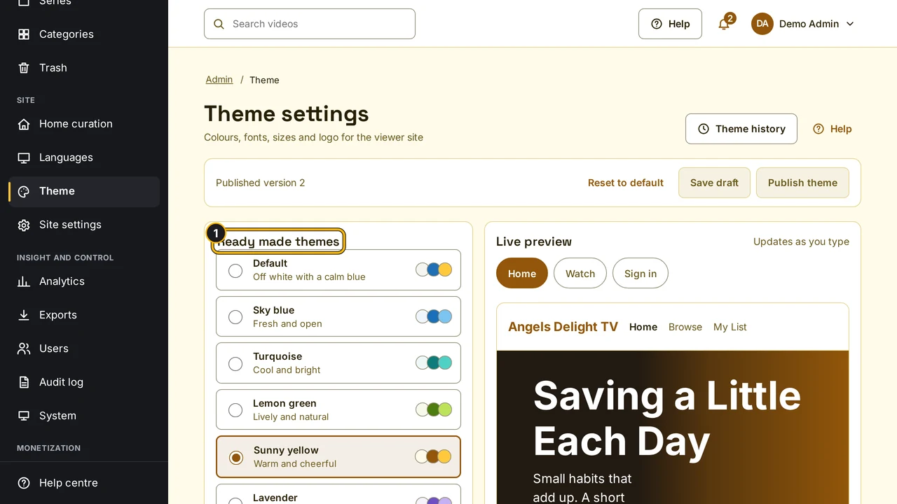
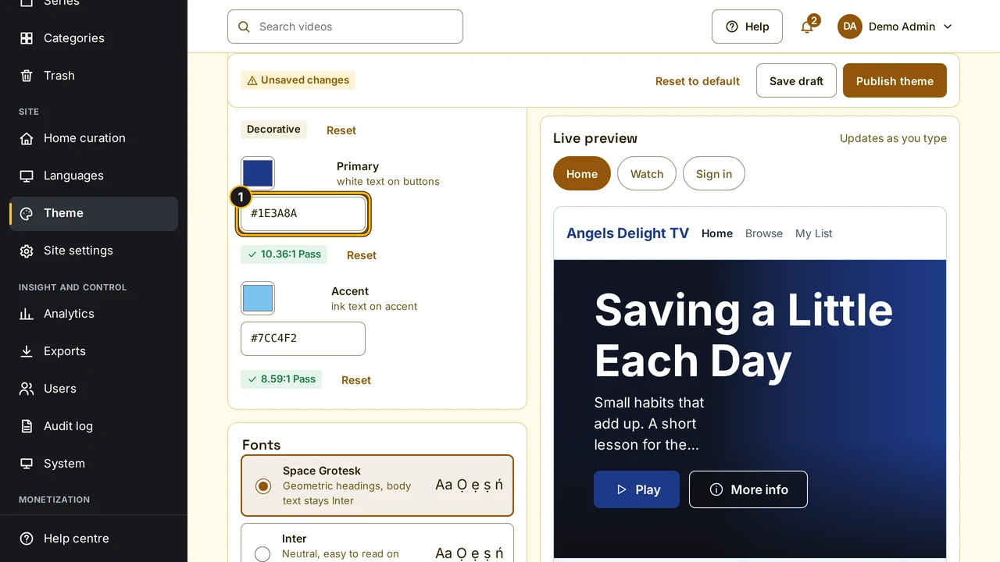
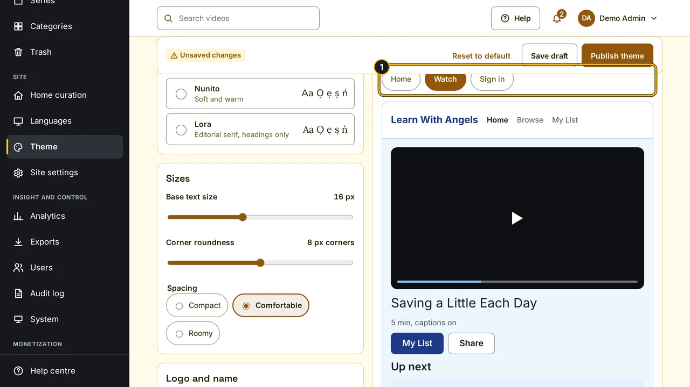

## What you will do
Choose a ready made theme, adjust a colour, pick a font and publish. You end with a new look live for viewers.

## Before you start
You need to be an Admin or a Super admin. Have your logo file ready if you want one. Read [Platform details and the Launch checklist](help:C01) if you have not yet.

## Steps
<!-- kb:steps C02 -->
1. Click **Theme** in the side menu.
   
2. Check the **Ready made themes** and pick one.
   A ready made theme sets all the colours at once. You can still change any colour after.
3. Type "#1e3a8a" in the **Primary** box.
   Primary is the colour of buttons. Type a hex colour such as #1e3a8a, or use the colour picker beside the box.
   
4. Check that the contrast badge says **Pass**.
   Pass means the text can be read. Low or Too low means some people will struggle to read it.
5. Check the **Fonts** list and pick one.
6. Type "Learn With Angels" in the **Platform name** box.
   To add a logo, use the logo file button in the Logo and name card.
7. Click **Watch** in the live preview.
   The preview tabs are Home, Watch and Sign in. Mobile shows a phone sized view.
   
8. Click **Save draft**.
   A draft is not shown to viewers.
9. Click **Publish theme** and confirm.
   Viewers see the new look on their next page load. The old theme stays in history.
<!-- /kb:steps -->

## What you should see
The message **Theme published.** appears. Viewers see the new colours, font and name on their next page load. The old theme stays in **Theme history**.

> [!TIP]
> Watch the contrast badges. **Pass** means text can be read easily. **Low** or **Too low** means some people will struggle. The screen asks you to confirm before you publish low contrast.

> [!NOTE]
> The colour boxes are **Text**, **Page background**, **Card surface**, **Muted text**, **Borders**, **Primary** and **Accent**. The **Sizes** card sets **Base text size**, **Corner roundness** and **Spacing**. Use **Reset to default** to start again.

## If something goes wrong
- **A colour will not save.** The red message says the colour cannot be read. Click the suggested colour in the message, or type a darker colour.
- **Publish theme is greyed out.** You have no changes yet, or a colour box has a typing mistake. Fix the box, then try again.
- **The site looks wrong after publishing.** Go back to the earlier look in [Go back to an earlier theme](help:C03). Still stuck? [What to send ARKDEV](help:T11)
