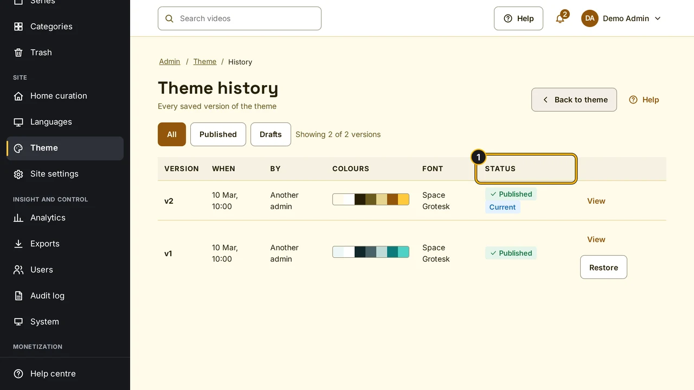
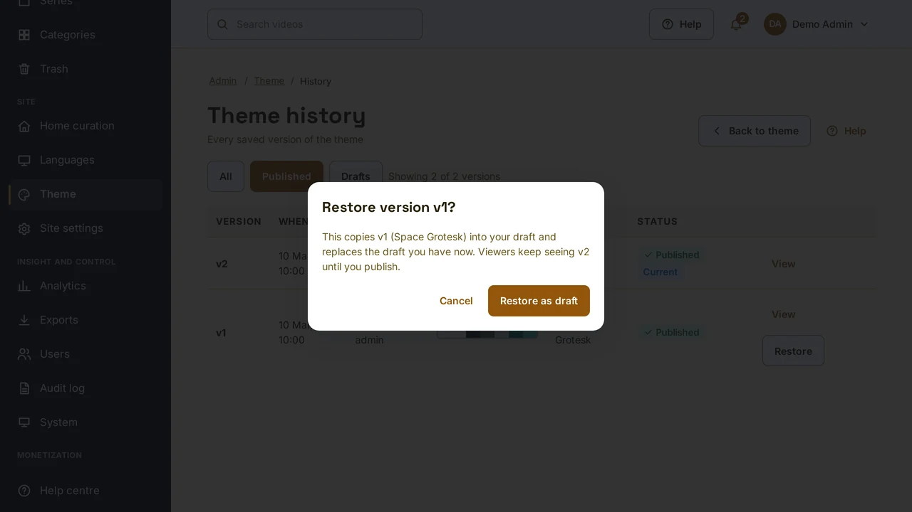

## What you will do
Restore an older theme and publish it. You end with the earlier look live again.

## Before you start
You need to be an Admin or a Super admin. The theme must have been saved at least once before. Read [Colours, fonts and logo with the Theme editor](help:C02) if you have not yet.

## Steps
<!-- kb:steps C03 -->
1. Click **Theme** in the side menu.
2. Click **Theme history**.
   
3. Click **Published** to filter the list.
   The filters are All, Published and Drafts. The Current badge marks the theme viewers see now.
4. Click **Restore version 1**.
   Pick the older version you want back. View version shows its colours first.
   
5. Click **Restore as draft** to confirm.
   This copies the old theme into your draft and opens the Theme screen. Viewers keep the current theme until you publish.
6. Click **Publish theme** and confirm.
   Viewers see the earlier look on their next page load.
<!-- /kb:steps -->

## What you should see
The message **Theme published.** appears. Viewers see the earlier colours and font on their next page load. In **Theme history** the restored theme appears as a new version at the top, marked **Current**.

> [!TIP]
> Click **View version** on a row to see its colours, font and contrast before you restore it. On the **Theme** screen, **Reset to default** goes back to the platform defaults instead of a saved version.

> [!NOTE]
> Restoring never deletes anything. The version you leave stays in the history, so you can go forward again.

## If something goes wrong
- **The history says No saved versions yet.** Nothing has been saved. Save or publish a theme first. [Colours, fonts and logo with the Theme editor](help:C02)
- **There is no Restore button on a row.** That row is the theme viewers see now. Pick an older row.
- **Viewers still see the old look.** Restoring only fills your draft. Click **Publish theme** on the **Theme** screen. Still stuck? [What to send ARKDEV](help:T11)
