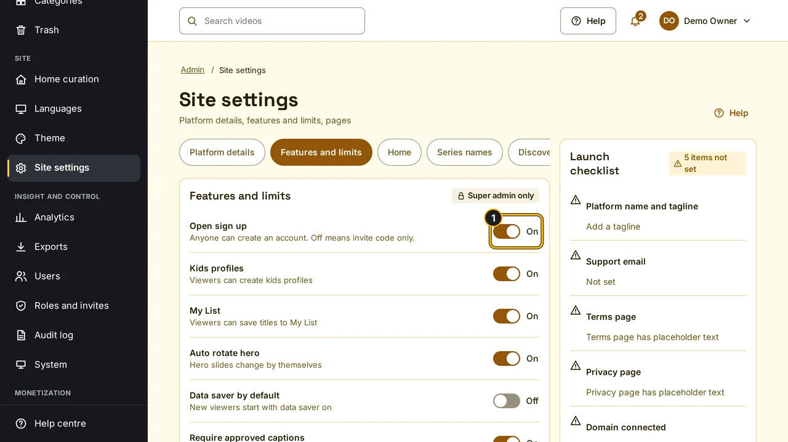
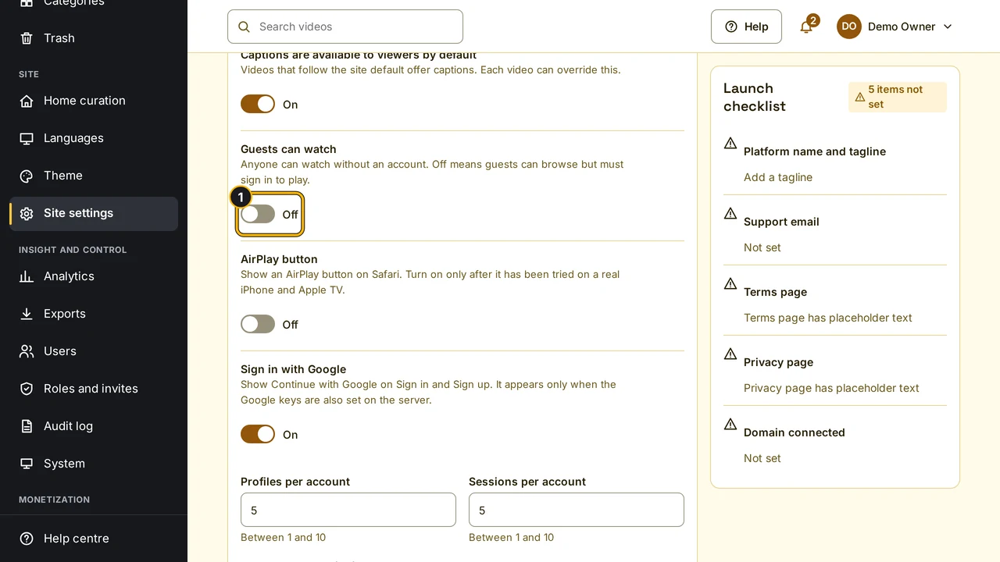
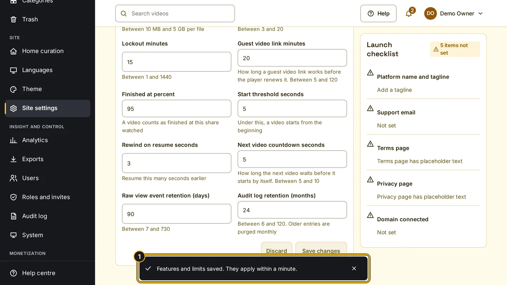

## What you will do
Change a feature switch and a limit, then save. You end with the change live for viewers within a minute.

## Before you start
You need to be a Super admin. Admins can open the tab but the switches are locked and show a note. Read [Platform details and the Launch checklist](help:C01) first.

## Steps
<!-- kb:steps C04 -->
1. Click **Site settings** in the side menu.
2. Click **Features and limits** at the top.
   Only a Super admin can change this tab. Admins can read it but the switches are locked.
   
3. Check the hint under **Open sign up**.
   Every switch has a hint that says what it does. The full list is in the [settings dictionary](help:R04).
4. Untick **Guests can watch**.
   With this off, visitors can browse but must sign in to play a video.
   
5. Type "3" in the **Profiles per account** box.
   Limits have a range. A number outside it shows a red message and cannot be saved.
6. Click **Save changes**.
   The message Features and limits saved appears. Changes reach viewers within a minute.
   
<!-- /kb:steps -->

## What you should see
The message Features and limits saved appears for a few seconds, then goes. The switch you changed keeps its new state when you reload.

> [!CAREFUL]
> **Open sign up**, **Guests can watch** and **Maintenance mode** change what every viewer can do. Check the hint first. You can turn any of them back on or off at any time.

> [!NOTE]
> Switches on this tab: **Open sign up**, **Kids profiles**, **My List**, **Auto rotate hero**, **Data saver by default**, **Require approved captions**, **Captions are available to viewers by default**, **Guests can watch**, **AirPlay button** and **Sign in with Google**. **Require approved captions** means a video cannot be published until its captions are approved. **Captions are available to viewers by default** is the site default that each video can follow or override, see [Turn captions on or off for one video](help:W09). The limits are explained one by one in the [settings dictionary](help:R04).

## If something goes wrong
- **The switches are greyed out.** Your role is Admin. Ask a Super admin to make the change.
- **A limit shows a red message.** The number is outside the allowed range. Use a number inside the range in the hint.
- **A change does not show for viewers.** Wait one minute and reload the site. Features and limits apply within a minute. Still stuck? [What to send ARKDEV](help:T11)
