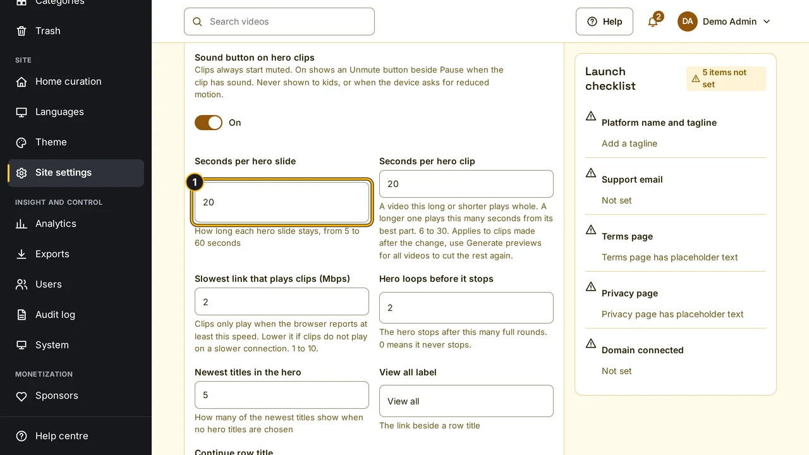
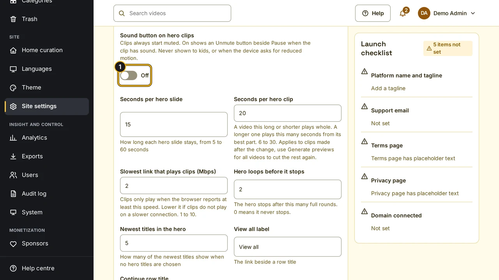
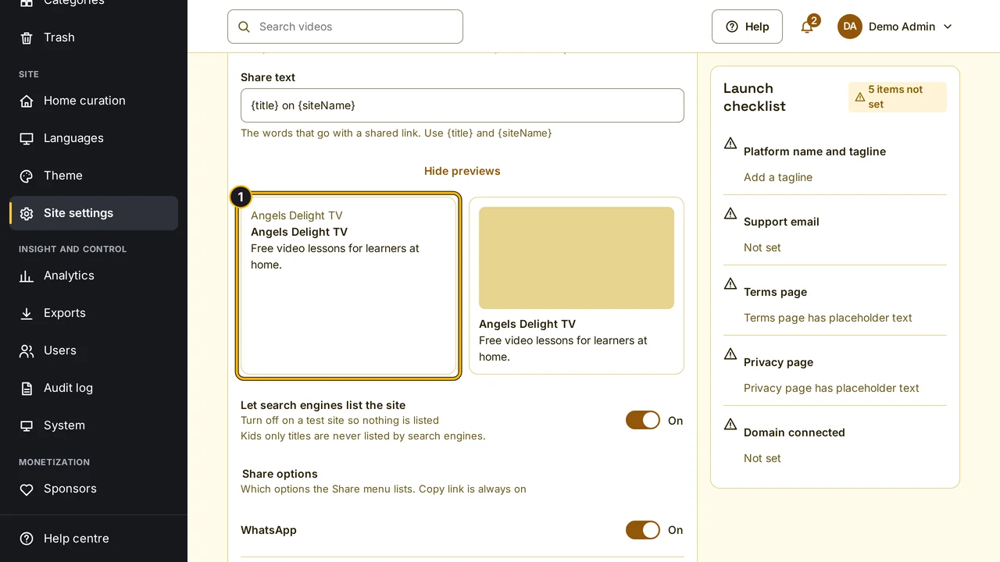

## What you will do
Set the timing and sound of the Home banner, then set the words search engines and share cards use. You end with both tabs saved.

## Before you start
You need to be an Admin or a Super admin. To choose which videos appear in the banner, use **Home curation** instead, see [Choose hero banners and preview clips](help:W05).

## Steps
<!-- kb:steps C05 -->
1. Click **Site settings** in the side menu.
2. Click **Home** at the top.
   
3. Type "15" in the **Seconds per hero slide** box.
   Choose 5 to 60 seconds. Each hero slide stays this long.
4. Untick **Sound button on hero clips**.
   Clips always start muted. This only controls whether viewers see an Unmute button.
   
5. Type "Keep learning" in the **Continue row title** box.
   This is the title of the row of videos a viewer has started.
6. Click **Save changes**.
7. Click **Discovery** at the top.
   This tab sets how the site looks in search results and when a link is shared.
8. Type "Free video lessons for learners at home." in the **Site description** box.
   Keep it under 160 characters.
9. Check the preview shows **Angels Delight TV** as the name.
   The two previews show how the site looks in a search result and in a shared link. Use Hide previews to close them.
   
10. Click **Save changes**.
<!-- /kb:steps -->

## What you should see
The messages **Home settings saved. They apply within a minute.** and **Discovery settings saved. They apply within 5 minutes.** appear. The previews under **Share text** show how the site looks in a search result and when shared.

> [!NOTE]
> The other Home settings are **Slide waits for its clip**, **Hero loops before it stops**, **Hero preview clips**, **Preview clips on unknown connections**, **Slowest link that plays clips (Mbps)**, **Seconds per hero clip**, **Newest titles in the hero** and **View all label**. The Discovery tab also has **Social image link**, **Share text**, **Let search engines list the site** and the share options. Each is explained in the [settings dictionary](help:R04). The storage notice is in [Storage notice and sharing options](help:C15).

## If something goes wrong
- **A number box shows a red message.** The number is outside the allowed range. Use the range in the hint, for example 5 to 60 seconds.
- **The description will not save.** It is over 160 characters. Shorten it, then save.
- **Viewers do not see the change yet.** Home settings apply within a minute and Discovery settings within 5 minutes. Wait, then reload the site. Still stuck? [What to send ARKDEV](help:T11)
