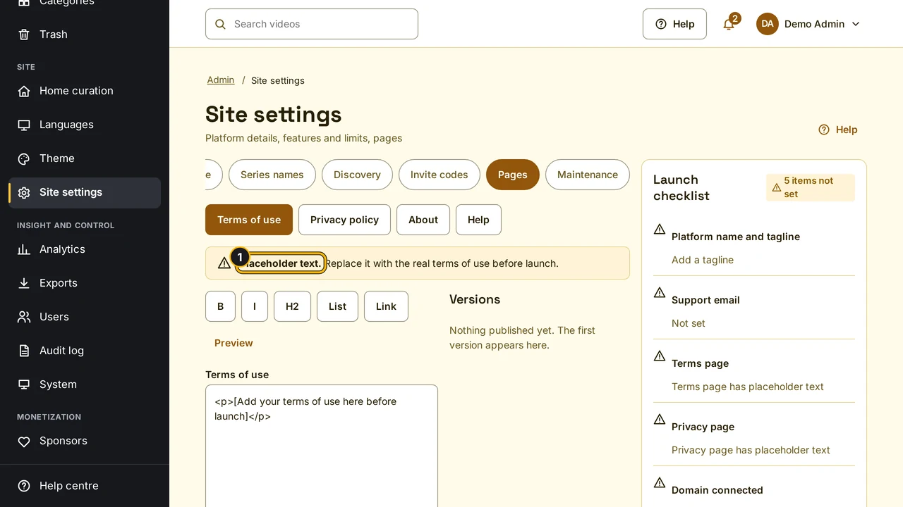
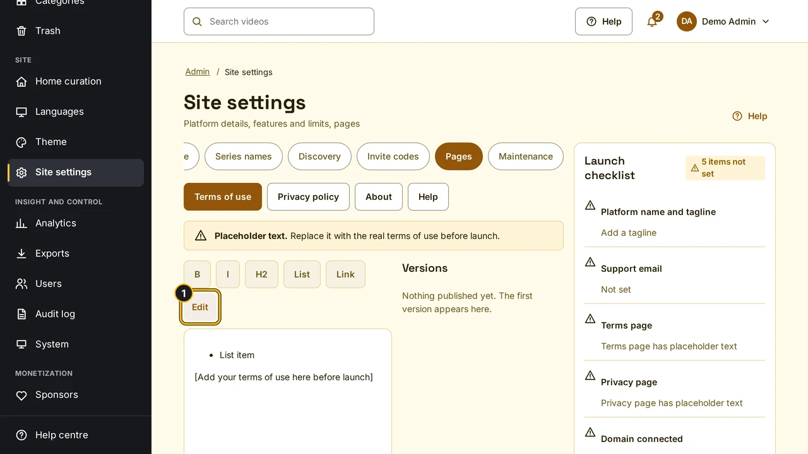
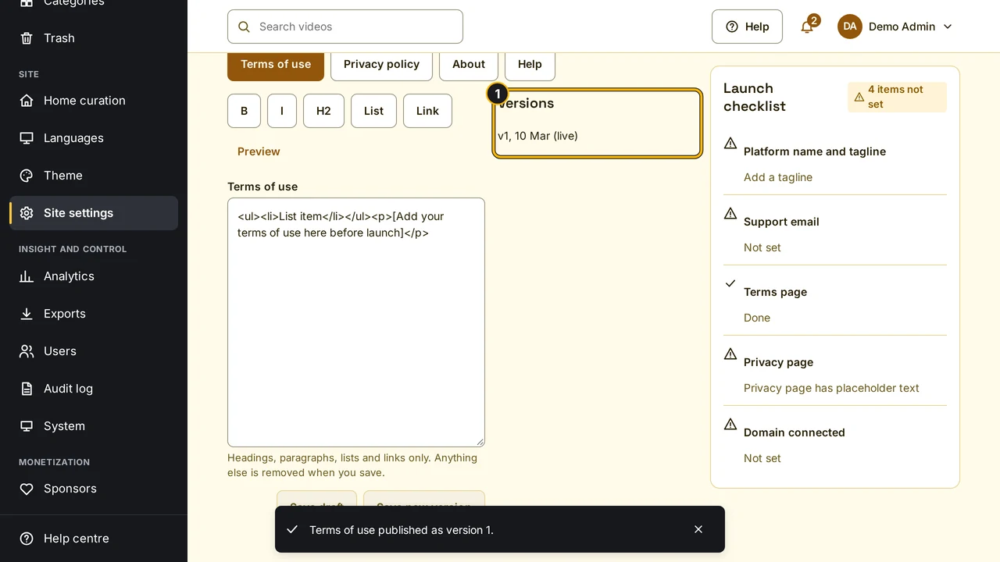

## What you will do
Edit one of the three public pages and publish it. You end with a new live version that you can restore later.

## Before you start
You need to be an Admin or a Super admin. Have the real text ready from your lawyer or organisation. Read [Platform details and the Launch checklist](help:C01) if you have not yet.

## Steps
<!-- kb:steps C06 -->
1. Click **Site settings** in the side menu.
2. Click **Pages** at the top.
   
3. Check the **Placeholder text.** warning.
   The Terms page and Privacy page start with placeholder text. Replace it before you launch.
4. Click **Bulleted list** in the formatting bar.
   The bar also has Bold, Italic, Heading and Link. Select text first, then click the tool.
5. Click **Preview** to see what viewers will read.
   
6. Click **Edit** to go back to the text.
7. Click **Save draft**.
   A draft is only for you. Viewers keep seeing the live version.
8. Click **Save new version** to publish it.
   Each save makes a numbered version. The newest one is live.
   
<!-- /kb:steps -->

## What you should see
The **Versions** list shows a new version at the top marked **(live)**. On the **Launch checklist** in [Platform details and the Launch checklist](help:C01), the **Terms page** or **Privacy page** line says **Published** once the placeholder text is gone.

> [!TIP]
> To go back to an older text, click **Restore** beside an older version. This copies it into your draft. Viewers keep the live version until you click **Save new version**.

> [!NOTE]
> The page buttons are **Terms**, **Privacy** and **About**. The editor accepts headings, paragraphs, lists and links only. Anything else is removed when you save.

## If something goes wrong
- **Save new version is greyed out.** You have not edited the page yet. Change the text first.
- **My formatting disappeared.** The editor keeps only headings, paragraphs, lists and links. Use those instead.
- **The checklist still shows placeholder text.** The page still contains the sample words. Replace all of them, then save a new version. Still stuck? [What to send ARKDEV](help:T11)
