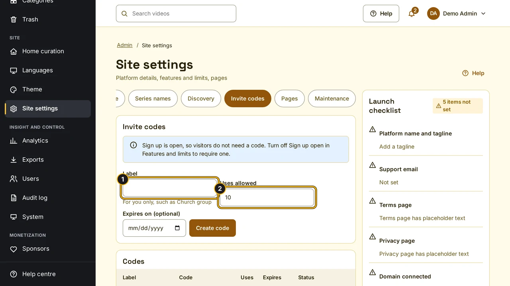
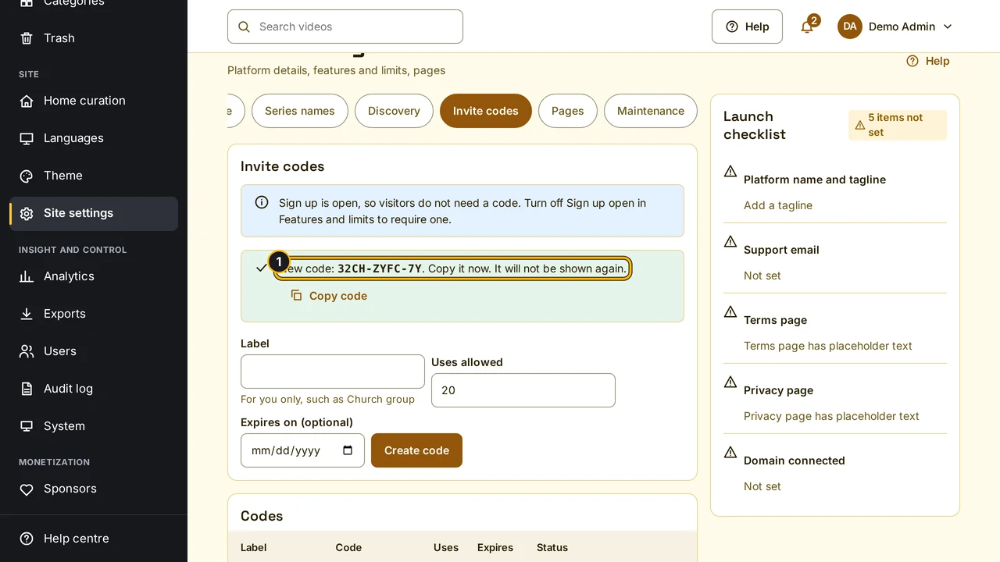
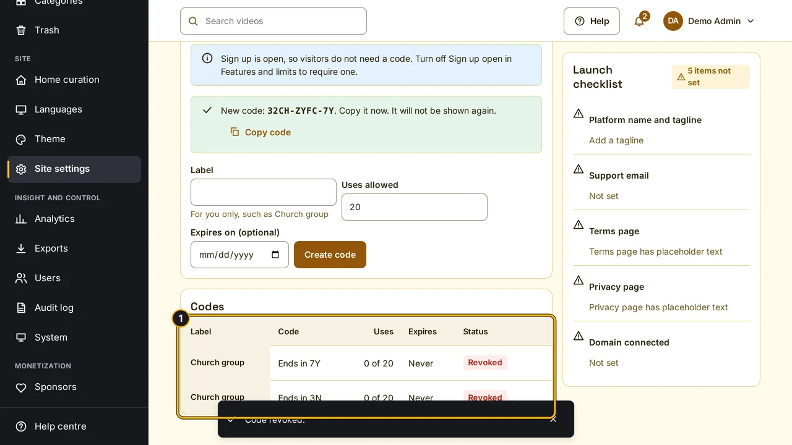

## What you will do
Create an invite code for a group, copy it, then revoke it. You end knowing how to open and close early access.

## Before you start
You need to be an Admin or a Super admin. Codes are only needed when **Open sign up** is off. A Super admin turns that off in [Features and limits: what each switch does](help:C04).

## Steps
<!-- kb:steps C07 -->
1. Click **Site settings** in the side menu.
2. Click **Invite codes** at the top.
   Visitors need a code only when Open sign up is off in Features and limits. Otherwise this tab says sign up is open.
   
3. Type "Church group" in the **Label** box.
   The label is for you only. Viewers never see it.
4. Type "20" in the **Uses allowed** box.
   This is how many people can sign up with the code.
5. Click **Create code**.
6. Check the **New code:** message and copy the code.
   The full code is shown once. Copy it now and send it to your group. Later you only see the last characters.
   
7. Click **Revoke code Church group** to stop the code.
   Revoke when a group is full or a code was shared by mistake.
8. Click **Revoke code** to confirm.
   Accounts already made with the code are not affected.
   
<!-- /kb:steps -->

## What you should see
The **Codes** table lists the code with its label, uses, expiry date and a status. After you revoke it the status changes and the **Revoke** button goes away.

> [!CAREFUL]
> The full code is shown once, right after you create it. Copy it before you leave the page. If you lose it, create a new code.

> [!NOTE]
> You can set **Expires on (optional)** so a code stops working by itself. Revoking a code never removes accounts that were already made with it.

## If something goes wrong
- **The tab says sign up is open.** Visitors do not need a code. Ask a Super admin to turn off **Open sign up**.
- **Create code shows a red message.** Check that **Uses allowed** is a whole number above zero and the date is in the future.
- **I lost the code.** The full code is never shown again. Revoke the old one and create a new one. Still stuck? [What to send ARKDEV](help:T11)
