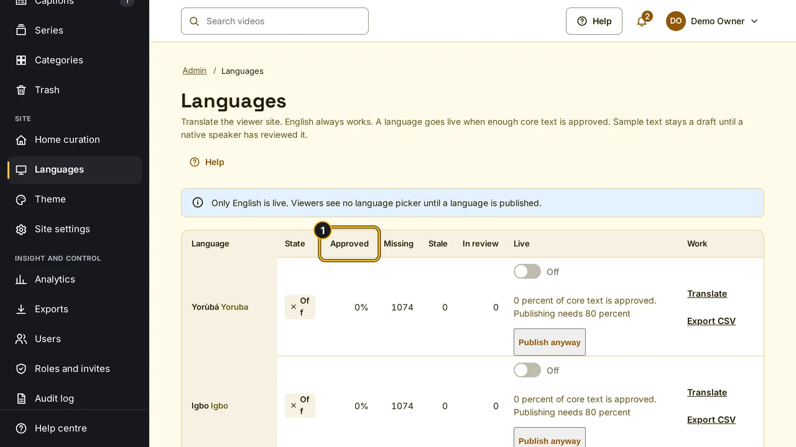
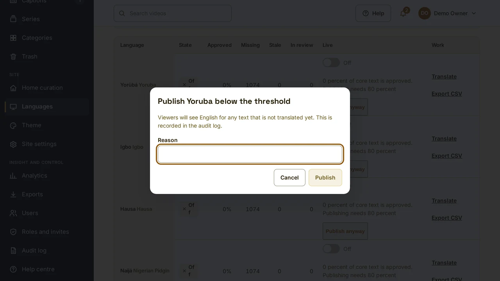
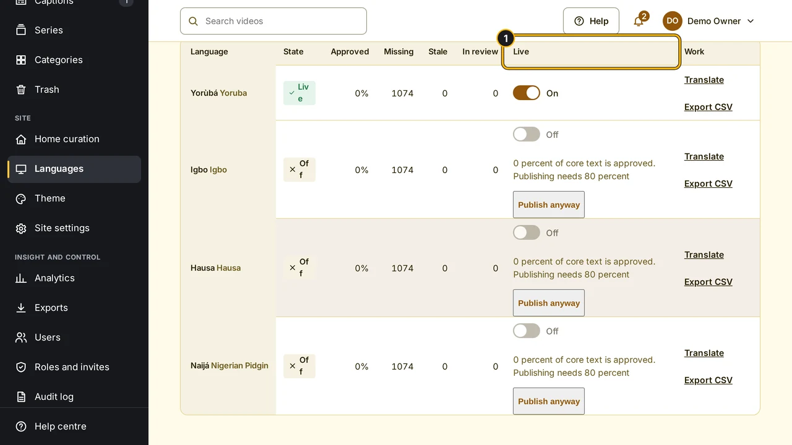

## What you will do
Publish a language so viewers can pick it for menus and text. You end with the language marked **Live**.

## Before you start
A language goes live when at least 80 percent of its core text is approved. Translating is explained in [Translate the site text](help:C09). The demo has no approved text, so this video shows the Super admin way of publishing below 80 percent. An Admin sees the same table but the switch stays locked until the language reaches 80 percent.

## Steps
<!-- kb:steps C08 -->
1. Click **Languages** in the side menu.
   
2. Check the **Approved** column.
   It shows how much of the core text a person has approved. A language can go live at 80 percent or more.
3. Click **Publish anyway** beside Yorùbá.
   Below 80 percent the switch is locked. Only a Super admin can publish anyway, and the reason is saved in the audit log.
   
4. Type "Sample text for a first test." in the **Reason** box.
5. Click **Publish** to confirm.
   Viewers see English for any text that is not translated yet.
   
6. Check the **Live** badge.
   The language picker now appears for viewers. Turn the Live switch off to take the language down again.
<!-- /kb:steps -->

## What you should see
The language shows **Live** in the **State** column and its switch is on. Viewers see a language picker once any language is live. Any text not translated yet shows in English.

> [!CAREFUL]
> Publishing below the threshold shows English for everything not yet translated. The reason you type is saved in the audit log. Turn the switch off to take a language down again.

> [!NOTE]
> The languages are Yorùbá, Igbo, Hausa and Naijá (Nigerian Pidgin). **Approved**, **Missing**, **Stale** and **In review** count the lines in each state. Sample text stays a draft until a native speaker has reviewed it.

## If something goes wrong
- **The switch is locked and there is no Publish anyway.** Your role is Admin, or the language is below 80 percent. Approve more lines, or ask a Super admin.
- **Viewers do not see the picker.** Changes take about a minute. Reload the site, and check at least one language is **Live**.
- **A language looks half translated.** Lines missing a translation show in English. Finish them in [Translate the site text](help:C09).
