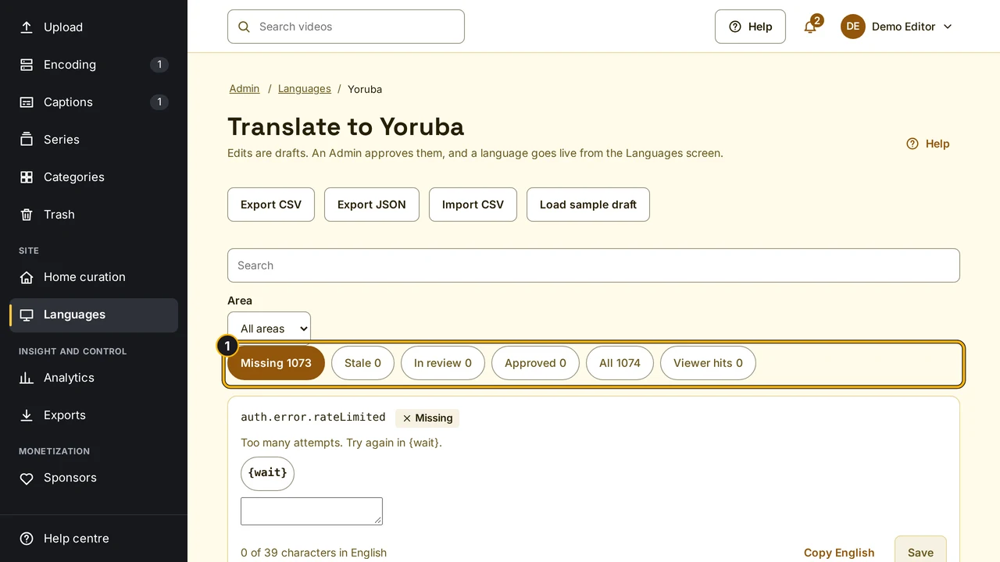
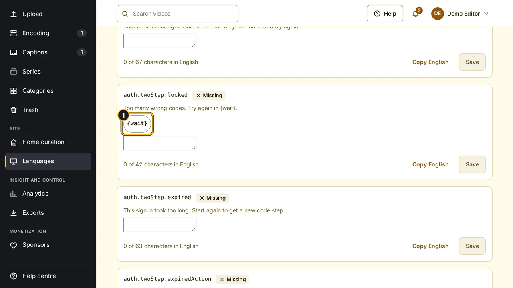

## What you will do
Open the translation workspace for a language and save a translated line. You end with the line waiting in **In review**.

## Before you start
You need to be an Editor or above. You need to read and write the language you are translating. Your edits are drafts, and an Admin approves them.

## Steps
<!-- kb:steps C09 -->
1. Click **Languages** in the side menu.
2. Click **Translate** beside Yorùbá.
   
3. Check the **Missing** tab.
   The tabs are Missing, Stale, In review, Approved and All. Missing is text with no translation yet. Stale is text whose English changed after it was translated.
4. Click **Copy English** on the first line.
   Copy English is only a starting point. Replace it with the real translation in the language you are working on.
5. Click **Save** on the first line.
   Saved lines go to In review. An Admin approves them. Nothing is live until the language is published.
6. Check the **{wait}** mark on the second line.
   A mark in curly brackets is filled in by the site, for example a number of minutes. Keep it exactly as written in your translation.
   
7. Type "share" in the **Search keys and text** box.
8. Check the **Export CSV** link.
   Export CSV gives you the list as a spreadsheet for a translator. Import CSV brings the finished file back. Imported lines go to In review.
<!-- /kb:steps -->

## What you should see
The saved line moves from **Missing** to **In review**. Nothing is live until an Admin approves the lines and a language is published, see [Publish an interface language](help:C08).

> [!TIP]
> To work offline, click **Export CSV**, give the file to a translator, then click **Import CSV** to bring it back. Imported lines go to **In review**. **Load sample draft** adds machine made starting text that no one has checked yet.

> [!NOTE]
> The tabs are **Missing**, **Stale**, **In review**, **Approved**, **All** and **Viewer hits**. Stale means the English changed after the line was translated. Marks in curly brackets such as {wait} are filled in by the site. Keep them exactly as written.

## If something goes wrong
- **Save is greyed out.** The box is empty, unchanged, or a mark in curly brackets is missing or changed. Fix the red message under the box.
- **I cannot find a line.** Type a word in the search box, or choose an area from the **Area** list.
- **My import was refused.** The red table lists each rejected row and why. Fix those rows in the file and import again. Still stuck? [What to send ARKDEV](help:T11)
