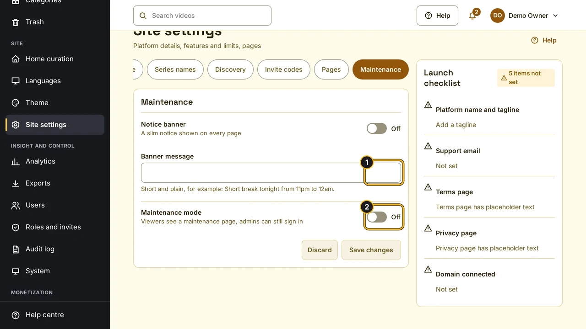
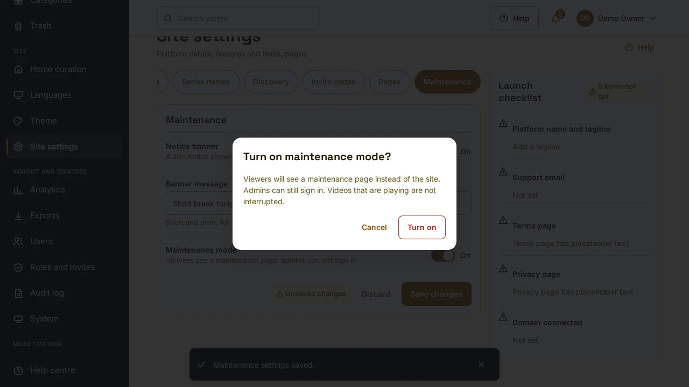

## What you will do
Show a notice banner, then turn Maintenance mode on and off. You end with the site open again and the banner saved.

## Before you start
You need to be a Super admin for Maintenance mode. An Admin can do the banner steps only. Choose a quiet time, because Maintenance mode closes the site to viewers.

## Steps
<!-- kb:steps C10 -->
1. Click **Site settings** in the side menu.
2. Click **Maintenance** at the top.
   
3. Tick **Show the notice banner**.
   The banner is a slim strip shown on every page. The site stays open.
4. Type "Short break tonight from 11pm to 12am." in the **Banner message** box.
   Keep it short and plain. The limit is 200 characters.
5. Click **Save changes**.
6. Tick **Maintenance mode**.
   This closes the site to viewers. Only Super admins can turn it on.
7. Check the **Unsaved changes** badge.
   The badge shows that your last change is waiting to be saved.
8. Click **Save changes** to continue.
   
9. Click **Turn on** to confirm.
   Admins can still sign in. Videos that are already playing carry on.
10. Untick **Maintenance mode** to open the site again.
11. Click **Save changes** to finish.
   Turning it off needs no confirmation.
<!-- /kb:steps -->

## What you should see
The message **Maintenance settings saved.** appears after each save. While the banner is on, every viewer page shows your message in a slim strip. While Maintenance mode is on, viewers see a maintenance page.

> [!CAREFUL]
> Maintenance mode closes the site to viewers. Admins can still sign in, and videos that are already playing are not interrupted. Turn it off again with the same switch.

## If something goes wrong
- **The Maintenance mode switch will not save.** Your role is Admin. Ask a Super admin to turn it on.
- **Viewers still see the old page.** Wait one minute and reload. Changes reach viewers within a minute.
- **The banner message will not save.** It is over 200 characters. Shorten it. Still stuck? [What to send ARKDEV](help:T11)
