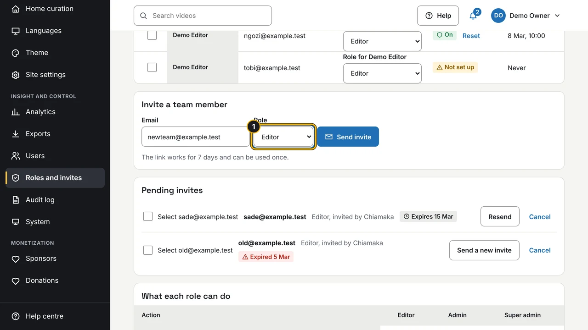
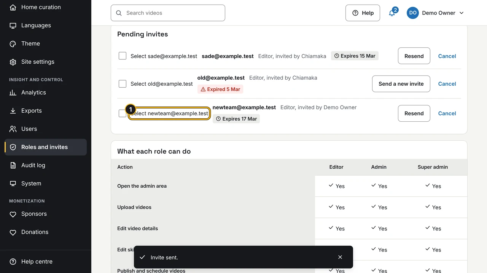

## What you will do
Invite a new team member by email and choose their [role](glossary:role). They get a link to set a password and set up [two step sign in](glossary:two-step-sign-in).

## Before you start
Only a Super admin can do this. Know the person's email and which role they need. [Roles and permissions](help:R02) lists what each role can do. Give the least access that lets them do their job.

## Steps
<!-- kb:steps C11 -->
1. Choose **Roles and invites** in the side menu.
   Only a Super admin can see this page.
   
2. Scroll to **Invite a team member**.
3. Type "newteam@example.test" in the **Email** box.
   Use the address they read email on. They get the invite there.
4. Select **Editor** from the **Role** list.
   Editor looks after videos. Admin also sets the look and handles accounts.
   
5. Click **Send invite**.
   They have a limited time to accept. Use Resend invite or Cancel invite in Pending invites.
   
<!-- /kb:steps -->

## What you should see
The invite appears under **Pending invites** with their email. The person gets an email with a link. When they accept, they move to the staff list.

> [!NOTE]
> If they do not get the email, use **Resend invite to** their address in **Pending invites**. Use **Cancel invite to** their address to take the invite back. An invite that ran out can be sent again with **Send a new invite to**.

> [!CAREFUL]
> An invite is a way into your admin. Check the address twice. Cancel any invite you sent by mistake.

## If something goes wrong
- **The email never arrives.** Ask them to check their spam folder, then click **Resend invite to** their address.
- **The invite says the address is already in use.** That person already has an account. Change their role instead. [Change a role](help:C12)
- **The Send invite button does nothing.** Fill in both the **Email** box and the **Role** list.
