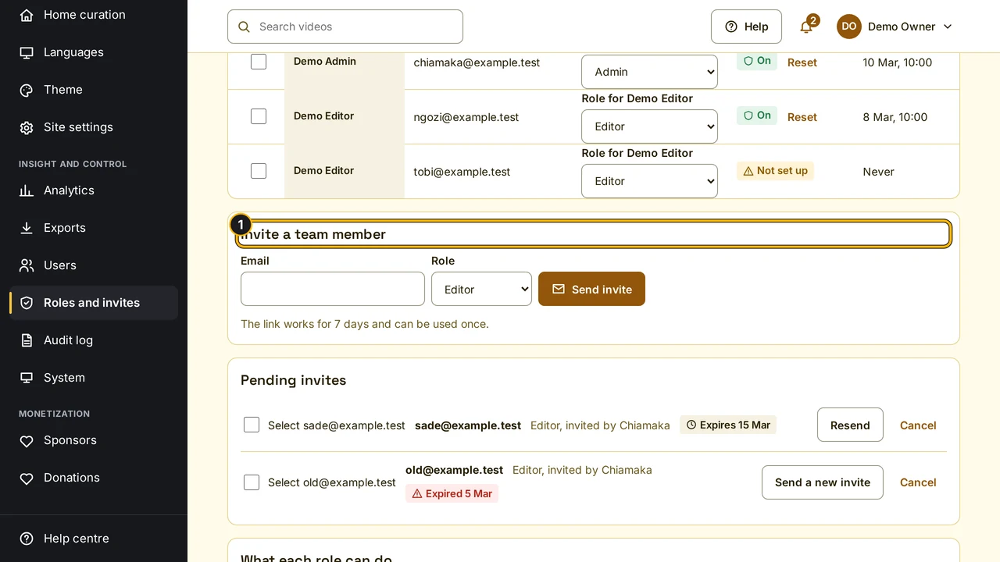
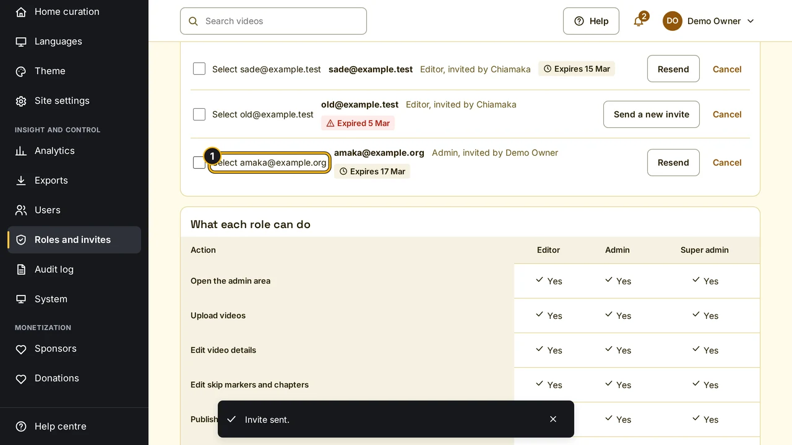

## What you will do
Invite a new person by email and choose their role. You end with a pending invite you can resend or cancel.

## Before you start
You need to be a Super admin. Have the person's email address and decide their role. Read [Find your way around](help:S04) if you have not yet.

## Steps
<!-- kb:steps C11 -->
1. Click **Roles and invites** in the side menu.
   Only Super admins see this screen.
   
2. Type "amaka@example.org" in the **Email** box.
3. Select **Admin** from the **Role** list.
   Editor looks after videos and Home. Admin also sets the look, pages and accounts. Super admin also controls the team and the switches.
4. Click **Send invite**.
   The link in the email works for 7 days and can be used once.
5. Check the pending list for **amaka@example.org**.
   
6. Click **Resend invite to amaka@example.org**.
   Use this when the email did not arrive. Ask them to check their spam folder first.
7. Click **Cancel invite to amaka@example.org**.
   Cancel an invite sent to the wrong address. The link stops working.
8. Click **Cancel invite** to confirm.
<!-- /kb:steps -->

## What you should see
The invite appears under **Pending invites** with the role, who invited them and the day it expires. The person gets an email with a link that works for 7 days and can be used once. They choose a password and set up two step sign in when they open it.

> [!NOTE]
> Roles: **Editor** looks after videos, captions and Home. **Admin** also sets the look, pages and viewer accounts. **Super admin** also controls the team and the switches. The table **What each role can do** at the bottom of the screen lists every action.

## If something goes wrong
- **The email did not arrive.** Ask the person to check spam, then click **Resend invite**. If it keeps failing, look for it on the Jobs tab of System. [System: jobs, storage and player quality](help:C14)
- **The invite shows Expired.** The link lasted 7 days. Click **Send a new invite** beside it.
- **I typed the wrong address.** Click **Cancel invite**, then send a new one to the right address. Still stuck? [What to send ARKDEV](help:T11)
