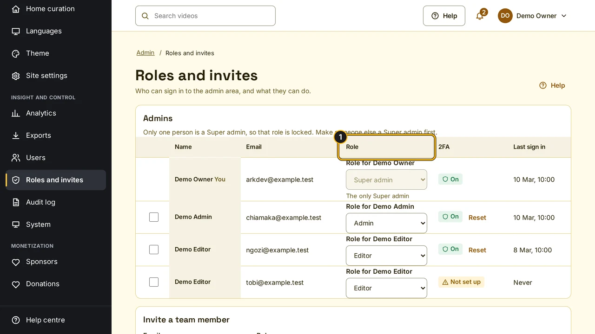
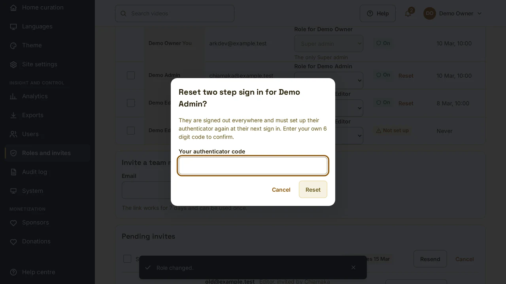

## What you will do
Change one person's role and reset another person's two step sign in. You end with both changes recorded in the audit log.

## Before you start
You need to be a Super admin. Read [Invite a teammate and choose their role](help:C11) first. For a reset, you need your own authenticator app.

## Steps
<!-- kb:steps C12 -->
1. Click **Roles and invites** in the side menu.
2. Check the **Role** column of the staff list.
   You cannot change your own role. The only Super admin is locked, so make someone else a Super admin first.
   
3. Select **Admin** from the **Role for Demo Editor** list.
4. Click **Change role** to confirm.
   The box explains what the new role can do. The person gets the new role the next time they open the admin.
5. Click **Reset two step sign in for Demo Admin**.
   Use this when someone loses their phone. They are signed out everywhere and set up their authenticator again at their next sign in.
   
6. Type "123456" in the **Your authenticator code** box.
   This is your own 6 digit code, not theirs. In this demo the code is 123456.
7. Click **Reset** to confirm.
<!-- /kb:steps -->

## What you should see
The **Role** column shows the new role. After a reset, the person is signed out everywhere, and the **2FA** column says **Not set up** until they sign in again and scan a new code.

> [!CAREFUL]
> You cannot change your own role. The only Super admin is locked, so make someone else a Super admin before you step down.

> [!NOTE]
> There is no Remove access button in this version. To stop a person signing in, change their role to the lowest one you can, or cancel an invite that was not used yet. Ask your developer to remove an account fully.

## If something goes wrong
- **The role list is greyed out.** It is your own row, or the only Super admin. Ask another Super admin.
- **The reset says the code is wrong.** Enter your own 6 digit code from your authenticator app, not the other person's code.
- **The person still cannot sign in.** They must use the sign in page and follow the new setup steps. They can use a recovery code if they kept one. Still stuck? [What to send ARKDEV](help:T11)
