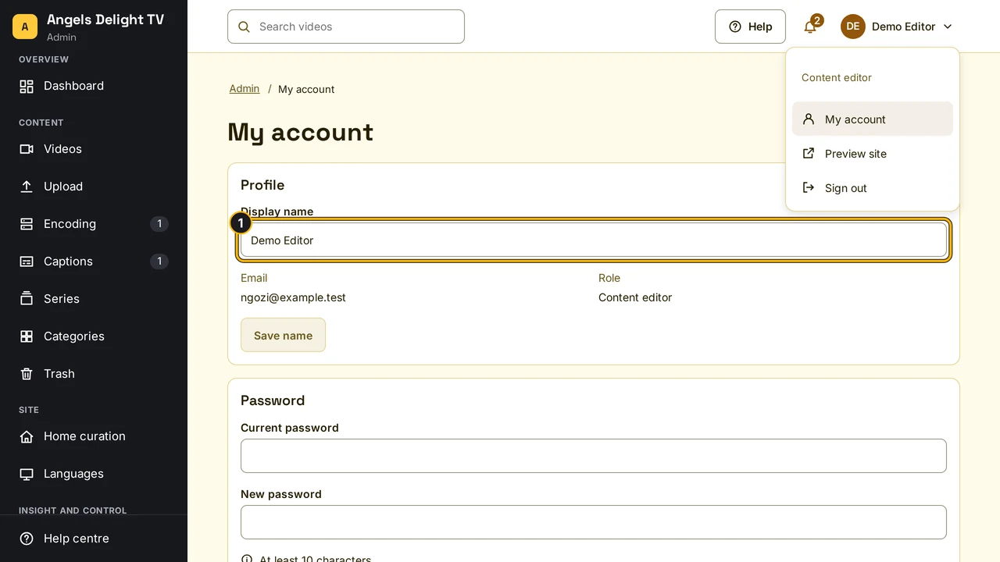
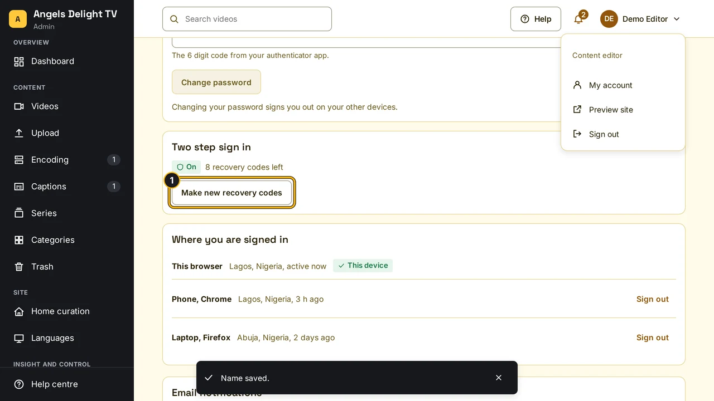

## What you will do
Change your display name and look after your own sign in. You end with your name saved and other devices signed out.

## Before you start
Any staff role can do this. You need your authenticator app on your phone for password changes. Read [Find your way around](help:S04) if you have not yet.

## Steps
<!-- kb:steps C13 -->
1. Click **Demo Editor** in the top bar.
   The menu is the round badge with your name at the top right.
2. Click **My account**.
   
3. Type "Demo Editor One" in the **Display name** box.
4. Click **Save name**.
5. Check the **Two step sign in** card.
   It shows whether two step sign in is on and how many recovery codes you have left. Make new ones before you run out.
   
6. Click **Sign out Laptop, Firefox**.
   Use this when you left yourself signed in on a shared computer. Sign out only the other devices, not this browser.
   
7. Check the **Email notifications** card.
   Choose which emails you get: failures, captions ready to review and a daily summary. Security emails like password resets are always sent.
<!-- /kb:steps -->

## What you should see
The message **Name saved.** appears. The device you signed out disappears from **Where you are signed in**. The **This device** line stays, because it is the browser you are using.

> [!NOTE]
> The **Password** card changes your password: type your **Current password**, a **New password**, **Confirm new password** and your **Authenticator code**, then click **Change password**. This signs you out on your other devices. **Make new recovery codes** replaces your old codes, so save the new ones somewhere safe. Under **Email notifications** you choose **Failures**, **Captions ready to review** and **Daily summary**, and **How often** they arrive.

## If something goes wrong
- **Change password will not work.** Check the rules under the New password box. The password needs at least 10 characters and must not be common or your email.
- **I lost my phone.** Ask a Super admin to reset your two step sign in. [Change a role, remove access, reset two step](help:C12)
- **I do not get any emails.** Check **Email notifications**. Security emails are always sent, other emails only if their switch is on.
