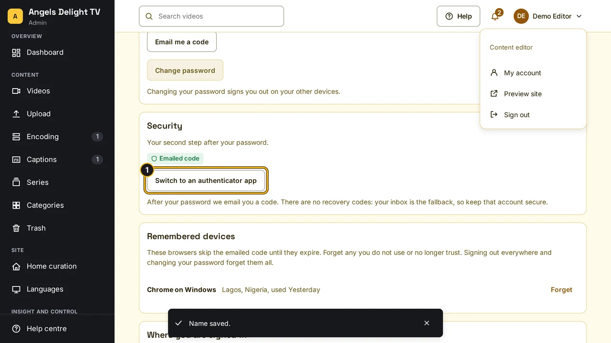
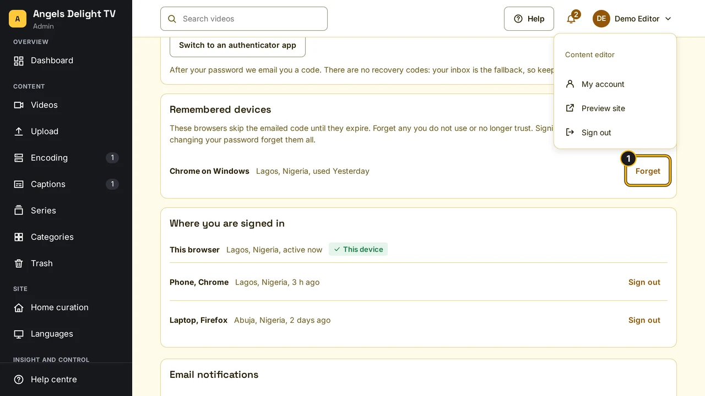
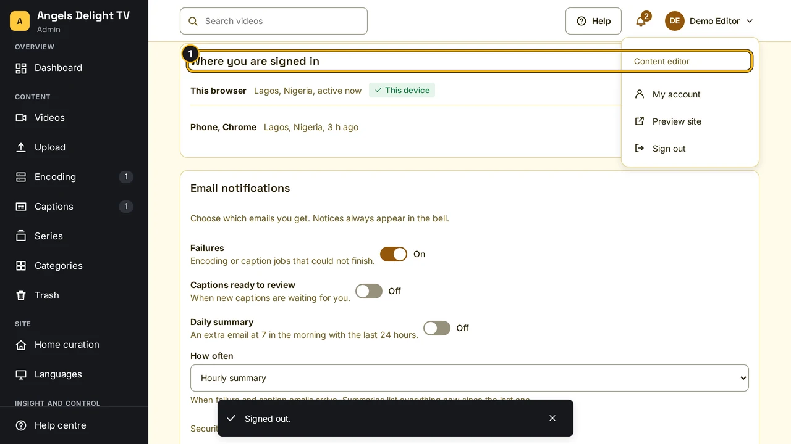

## What you will do
Change your display name and look after your own sign in. You end with your name saved and other devices signed out.

## Before you start
Any staff role can do this. For a password change you need your inbox or your authenticator app. Read [Find your way around](help:S04) if you have not yet.

## Steps
<!-- kb:steps C13 -->
1. Click **Demo Editor** in the top bar.
   The menu is the round badge with your name at the top right.
2. Click **My account**.
   
3. Type "Demo Editor One" in the **Display name** box.
4. Click **Save name**.
5. Check the **Security** card.
   It shows whether you get a code by email or from an authenticator app. Use **Switch to an authenticator app** or **Switch to emailed codes** to change it.
   
6. Check the **Remembered devices** card.
   These browsers skip the emailed code until they expire. Click **Forget** beside one you no longer trust.
   
7. Click **Sign out Laptop, Firefox**.
   Use this when you left yourself signed in on a shared computer. Sign out only the other devices, not this browser.
   
8. Check the **Email notifications** card.
   Choose which emails you get: failures, captions ready to review and a daily summary. Security emails like password resets are always sent.
<!-- /kb:steps -->

## What you should see
The message **Name saved.** appears. The device you signed out disappears from **Where you are signed in**. The **This device** line stays, because it is the browser you are using.

> [!NOTE]
> To move from an authenticator app to emailed codes, click **Switch to emailed codes** on the **Security** card. First click **Send test code** and enter the code, so we know the email reaches you. Then enter your password and a code from your app, or choose **Confirm with an emailed code instead**. Your app and its recovery codes stop working and your other devices are signed out, and we email you to say the method changed. To go back, click **Switch to an authenticator app**, enter your password, scan the new QR code and save the new recovery codes. The switch is blocked while email is not set up, the site is set to authenticator apps, or your address is not verified. A Super admin can allow emailed codes in Site settings, Security.

> [!NOTE]
> The **Password** card changes your password: type your **Current password**, a **New password**, **Confirm new password** and a code (choose **Email me a code** or use your app), then click **Change password**. This signs you out on your other devices and forgets remembered devices. **Make new recovery codes** (authenticator only) replaces your old codes, so save the new ones somewhere safe. Under **Email notifications** you choose **Failures**, **Captions ready to review** and **Daily summary**, and **How often** they arrive.

## If something goes wrong
- **Change password will not work.** Check the rules under the New password box. The password needs at least 10 characters and must not be common or your email.
- **I lost my phone or cannot get the email.** Ask a Super admin to reset your two step sign in. [Change a role, remove access, reset two step](help:C12)
- **I do not get any emails.** Check **Email notifications**. Security emails are always sent, other emails only if their switch is on. Still stuck? [What to send ARKDEV](help:T11)
