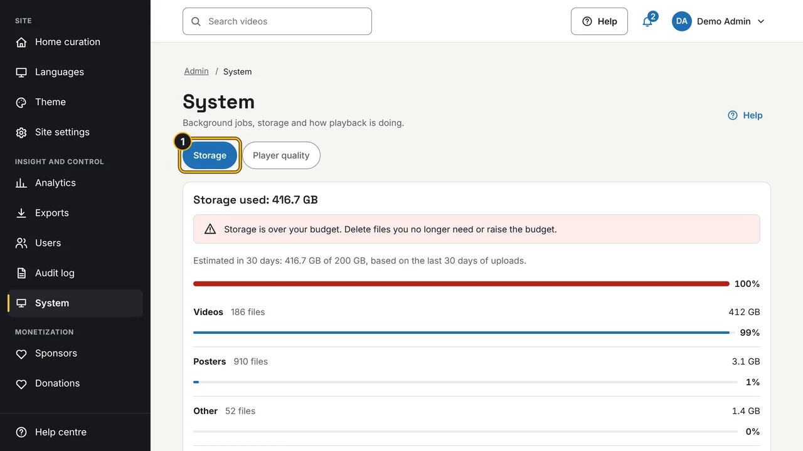
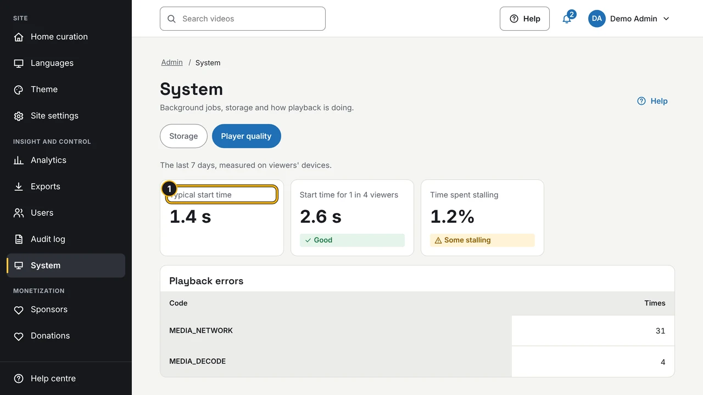

## What you will do
Open the System page once a week and check three things: failed background jobs, how full your storage is, and how well playback works for viewers.

## Before you start
Admins and Super admins can open this page. The **Jobs** tab is for Super admins only, so an Admin sees **Storage** and **Player quality**.

## Steps
<!-- kb:steps C14 -->
1. Choose **System** in the side menu.
   Admins can look. Only a Super admin can Retry or Discard a failed job.
   
2. Check that **Storage used** is on the page.
   The bar shows how much of your storage budget is used. A warning appears before it is full.
3. Click **Player quality**.
   This is measured on viewers' devices over the last 7 days.
   
4. Check that **Typical start time** shows a number.
   A long start time or a lot of stalling means viewers are on slow connections.
5. Click **Storage**.
<!-- /kb:steps -->

## What you should see
**Storage** shows how much space you use, split by type of file, with a bar against your budget. **Player quality** shows how fast videos start and how often they stall, measured on viewers' devices over the last 7 days.

> [!NOTE]
> What the warnings mean. **Storage used** near the budget: empty [Trash](help:W13) and clean up failed encodes, or ask the developer to raise the limit. **Typical start time** high or **Time spent stalling** high: viewers have slow connections, or a video needs encoding again. **Playback errors**: a code and a count of how often it happened. Send the code to the developer.

> [!NOTE]
> Super admins also see the **Jobs** tab. It lists background work that failed, with **Retry** and **Discard**. It also says when [Trending](glossary:trending) was last refreshed. Trending and Top 10 refresh by themselves about every hour. If the snapshot is older than 3 hours, Trending and Top 10 are hidden from viewers until the job runs again.

## If something goes wrong
- **Storage is almost full.** Open Trash and delete what you do not need, then clean up failed encodes. [Clean up Trash and failed encodes](help:W13)
- **The Jobs tab is missing.** Only a Super admin sees it. Ask one to look.
- **The page says it could not load.** Nothing was changed. Try again in a minute.
