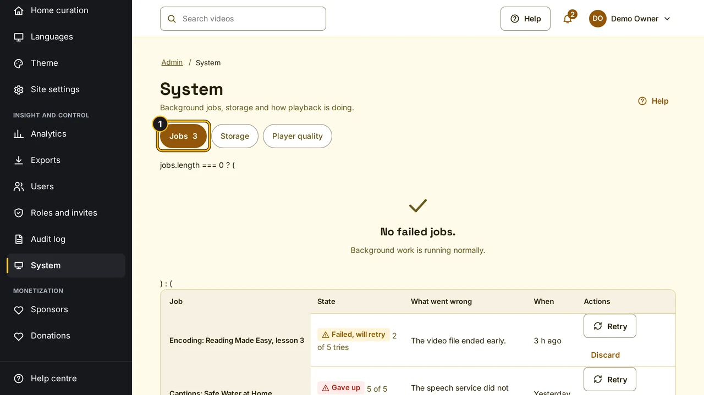
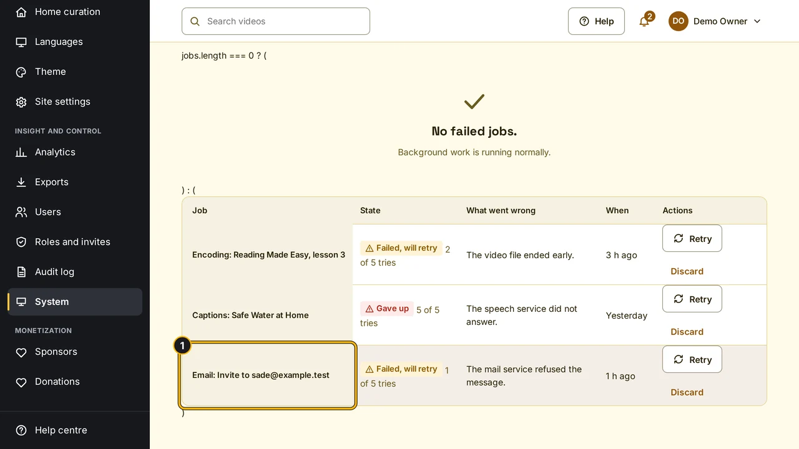
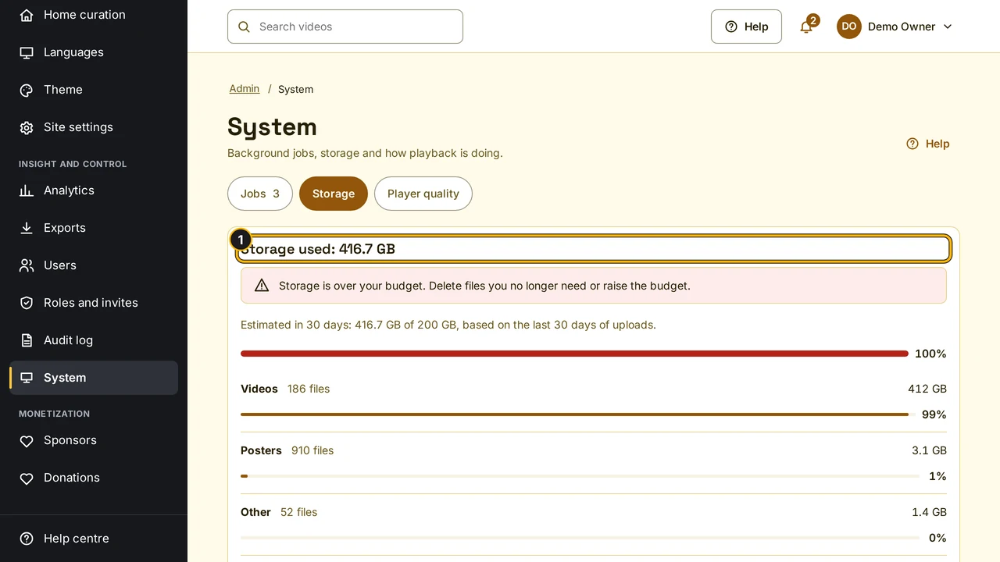
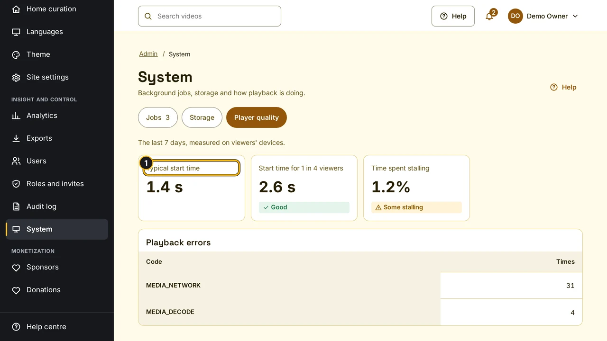

## What you will do
Look at failed jobs, how much storage is used and how well video plays. You end knowing when to ask your developer for help.

## Before you start
You need to be an Admin to see Storage and Player quality, and a Super admin to see Jobs and to retry or discard a job. Read [Find your way around](help:S04) if you have not yet.

## Steps
<!-- kb:steps C14 -->
1. Click **System** in the side menu.
   
2. Check the job **Email: Invite to sade@example.test**.
   The Jobs tab lists work that failed, such as encodes, captions and emails. A failed email job means the mail service refused the message. Retry it, or Discard it. Only Super admins can do either.
   
3. Click **Storage** at the top.
4. Check the **Storage used** figure and the list.
   The list shows what takes the space: videos, posters, captions and other files. The estimate says when you will reach your budget.
   
5. Click **Player quality** at the top.
6. Check the **Typical start time** figure.
   This is how long viewers wait for a video to start. Slow start, stalling and playback errors are listed below it. Send these numbers to your developer if they look bad.
   
<!-- /kb:steps -->

## What you should see
You can read the failed jobs, the storage used against your budget, and the start time, stalling and error numbers for the player.

> [!NOTE]
> Email checks: there is no separate mail or domain status screen. If an invite or notice email fails, it appears on the Jobs tab as an **Email** job with a reason such as the mail service refusing the message. Retry it once. If it fails again, send the reason to your developer, because mail sender settings are set on the server. The **Domain connected** line on the Launch checklist only shows that a domain was typed in, see [Platform details and the Launch checklist](help:C01).

> [!CAREFUL]
> **Discard** removes a failed job for good, so use it only when you are sure the work is not needed. **Retry** is safe to press again.

## If something goes wrong
- **I cannot see the Jobs tab.** Your role is Admin. Ask a Super admin to check jobs.
- **Storage says it is over budget.** Delete files you no longer need in Trash and failed encodes, or ask your developer to raise the budget.
- **Start time looks slow.** Send the numbers and the day to your developer. Viewers on slow links may see this even when the site is healthy.
