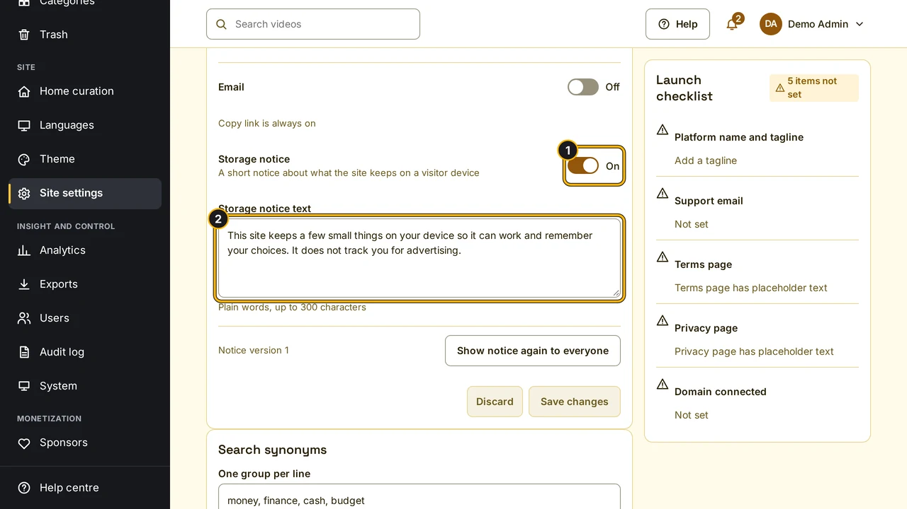
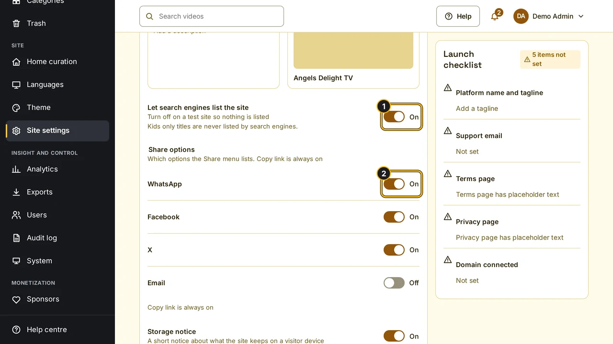

## What you will do
Edit the storage notice, show it again to everyone and choose the share options. You end with the Discovery tab saved.

## Before you start
You need to be an Admin or a Super admin. Read [Home and Discovery settings](help:C05) first, because these settings are on the same **Discovery** tab.

## Steps
<!-- kb:steps C15 -->
1. Click **Site settings** in the side menu.
2. Click **Discovery** at the top.
3. Scroll to **Storage notice**.
   The storage notice is the short message that tells visitors what the site keeps on their device.
   
4. Type "We keep small settings on your device." in **Storage notice text**.
   Keep the words short and plain. No dashes, emoji or markup.
5. Click **Show notice again to everyone**.
   Use this after you change the words in a way that matters. Everyone who closed the notice sees it again.
6. Scroll to **Let search engines list the site**.
   Kids only titles are never listed by search engines, whatever this switch says.
   
7. Untick **WhatsApp**.
   These switches choose which options the Share menu shows. Copy link is always on.
8. Click **Save changes**.
<!-- /kb:steps -->

## What you should see
The message **Discovery settings saved. They apply within 5 minutes.** appears. The Share menu on the site shows only the options you left on, and always has **Copy link**.

> [!CAREFUL]
> **Show notice again to everyone** makes every visitor see the notice again, including people who closed it. Use it only when the wording changed in a way that matters. The notice version number goes up by one when you save.

> [!NOTE]
> The **Storage notice** switch turns the notice on or off. **Let search engines list the site** is on by default. Titles that are only for kids are never listed. The share options are **WhatsApp**, **Facebook**, **X** and **Email**.

## If something goes wrong
- **The text will not save.** The words contain a dash, an emoji or markup. Remove them and try again.
- **The notice did not come back for some visitors.** Changes apply within 5 minutes. Click **Show notice again to everyone** and save, then wait.
- **Search engines still list the site.** They update slowly, sometimes over several days. Still stuck? [What to send ARKDEV](help:T11)
