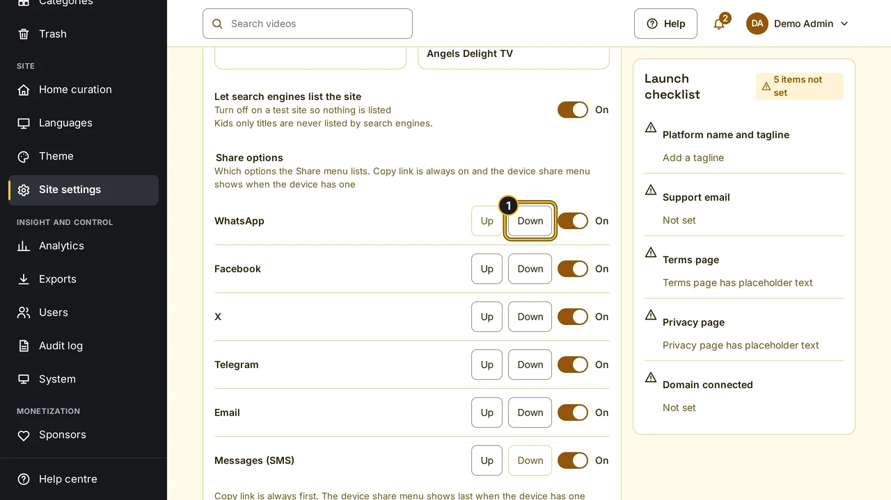

## What you will do
Choose which options viewers see in the Share sheet and put them in the order you want. You end with the **Discovery** tab saved.

## Before you start
You need to be an Admin or a Super admin. The options are on the same **Discovery** tab as the storage notice in [Storage notice and sharing options](help:C15). To see what viewers get, read [How the Share sheet works for viewers](help:R14).

## Steps
<!-- kb:steps C16 -->
1. Click **Site settings** in the side menu.
2. Click **Discovery** at the top.
3. Scroll to **Share options**.
   Each row is one way to share. The switch turns it on or off, and the order of the rows is the order viewers see.
   
4. Click **Move WhatsApp down**.
   The first row has no Up button and the last row has no Down button, because they cannot move further.
5. Click **Move Email up**.
6. Untick **Telegram**.
   A switched off option disappears from the Share sheet. Copy link is always first and the device menu is always last.
7. Click **Save changes**.
<!-- /kb:steps -->

## What you should see
The message **Discovery settings saved. They apply within 5 minutes.** appears. The Share sheet on the site lists the options you left on, in the order of the rows. The setting behind this list is called `seo.share_channels`.

> [!NOTE]
> **Copy link** is always first and the device share menu (**More**) is always last, so neither has a row here. The six options are **WhatsApp**, **Facebook**, **X**, **Telegram**, **Email** and **Messages (SMS)**. A switched off option has no Up or Down button.

## If something goes wrong
- **Up or Down is greyed out.** The row is already first or last. Move the other rows instead.
- **The order did not change on the site.** Changes apply within 5 minutes. Reload the page after that wait.
- **An option is missing from the Share sheet.** Its switch is off, or the device cannot use it. [Share sheet for viewers](help:R14)
