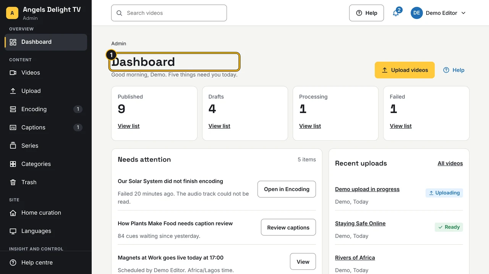
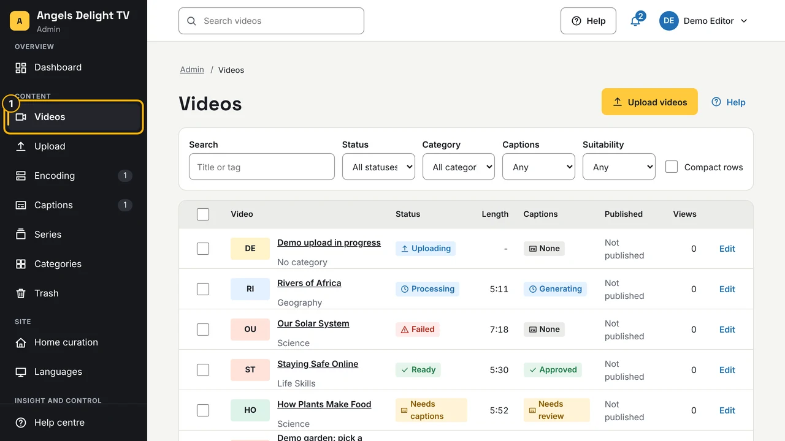
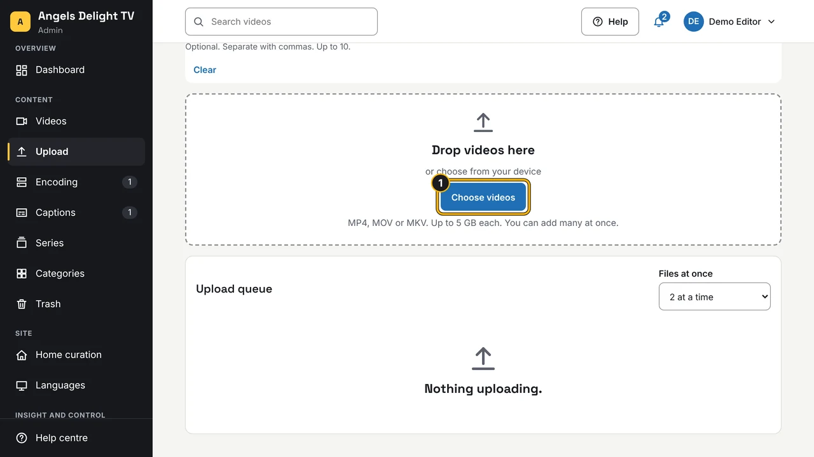
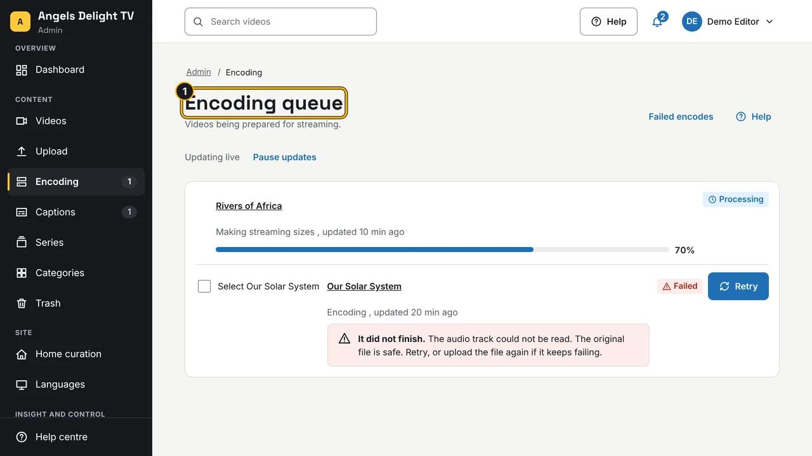
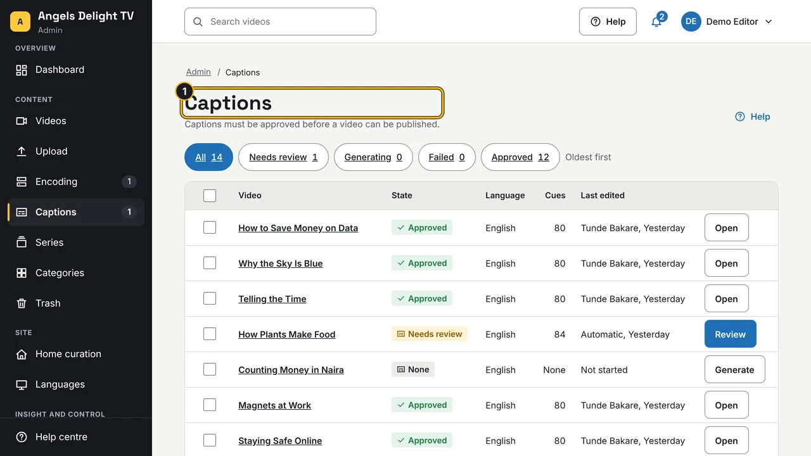
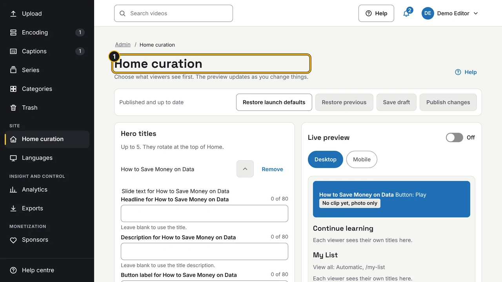
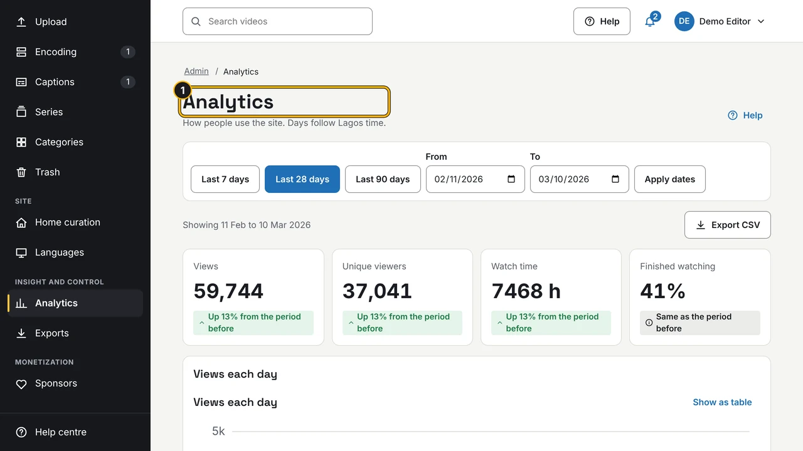
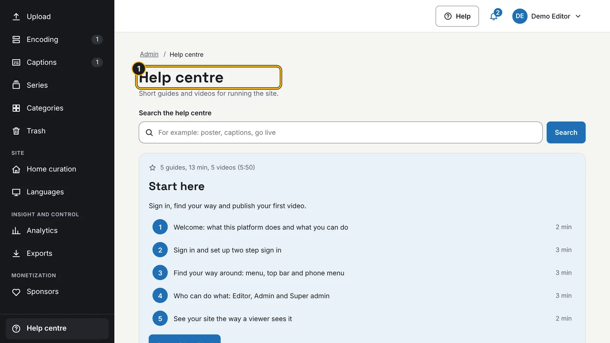

## What you will do
Take a short tour of the admin. You visit each main area once, so you know where videos, captions, the Home page and your numbers live.

## Before you start
- **Who can do this:** every staff member. Editors, Admins and Super admins all see this tour.
- **Time:** about 2 minutes.
- Sign in first. If you have not, read [Sign in and set up two step sign in](help:S02).
- This platform is a free video site for learners. Viewers watch on the public site. You manage everything here, in the [Dashboard](/admin).

## Steps
<!-- kb:steps S01 -->
1. Check that the **Dashboard** is open. It is your home in the admin.
   
2. Choose **Videos** in the side menu to see every video you have added.
   
3. Choose **Upload** in the side menu to add a new video.
   
4. Choose **Encoding** in the side menu to watch videos get ready.
   
5. Choose **Captions** in the side menu to check the words on screen.
   
6. Choose **Home curation** in the side menu to arrange the Home page.
   
7. Choose **Analytics** in the side menu to read your numbers.
   
8. Choose **Help centre** in the side menu when you need a guide.
   
9. Choose **Dashboard** in the side menu to come back home.
<!-- /kb:steps -->

## What you should see
You end on the [Dashboard](glossary:dashboard) again. You now know the areas you will use most:

- **Videos** and **Upload** hold your videos.
- **Encoding** shows videos that are getting ready to play.
- **Captions** is where you check the words shown on screen.
- **Home curation** controls what viewers see first.
- **Analytics** shows how many people watch.
- **Help centre** has a guide for every task.

> [!TIP]
> The side menu only shows what your role may use. If an item is missing, it is for a higher role. [Who can do what](help:S05) explains this.

## If something goes wrong
- **A menu item is missing.** It may be for a higher role. Ask a Super admin which role you have.
- **The page looks cut off.** Make the window wider, or open the side menu with the menu button at the top left. Still stuck? [What to send ARKDEV](help:T11)
