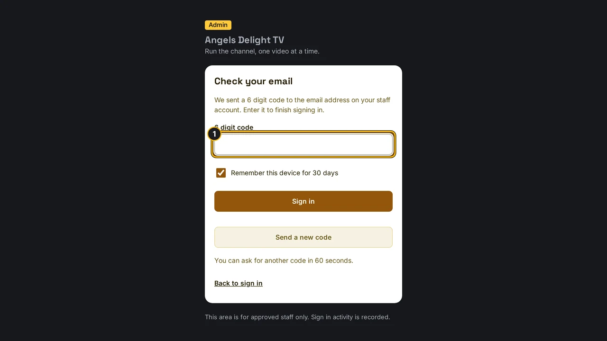

## What you will do
Sign in to the admin with your email, your password and a 6 digit code. You end on the [Dashboard](/admin).

## Before you start
- **Who can do this:** every staff member.
- **Time:** about 3 minutes.
- You need your email, your password and your phone with an [authenticator app](glossary:authenticator-app).
- The full address of your admin site. Your developer gives it to you. The sign in page ends with `/admin/login`.
- **First sign in:** the page title says "Set up two factor sign in". It shows a square code. Scan it with your authenticator app, type the 6 digit code the app shows into the **6 digit code** box, and choose **Confirm and finish**. You then see your [recovery codes](glossary:recovery-code). Write them down and keep them safe, then choose **I have saved them, continue**. This setup cannot be shown on the practice site that made the video, so there is no picture of it.

## Steps
<!-- kb:steps S02 -->
1. Go to the sign in page, "/admin/login".
   Your developer gives you the full address of your site. Add this ending to it.
   
2. Type your email in the **Email** box.
3. Type your password in the **Password** box.
   The dots hide your password. Nobody can read it over your shoulder.
4. Click **Sign in**.
5. Wait until you see **Enter your code**.
   The first time, this page shows a square code to scan with an authenticator app. Scan it, then enter the code the app shows.
   
6. Type the 6 digit code from your app in the **Digit 1 of 6** box.
   The code changes every 30 seconds. Type the one you see now.
7. Click **Verify**.
8. Wait until you see **Dashboard**. You are signed in.
   
<!-- /kb:steps -->

## What you should see
The **Dashboard** opens with your name at the top right. From now on you sign in with a password and a code from your app. The code changes every 30 seconds.

> [!CAREFUL]
> Each recovery code works once. Keep them away from your phone, so a lost phone does not lock you out.

## If something goes wrong
- **The code is not accepted.** Wait for a new code in your app and type that one. Check that your phone clock is correct.
- **The message says the sign in failed.** The message is the same for a wrong email and a wrong password, on purpose. Check both and try again.
- **You lost your phone.** Use a recovery code on the code page. If you have none, ask a Super admin to reset your two step sign in. Still stuck? [What to send ARKDEV](help:T11)
