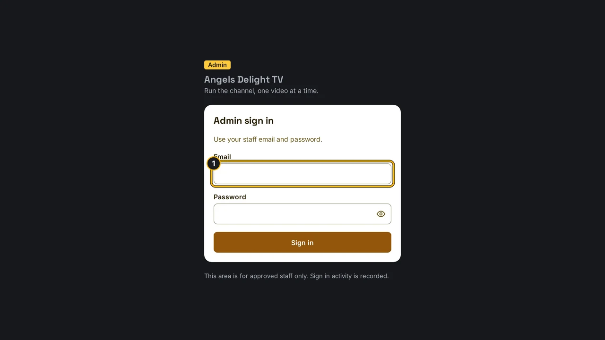
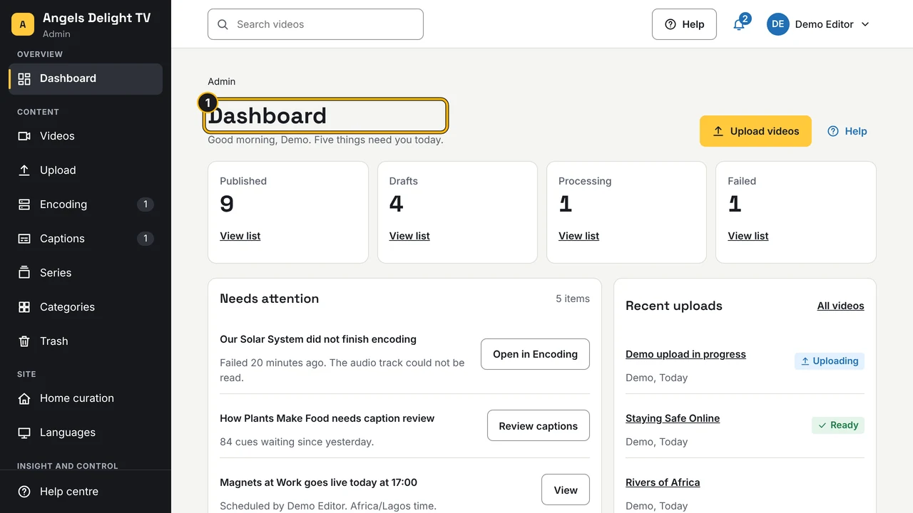

## What you will do
Sign in to the admin with your email, your password and a 6 digit code sent to your inbox. You end on the [Dashboard](/admin).

## Before you start
- **Who can do this:** every staff member.
- **Time:** about 3 minutes.
- You need your email, your password and access to your inbox. If you already use an [authenticator app](glossary:authenticator-app), keep using it.
- The full address of your admin site. Your developer gives it to you. The sign in page ends with `/admin/login`.
- **Authenticator app:** if you set one up before, the sign in asks for the code from your app instead of an email. Nothing else changes.

## Steps
<!-- kb:steps S02 -->
1. Go to the sign in page, "/admin/login".
   Your developer gives you the full address of your site. Add this ending to it.
   
2. Type your email in the **Email** box.
3. Type your password in the **Password** box.
   The dots hide your password. Nobody can read it over your shoulder.
4. Click **Sign in**.
5. Wait until you see **Enter your code**.
   We email a 6 digit code to your address. It works once and lasts 10 minutes. The page has a **Remember this device** box, on by default.
   
6. Type the 6 digit code from the email in the code box.
   If it has not come, wait a minute and choose **Email me a new code**. Authenticator app users type the app code instead.
7. Click **Verify**.
8. Wait until you see **Dashboard**. You are signed in.
   
<!-- /kb:steps -->

## What you should see
The **Dashboard** opens with your name at the top right. With **Remember this device** on, this device skips the code for 30 days and your session stays open for up to 7 days of no use. Use a shared computer? Untick it.

> [!CAREFUL]
> Do not tick **Remember this device** on a shared computer. You can see and forget remembered devices on **My account**.

## If something goes wrong
- **The code is not accepted or has not come.** Check spam, then click **Send a new code** after the wait. Only the newest code works.
- **The message says the sign in failed.** The message is the same for a wrong email and a wrong password, on purpose. Check both and try again.
- **You cannot reach your inbox or lost your phone.** Ask a Super admin to reset your two step sign in. Authenticator users can use a recovery code. Still stuck? [What to send ARKDEV](help:T11)
