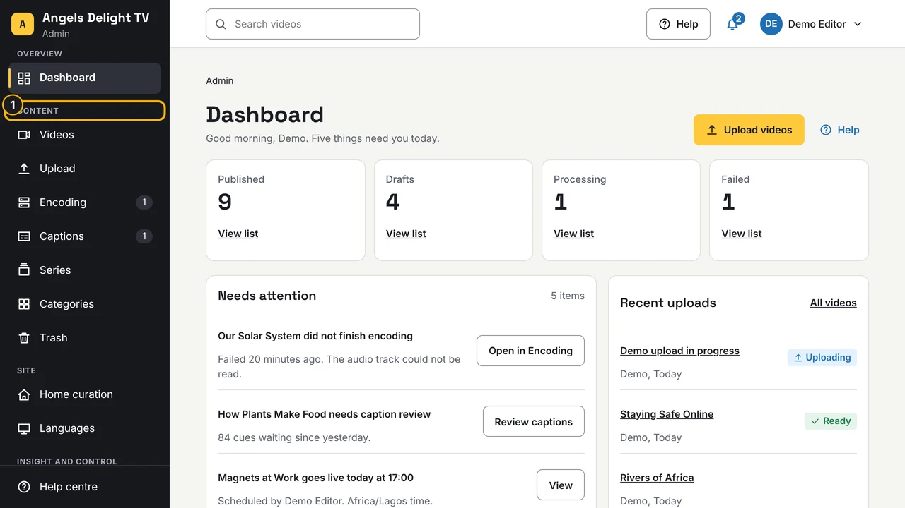

## What you will do
Learn where things are in the admin. You end by opening a screen from the menu and coming back to the Dashboard.

## Before you start
Sign in first. You do not need anything else.

## Steps
1. Look at the side menu on the left. It has groups such as **Content** and **Site**.
   
2. Click **Videos** to see every video you have uploaded.
3. Look at the top bar. It shows your upload progress, the notice bell and your account menu.
4. Open your account menu and choose **Preview site** to see the site as a viewer sees it.
5. Click **Dashboard** in the side menu to come back.
   > [!TIP]
   > On a phone, tap the menu button at the top left to open the side menu.

## What you should see
The Dashboard shows tiles for your videos and a list called **Needs attention**. Menu items you cannot use are hidden for your role.

## If something goes wrong
- **A menu item is missing.** It may be for a higher role. Ask a Super admin which role you have.
- **The page looks cut off.** Make the window wider or turn your phone sideways.
