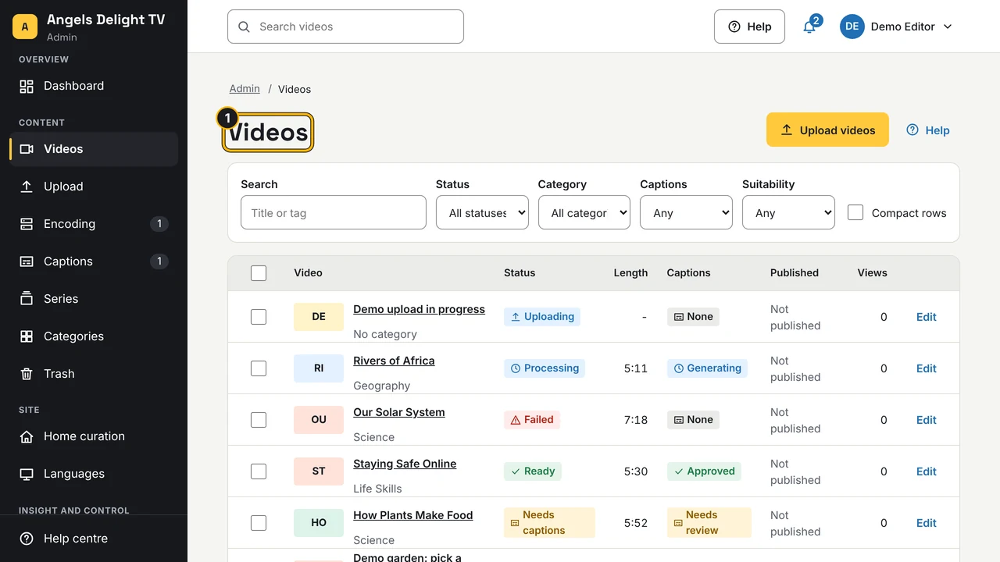
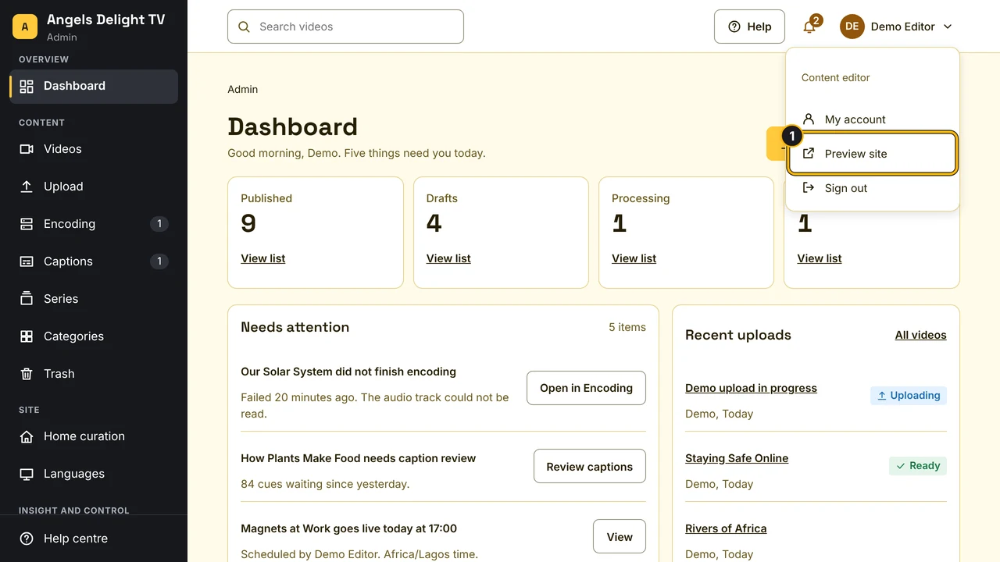
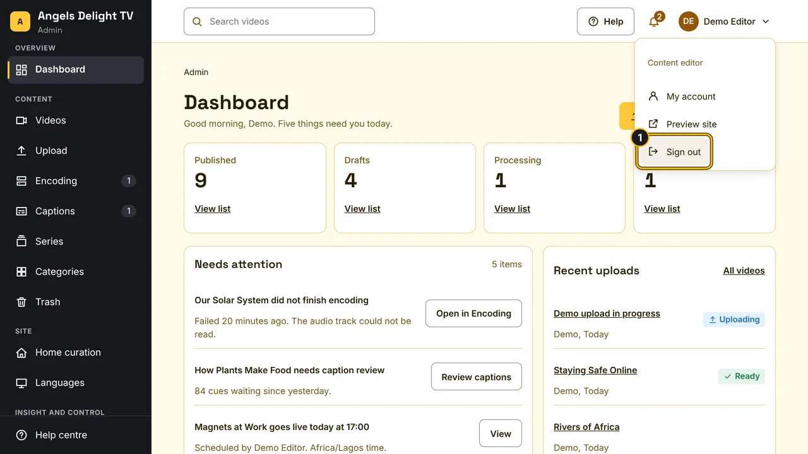

## What you will do
Learn where things are in the admin. You open a screen from the [side menu](glossary:side-menu), come back to the [Dashboard](glossary:dashboard) and look at your account menu.

## Before you start
- **Who can do this:** every staff member.
- **Time:** about 3 minutes.
- Sign in first. Read [Sign in and set up two step sign in](help:S02) if you have not.
- On a phone the side menu is hidden. Tap the menu button at the top left to open it. It closes again when you choose a screen.

## Steps
<!-- kb:steps S04 -->
1. Check that the **Content** group holds your video screens.
   On a phone, tap the menu button at the top left to open the side menu.
   
2. Choose **Videos** in the side menu to open a screen.
   
3. Choose **Dashboard** in the side menu to go back.
4. Check that a number beside **Captions** shows how many videos wait.
5. Click **Account menu for Demo Editor** at the top right.
   Your own name is on the button.
   
6. Check that **Preview site** shows the site the way viewers see it.
7. Check that **Sign out** is in this menu.
   
<!-- /kb:steps -->

## What you should see
You end on the Dashboard with your account menu open. The side menu groups screens by job: **Overview**, **Content**, **Site**, **Insight and control** and **Monetization**. Numbers beside **Encoding** and **Captions** show how many videos wait.

The top bar has a search box for videos, a **Help** link, the notice bell and your account menu. While a video uploads, a small chip shows its progress.

> [!NOTE]
> The side menu shows only what your role may use. If an item is missing, it is for a higher role. [Who can do what](help:S05) explains the roles.

## If something goes wrong
- **A menu item is missing.** It may be for a higher role. Ask a Super admin which role you have.
- **The page looks cut off.** Make the window wider or turn your phone sideways.
- **You cannot find the account menu.** It is the button with your name at the top right. On a phone it shows your initials. Still stuck? [What to send ARKDEV](help:T11)
