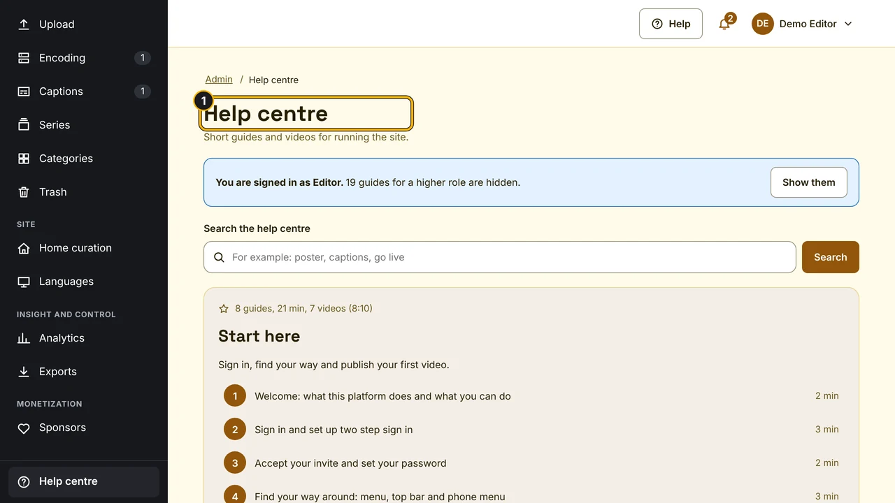
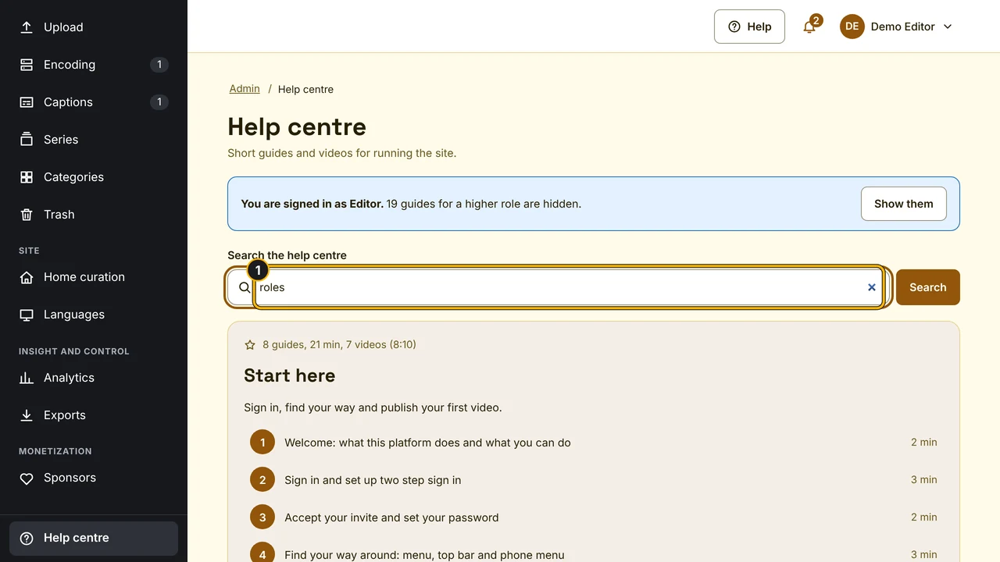
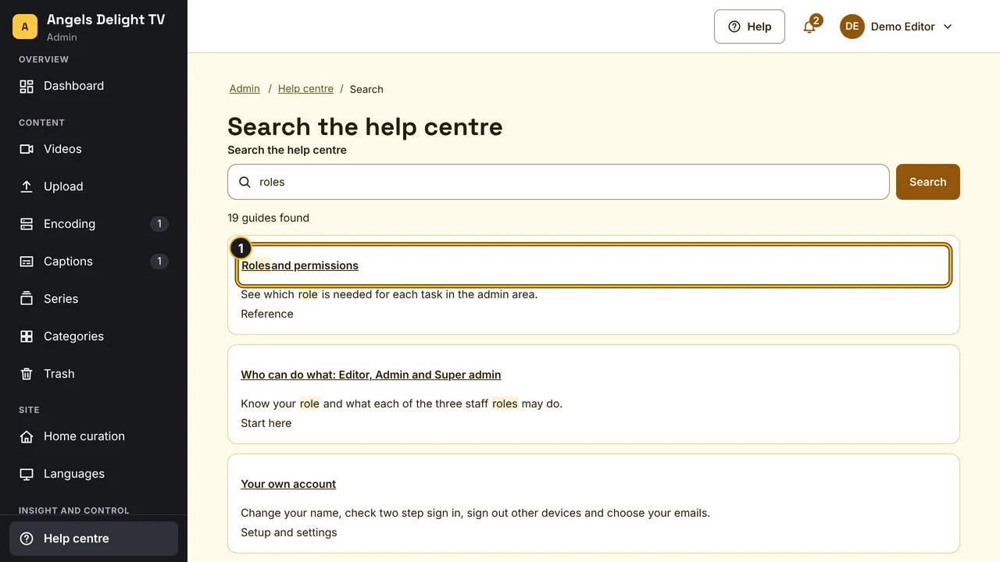
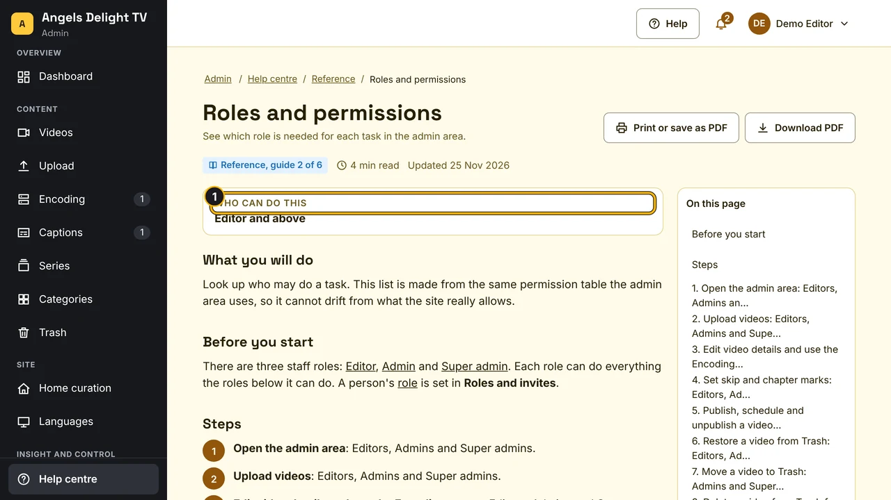
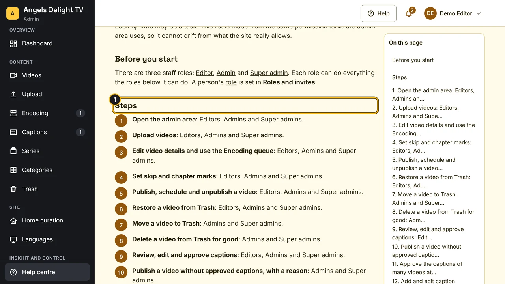

## What you will do
Find your own [role](glossary:role) and learn what the three staff roles can do. You end on the guide that lists every task by role.

## Before you start
- **Who can do this:** every staff member.
- **Time:** about 3 minutes.
- There are three staff roles. Each role can do everything the roles below it can do.
- An [Editor](glossary:editor) looks after content: uploads, details, captions, series, categories, the Home page and analytics.
- An [Admin](glossary:admin) can also change the look and settings of the site, move videos to Trash, manage viewer accounts and read the audit log.
- A [Super admin](glossary:super-admin) can also invite and manage staff, change features and limits, and run failed jobs again.

## Steps
<!-- kb:steps S05 -->
1. Choose **Help centre** in the side menu.
   
2. Type "roles" in the **Search the help centre** box.
   
3. Click **Search**.
   
4. Click **Roles and permissions**.
5. Wait until you see **Who can do this**.
   
6. Scroll to **Steps**.
   
7. Scroll to **Related guides**.
<!-- /kb:steps -->

## What you should see
You are reading the guide **Roles and permissions**. It lists each task and the lowest role that can do it.

> [!TIP]
> If a button is grey, your role cannot use it. The button says why when you point at it. Ask a Super admin if you need a higher role.

## If something goes wrong
- **A screen is missing from the side menu.** It is for a higher role. Ask a Super admin to change your role.
- **You are not sure which role you have.** Open the account menu at the top right. The role is shown there, and on the **My account** screen. Still stuck? [What to send ARKDEV](help:T11)
