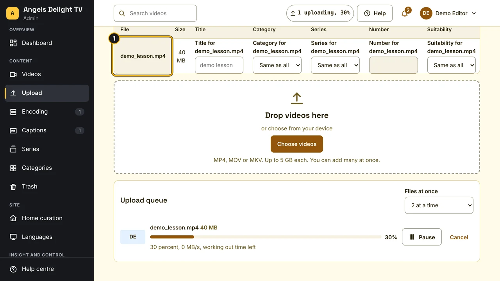
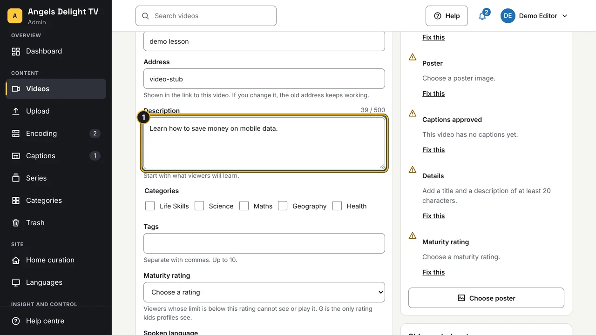
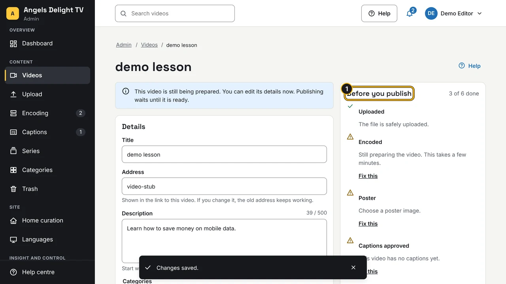
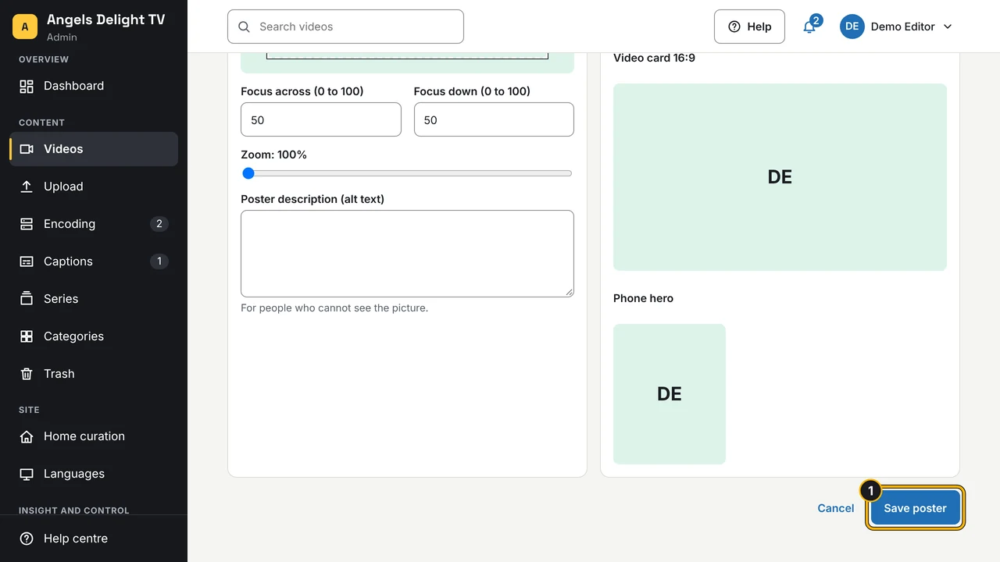
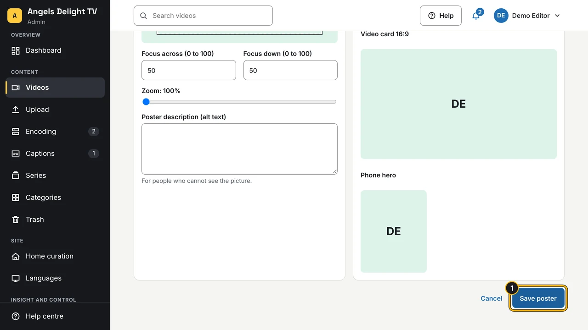

## What you will do
Take one video from your computer to the point where it only needs captions and a click on Publish. This guide covers upload, details and where to find the poster.

## Before you start
- **Who can do this:** Editors, Admins and Super admins.
- **Time:** about 4 minutes, plus the time your connection needs to send the file.
- You need a video file in MP4, MOV or MKV format.
- Read [Find your way around](help:S04) first if the side menu is new to you.
- On the practice site that made the video, captions are not made for a new upload, so the video stops at the checklist. On your real site the captions arrive by themselves after the video is prepared. Then follow [Review and approve captions](help:D07) and [Publish or unpublish a video](help:D08).

## Steps
<!-- kb:steps S06 -->
1. Choose **Upload** in the side menu.
2. Click **Choose videos**.
3. Choose a file from your computer.
   
4. Wait until you see **Uploaded just now**.
5. Click **Edit details for demo_lesson.mp4**.
6. Type "Learn how to save money on mobile data." in the **Description** box.
   
7. Tick **Life Skills**.
8. Select **G** from the **Maturity rating** list.
9. Click **Save changes**.
10. Wait until you see **Changes saved**.
11. Check that **Before you publish** shows what is left to do.
   
12. Click **Choose poster**.
   
13. Check that **Save poster** is on the screen.
   
<!-- /kb:steps -->

## What you should see
The card **Before you publish** shows how many steps are done. After this guide, the upload and details are done. The poster, captions and publishing are still to do. Follow [Choose or upload a poster](help:D06) for the poster.

> [!TIP]
> Open the **Encoding** screen to watch a new video get ready. It can take a while for a long video.

## If something goes wrong
- **The upload stops.** Check your connection and choose **Retry** on the row. The part that was sent is kept.
- **Save changes is grey.** Nothing has changed yet. Edit a box and it turns on.
- **You cannot find the poster button.** Open the video again from **Videos**. The button is in the card **Before you publish**. Still stuck? [What to send ARKDEV](help:T11)
