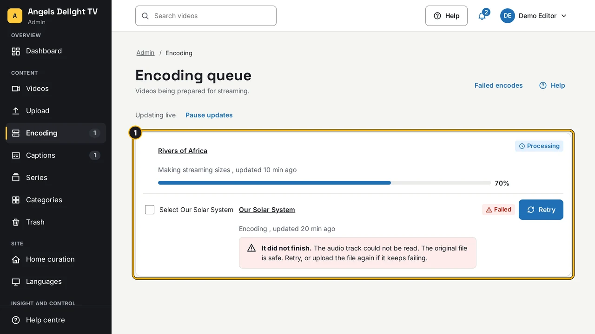
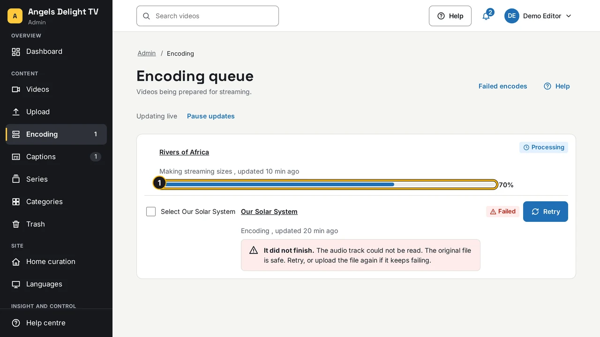
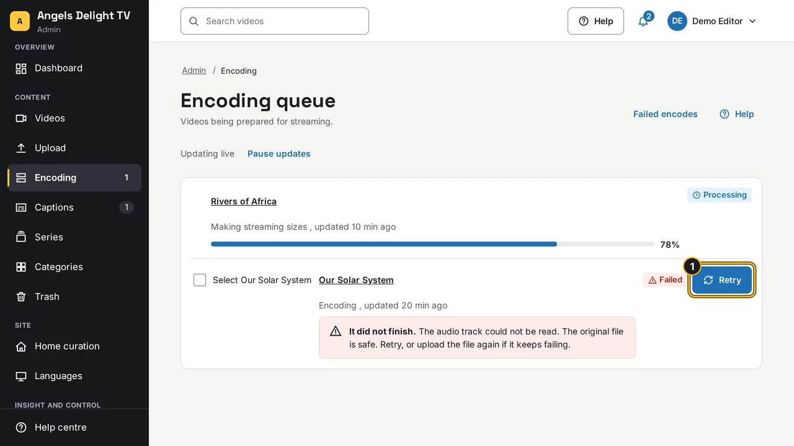

## What you will do
Check whether a new video is still being prepared or has failed, read the reason and use **Retry**. You end with the video moving again.

## Before you start
You need the Editor role or above. Have the video title ready. After an upload, the site prepares the video in a few stages, so a new video is not ready at once. This is called [encoding](glossary:encoding).

## Steps
<!-- kb:steps T01 -->
1. Choose **Encoding** in the side menu.
   Editors and above can open this page. It updates by itself every few seconds.
   
2. Check the **Failed encodes** section.
3. Check the **Processing** badge for your video.
   A long video can stay on one stage for several minutes. This is normal.
   
4. Wait until **Processing** shows the progress bar moving.
5. Scroll to **Failed** in the list.
6. Check that **It did not finish** appears in the red box.
   Your original file is safe. A failed encode never deletes it.
   
7. Click **Retry encoding Our Solar System**.
<!-- /kb:steps -->

## What you should see
A video that was preparing shows a blue **Processing** badge and a bar that moves. A video you retried shows a message that it is back in the queue, then moves along the stages.

> [!TIP]
> A long video can take longer than a short one. If the bar still moves, wait. Only a red **Failed** badge needs action.

## If something goes wrong
- **The bar has not moved for over an hour.** Leave it a little longer on a very large file, then ask the developer to look at it. What to send is in the guide for asking the developer
- **Retry fails again.** Upload the video file again from its page, then ask the developer if that also fails. [An upload keeps failing](help:T05)
- **The Retry button is missing.** Only a video that failed shows it. A Super admin can also retry other failed jobs on **System**. See the guide on failed jobs and emails
