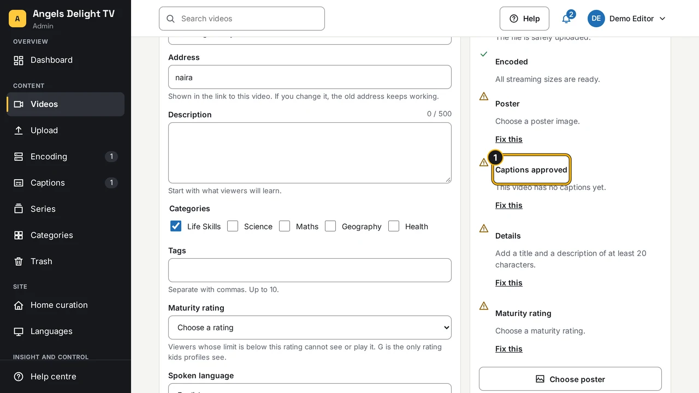
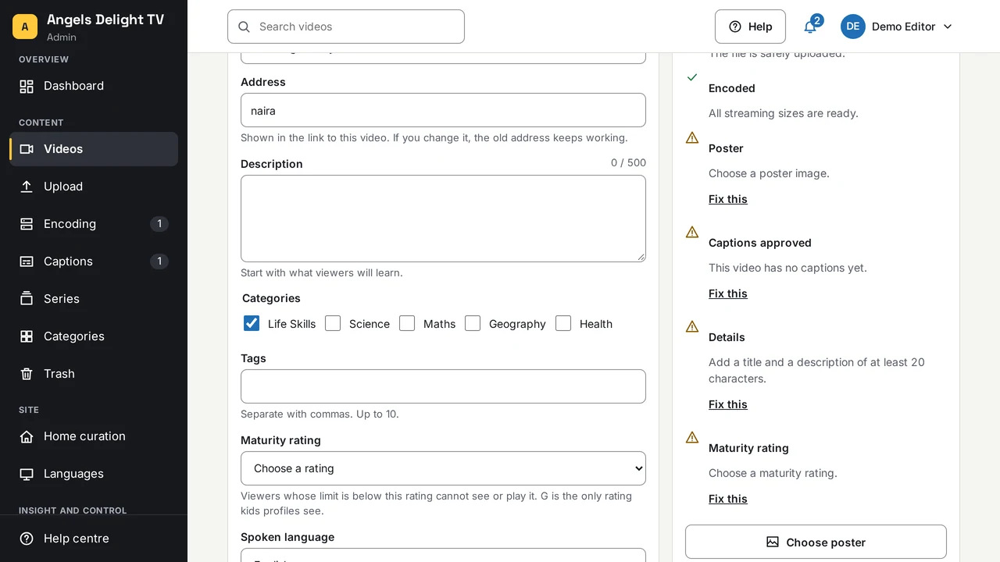

## What you will do
Open the **Before you publish** list for a video and fix what is missing. You end with every item ticked and the video ready to [publish](glossary:publish).

## Before you start
You need the Editor role or above. A video has six things to finish before it can go live: uploaded, encoded, poster, approved captions, details and a maturity rating.

## Steps
<!-- kb:steps T02 -->
1. Choose **Videos** in the side menu.
2. Type "Naira" in the **Search** box.
3. Click **Edit Counting Money in Naira**.
4. Check the **Before you publish** list on the right.
   
5. Check the **Needs attention** items.
   Each item says in plain words what is missing. The count shows how many are done.
6. Click **Fix this** under Poster.
   
<!-- /kb:steps -->

## What you should see
Each item you fix changes from needing attention to done, and the count in **Before you publish** goes up. When all six are done, **Publish** opens the publish choices.

> [!NOTE]
> **Publish** is also grey while the video is still preparing, after a failed encode, or while you have unsaved changes. The button explains why when you point at it.

## If something goes wrong
- **Encoded needs attention.** The video is still preparing or failed. Wait for it, or use **Retry** on the Encoding screen. [Stuck on Encoding](help:T01)
- **Captions approved needs attention.** The captions are missing, still being made or not approved. [Captions are missing or wrong](help:T03)
- **You are an Editor and need to publish without captions.** Only an Admin can publish without approved captions, and must give a reason. [Roles and permissions](help:R02)
