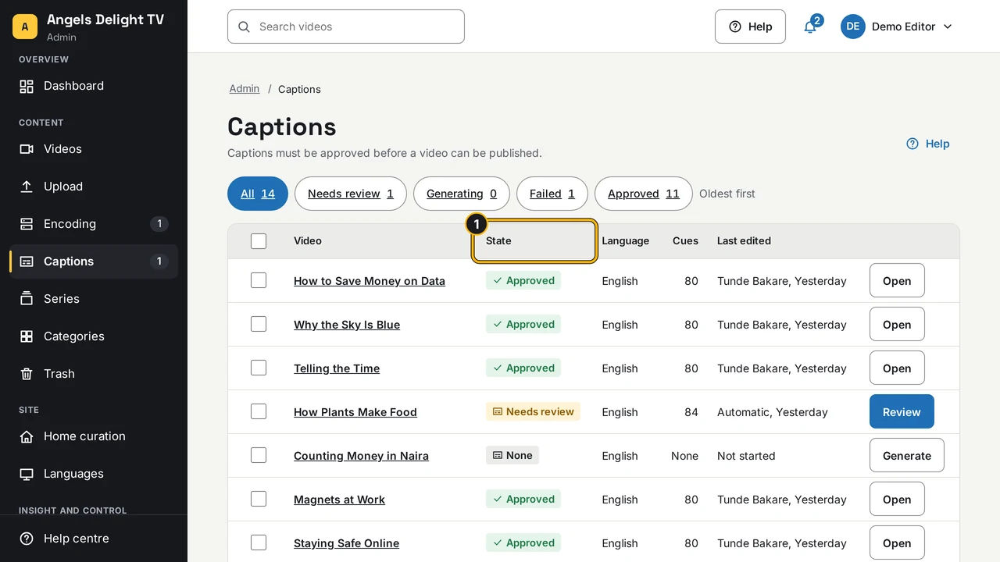
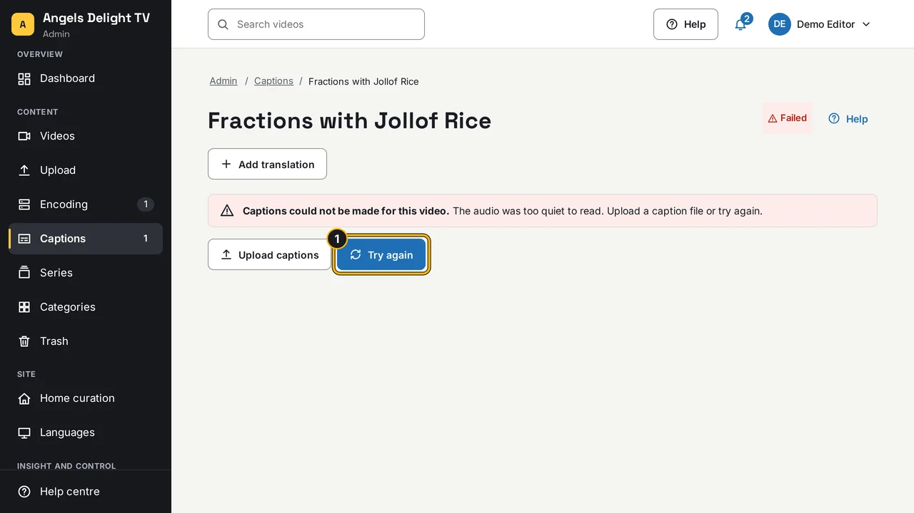

## What you will do
Find out why a video has no captions or wrong ones, then try again or fix the words. You end with captions being made, or ready to review and approve.

## Before you start
You need the Editor role or above. Captions are the words shown on screen while a video plays. The site writes them from the sound, so they can fail on a very quiet video. See [caption](glossary:caption) and [needs review](glossary:needs-review).

## Steps
<!-- kb:steps T03 -->
1. Choose **Captions** in the side menu.
   
2. Check the **State** of your video.
   None, Generating, Needs review, Failed and Approved each mean something different.
3. Click **Failed 1** above the list.
4. Click **Retry captions for Fractions with Jollof Rice**.
5. Check that **Captions could not be made for this video** appears.
   
6. Click **Try again**.
   You can also upload your own caption file with **Upload captions**.
7. Wait until **Making captions** appears.
<!-- /kb:steps -->

## What you should see
The video shows **Generating** with a bar and a time left. When it finishes the state becomes **Needs review**. Read the captions, fix wrong words and choose **Approve captions**.

> [!TIP]
> If the captions made by the site keep failing, upload your own caption file with **Upload captions**. It must be a WebVTT file ending in .vtt.

## If something goes wrong
- **The state stays on Generating for a long time.** Large videos take longer. Leave the page and come back later, then ask the developer if it is still stuck. [Stuck on Encoding](help:T01)
- **The words are wrong but the state is Needs review.** Click a line and fix it, then approve. Use **Find and replace** for a name that is wrong in many places. [A video will not publish](help:T02)
- **There is no Approve button for many videos at once.** Only an Admin can approve many at once. [Roles and permissions](help:R02)
