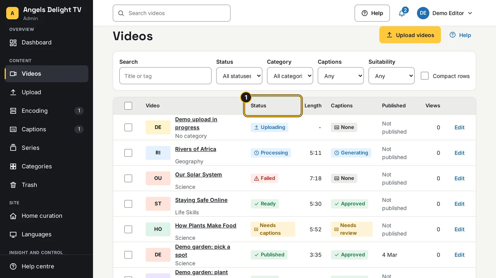

## What you will do
Check the three things that stop a video playing: it is not published, it is still preparing, or the viewer has a problem on their side. You end knowing which one it is, or with a reference code to send.

## Before you start
You need the Editor role or above. Ask the viewer for the video title and for the reference code on the screen. It looks like AD-7K4Q and is small text under the message. See [reference code](glossary:reference-code).

## Steps
<!-- kb:steps T04 -->
1. Choose **Videos** in the side menu.
2. Check the **Search** box above the video list.
3. Check the **Status** badge.
   Only a video marked Published can be watched by viewers.
   
<!-- /kb:steps -->

## What you should see
A video viewers can watch says **Published** in the **Status** column and shows a date under **Published**. Anything else, such as **Ready**, **Processing** or **Failed**, explains why viewers cannot play it.

> [!NOTE]
> Admins and Super admins can also open **System** and read the **Player quality** tab. It lists playback errors by code for the last 7 days.

## If something goes wrong
- **The video says Ready, not Published.** It is a draft. Open it and publish it. [A video will not publish](help:T02)
- **The video says Processing or Failed.** It is not ready for viewers. [Stuck on Encoding](help:T01)
- **The video is Published and still will not play.** Ask the viewer to try another browser and to send the reference code. Send it to the developer with the time.
