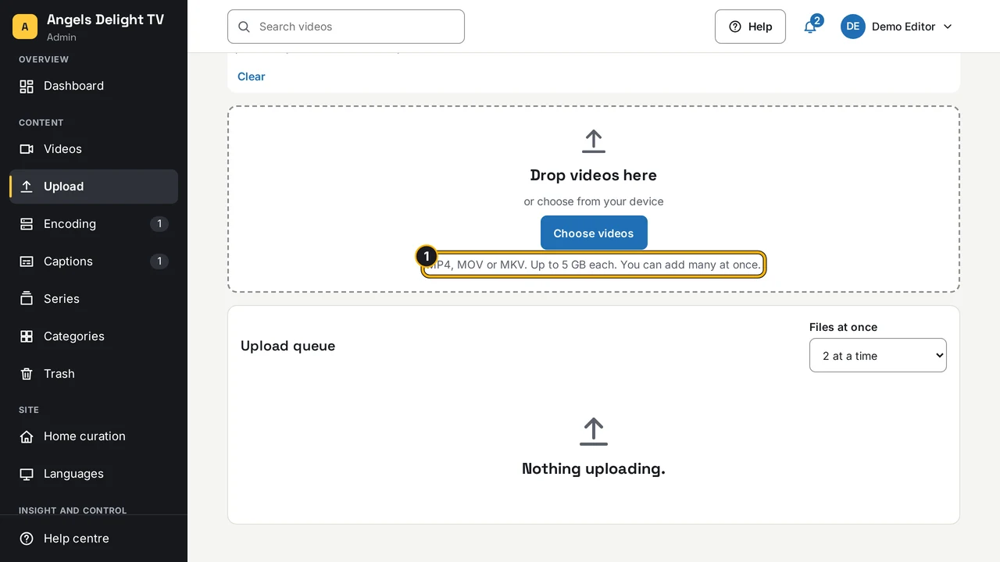
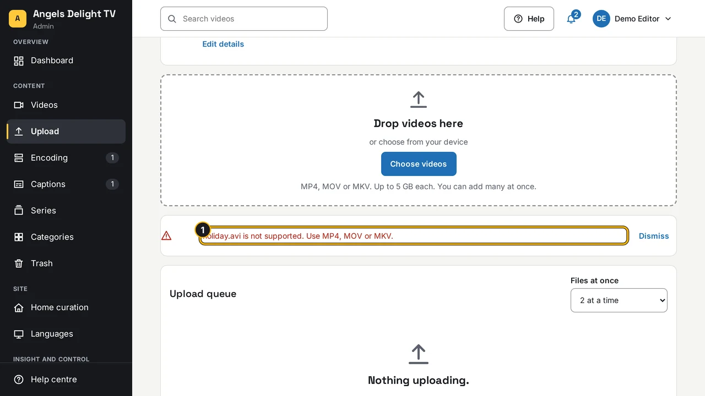

## What you will do
Find out why a file will not upload and fix it. You end with a good file uploading, or a clear message to send to the developer.

## Before you start
You need the Editor role or above. Have the file on your device. Only MP4, MOV and MKV files are accepted, and the size limit is shown under the upload box. Every file in a batch uploads on its own, so one bad file does not stop the others.

## Steps
<!-- kb:steps T05 -->
1. Choose **Upload** in the side menu.
2. Check the **Files at once** line.
   The limit is shown under the box. Only MP4, MOV and MKV files are accepted.
   
3. Click **Choose videos** and pick a file.
4. Check the **Upload queue** for the message under the file name.
   The message says what is wrong with that file. Other files in the same batch carry on.
   
5. Select a file that was not added to remove it with **Remove**.
<!-- /kb:steps -->

## What you should see
A file that is not accepted shows a short message under its name, such as that it is not supported. A good file shows a progress bar and then the words **Preparing your video**.

> [!TIP]
> On mobile data, a big file can pause when the signal drops. It says **Waiting for network. It will continue by itself.** Keep the page open, or move to Wi-Fi.

## If something goes wrong
- **The file is the wrong type.** Save or export it again as MP4, MOV or MKV, then add it again.
- **The file is over the size limit.** Make the video smaller in your editing app, or cut it into parts.
- **A file says Upload failed and Retry does not help.** Note the file name, the time and the message, and send them to the developer.
