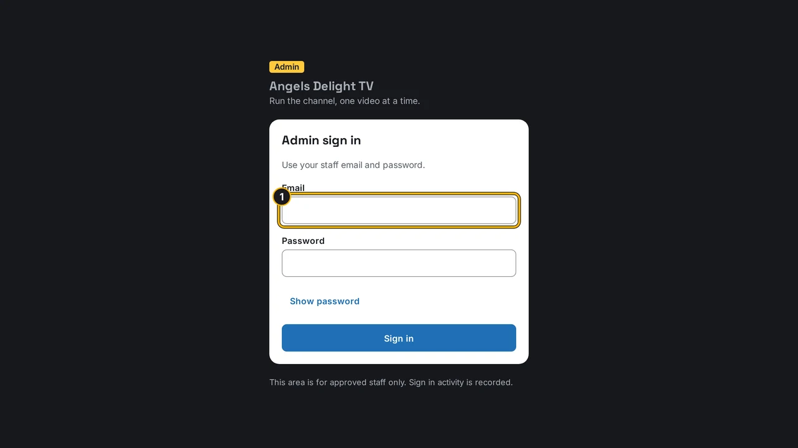
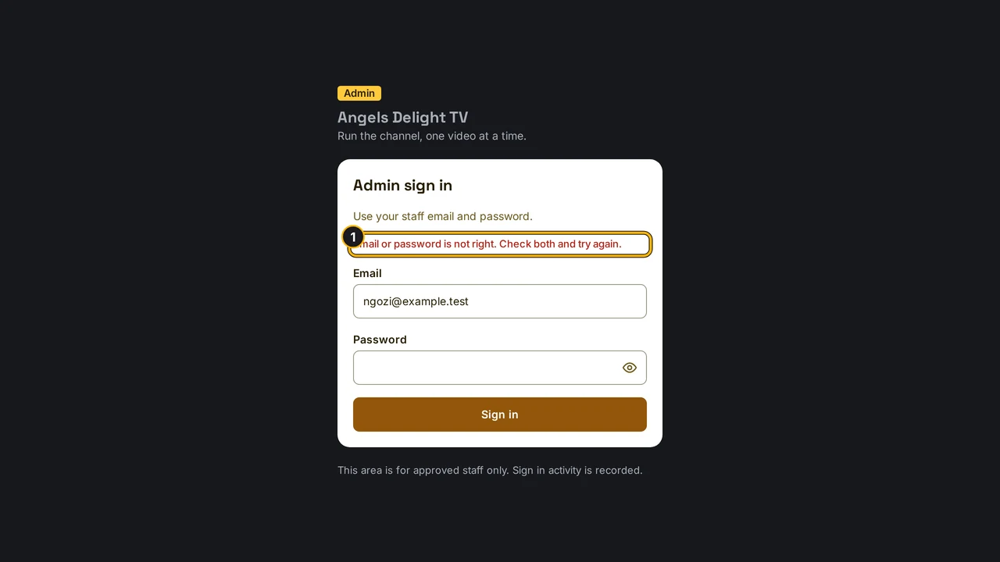
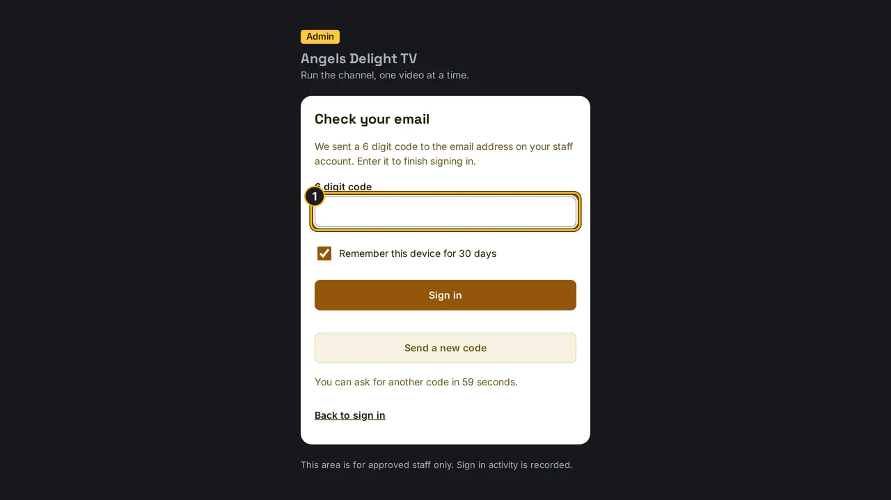

## What you will do
Find out why you cannot sign in and what to do next. You end signed in, or with a Super admin resetting your [two step sign in](glossary:two-step-sign-in).

## Before you start
Have your email address and access to your inbox. If you set up an [authenticator app](glossary:authenticator-app) and saved [recovery codes](glossary:recovery-code), find them. Each one works once.

## Steps
<!-- kb:steps T06 -->
1. Go to the sign in page, "/admin/login".
   
2. Type your email in the **Email** box.
3. Type "wrongpassword" in the **Password** box.
   The demo shows a made up password. Never share your real password with anyone.
4. Click **Sign in**.
5. Check the **Sign in** heading and the message above the boxes.
   The message is the same for a wrong email and a wrong password. This protects every account.
   
6. Type your password in the **Password** box.
7. Click **Sign in** again.
8. Check the **Check your email** page.
   The code is in the email we sent and lasts 10 minutes. If it has not come, wait a minute and click Send a new code. App users type the app code instead.
   
<!-- /kb:steps -->

## What you should see
After the right password, the page asks for the 6 digit code. After the right code you land on the **Dashboard**.

> [!NOTE]
> After too many wrong tries the page says **Too many attempts** and how many minutes to wait. Wait that long before you try again.

> [!CAREFUL]
> If you use an authenticator app and lost your phone, you can sign in with a recovery code. On the code page, click **Use a recovery code**, type one code and click **Use recovery code**. If you have no codes left, ask a Super admin to reset your two step sign in.

## If something goes wrong
- **The message says the email or password is not right.** Check both. The message is the same for a wrong email or password. Ask a Super admin which email your account uses.
- **The code is rejected or the email has not come.** Check spam, wait a minute, click **Send a new code** and use only the newest. App users: check the phone clock is automatic.
- **You lost your phone and have no recovery codes.** A Super admin opens **Roles and invites**, clicks **Reset** next to your name and enters their own code. You then sign in again with an emailed code.
