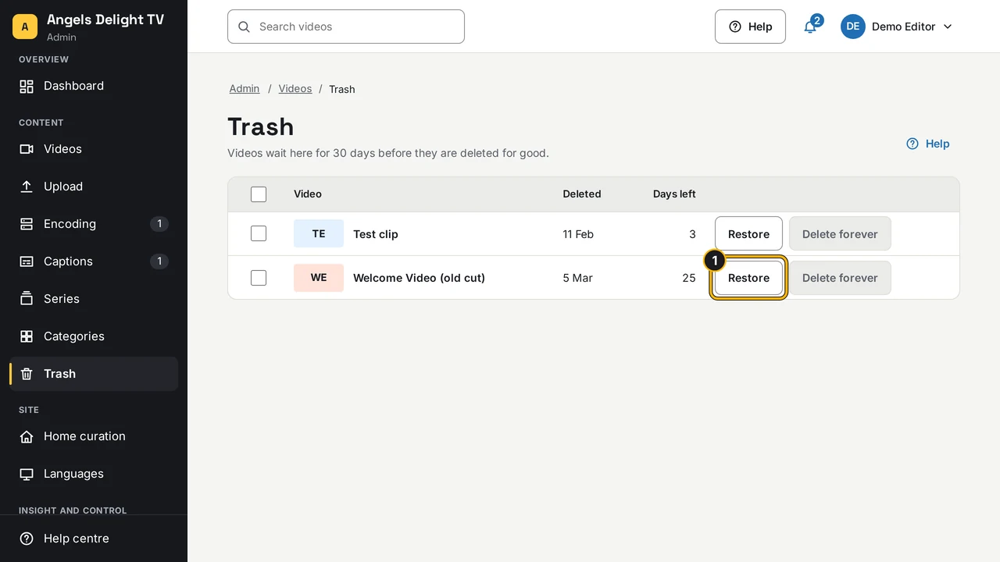
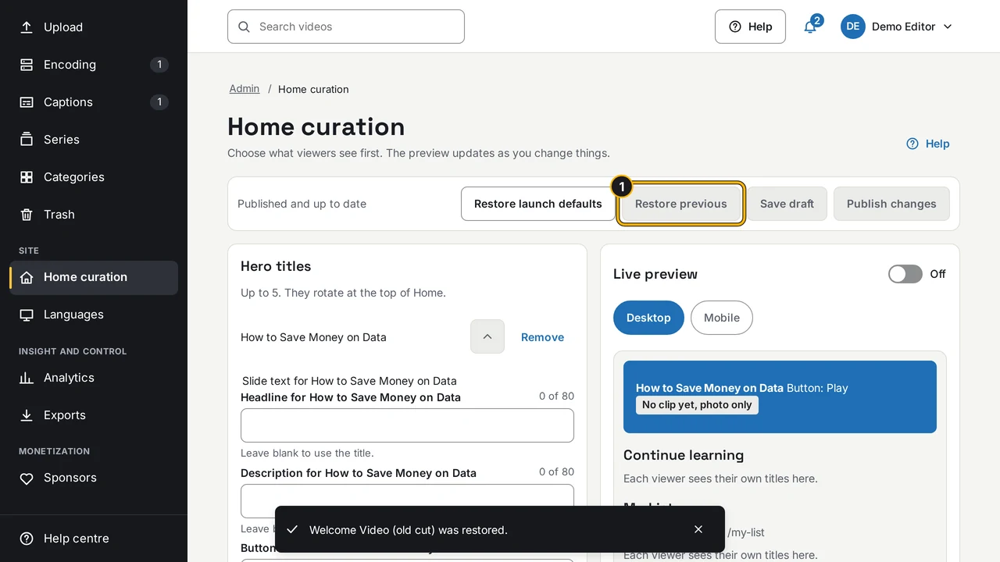

## What you will do
Bring back something you deleted or changed by mistake. You end with the video back in your list, or the earlier Home in place.

## Before you start
You need the Editor role or above. Act soon. A video stays in [Trash](glossary:trash) for 30 days, and after that it is gone for good.

## Steps
<!-- kb:steps T07 -->
1. Choose **Trash** in the side menu.
   
2. Check the **Deleted** column.
   A video waits here for 30 days. After that it is gone for good.
3. Click **Restore Welcome Video (old cut)**.
4. Choose **Home curation** in the side menu.
5. Scroll to **Restore previous** at the top.
   It puts back the version of Home that was live before your last publish. **Restore launch defaults** goes back to the first layout.
   
<!-- /kb:steps -->

## What you should see
The restored video leaves Trash and is back in **Videos** as a draft, so viewers do not see it until you publish it.

> [!TIP]
> After a change to many videos at once, the result box has an **Undo** button for a short time. Use it straight away. Theme changes can be undone from **Theme history**, where **Restore as draft** copies an old version into your draft.

## If something goes wrong
- **The video is not in Trash.** It was deleted for good, or it was never deleted. Check **Videos** with the **Status** filter, then ask the developer.
- **Restore previous is grey.** Home has no earlier published version. Use **Restore launch defaults** instead, and check the preview before you publish.
- **You cannot delete or restore a video.** Moving a video to Trash needs the Admin role. [Roles and permissions](help:R02)
