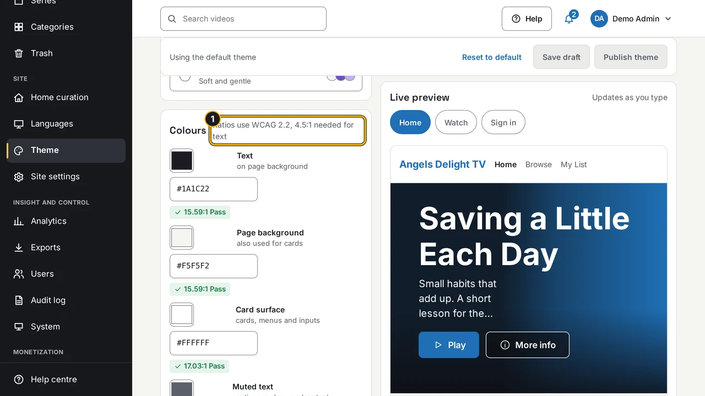
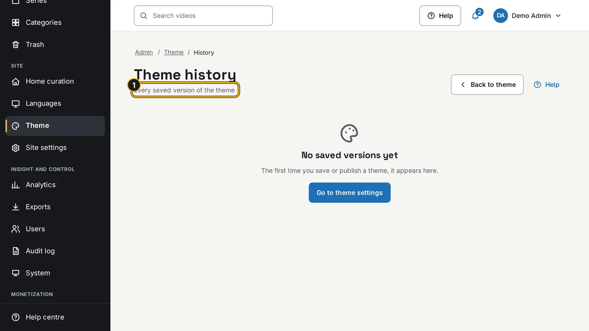

## What you will do
Find out why the site looks wrong after a [theme](glossary:theme) change, and put back a look that works. You end with a readable site.

## Before you start
You need the Admin role or above. Viewers only see a theme after you click **Publish theme**. If you have not published yet, the wrong look is only in your draft, so you can just change it.

## Steps
<!-- kb:steps T08 -->
1. Choose **Theme** in the side menu.
2. Scroll to **Colours** to see the colour ratios.
   Each pair shows a ratio and the word Pass or Fail. A pair that fails is hard to read for some people. Change it before you publish.
   
3. Click **Theme history**.
4. Check the **Theme history** list.
   Every theme you save or publish appears here. Click **Restore** next to a good one and choose **Restore as draft**. Nothing changes for viewers until you publish.
   
5. Click **Back to theme**.
6. Scroll to **Reset to default** at the top.
   Reset puts back the first look of the site. It asks you to confirm.
<!-- /kb:steps -->

## What you should see
Every colour pair under **Colours** says **Pass**, and the **Live preview** looks right. After you publish, the viewer site shows the same look.

> [!TIP]
> To go back to an earlier look, open **Theme history**, click **Restore** next to a good version and choose **Restore as draft**. Then click **Publish theme** when the preview looks right.

## If something goes wrong
- **Theme history is empty.** A version is only saved when you save or publish a theme. Use **Reset to default** to go back to the first look.
- **A colour pair says Fail.** Text on that colour is hard to read. Pick a darker or lighter colour until it says **Pass**.
- **The site still looks wrong for viewers.** Check you clicked **Publish theme** and not only **Save draft**. Then ask the developer.
