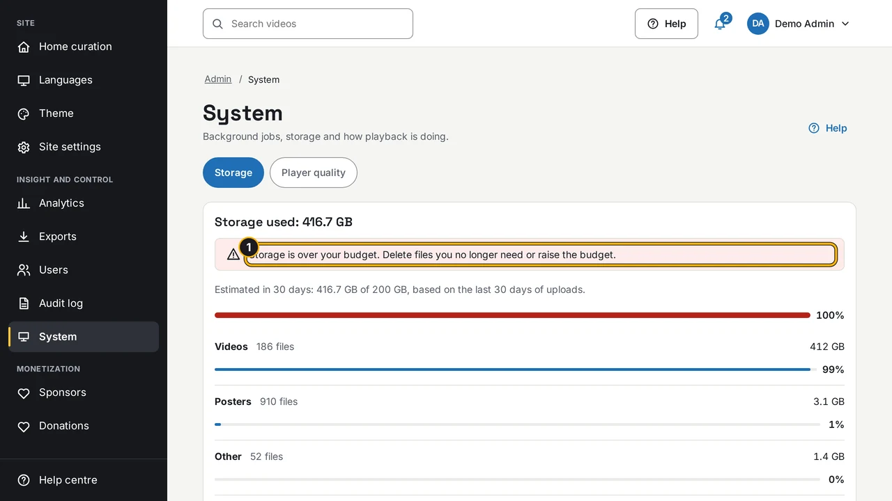
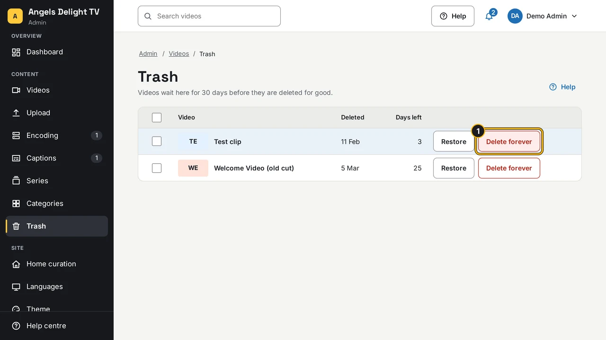

## What you will do
Read the storage warning on **System** and free space by removing videos you no longer need. You end with a lower figure and a plan.

## Before you start
You need the Admin role or above. Your [storage budget](glossary:storage-budget) is the amount of space you plan to use. Videos use almost all of it. Check that each video you delete is one you really do not need.

## Steps
<!-- kb:steps T10 -->
1. Choose **System** in the side menu.
2. Click **Storage**.
3. Check the **Storage used** figure and the warning under it.
   The warning appears at 80 percent of your storage budget, or when the pace of uploads will reach it within 30 days.
   
4. Check the **Videos** figure in the breakdown.
5. Choose **Trash** in the side menu.
6. Scroll to **Delete forever** next to a video you do not need.
   Deleting forever cannot be undone, and it frees the space after a short time. Only Admins can do it.
   
<!-- /kb:steps -->

## What you should see
The **Storage used** figure goes down some time after you delete videos for good. The warning goes away when you are under 80 percent of the budget.

> [!CAREFUL]
> **Delete forever** cannot be undone, and ARKDEV cannot get the video back from a backup. Keep your own copy of every original file before you delete.

## If something goes wrong
- **The warning says storage is over budget.** Delete test and old videos, or ask the developer to raise the budget. The budget is a plan figure, not the size of the disk.
- **The figure did not drop after deleting.** It updates after a short time. Check again later.
- **Videos in Trash are not enough.** Move more videos to Trash first, then delete them for good. Moving to Trash needs the Admin role.
