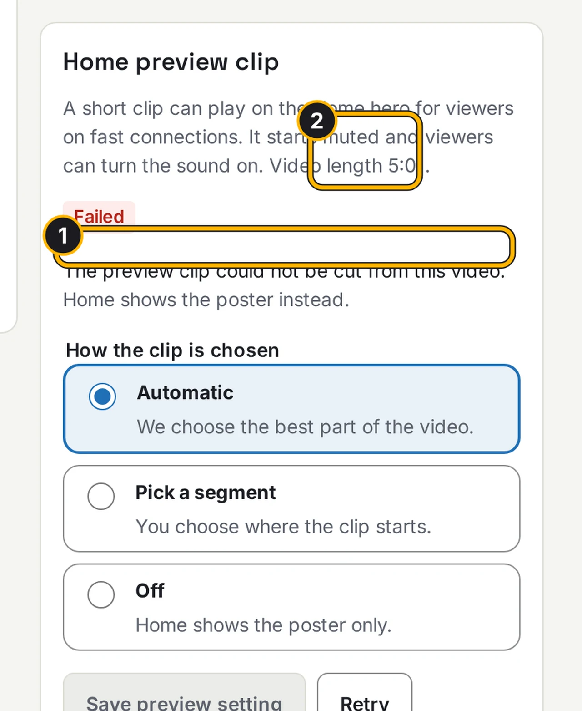

## What you will do
Find out why a video has no [preview clip](glossary:preview-clip) on Home, and try again. You end with the clip queued, or knowing that a poster is fine.

## Before you start
You need the Editor role or above. The preview clip is a short silent clip that can play on the Home hero for viewers on fast connections. Where it fails, Home shows the poster instead, so viewers still see the video.

## Steps
<!-- kb:steps T12 -->
1. Choose **Videos** in the side menu.
2. Type "Decimals" in the **Search** box.
3. Click **Edit Decimals at the Market**.
4. Scroll to **Home preview clip** on the right.
5. Check the **Preview clip** badge and the note under it.
   Failed means the clip could not be cut. Skipped means the video did not suit a clip, for example it is very short. Either way Home shows the poster instead.
   
6. Click **Retry** under the options.
7. Wait until the badge says **Queued**.
<!-- /kb:steps -->

## What you should see
The badge changes from **Failed** to **Queued**, then to **Ready** when the clip is made. A video marked **Skipped** keeps showing its poster.

> [!TIP]
> To make clips for every published video that has none, an Admin can use **Generate previews for all videos** on Home curation.

## If something goes wrong
- **Retry does nothing and the badge stays Failed.** The video file may be damaged. Ask the developer and send the video title.
- **The badge says Skipped.** The video is too short, or not suited to a clip. Choose **Pick a segment** and set **Start at**, or leave the poster.
- **There is no Retry button.** The clip is set to **Off**, or the state is not Failed or Skipped. Choose **Automatic** and click **Save preview setting**.
