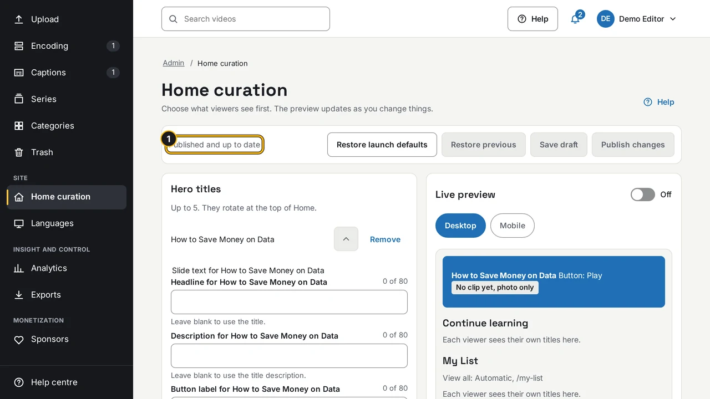
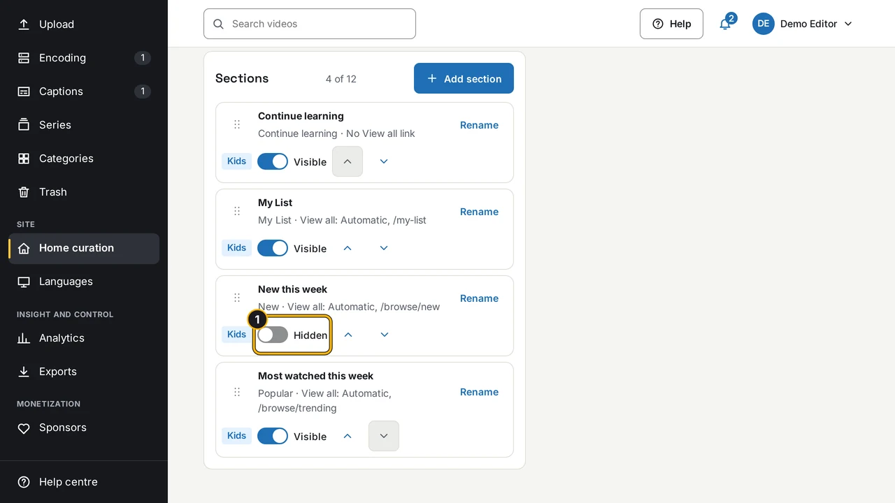

## What you will do
Find out why a [section](glossary:section) is missing from the viewer Home page, and fix it. You end with the section visible and published.

## Before you start
You need the Editor role or above. Home has a saved draft and a published version. Viewers only see the published version, so a change you made is not live until you click **Publish changes**.

## Steps
<!-- kb:steps T13 -->
1. Choose **Home curation** in the side menu.
2. Check the **Draft** line beside the buttons.
   It says Published and up to date, Saved draft not published, or Unsaved changes. Viewers only see what is published.
   
3. Scroll to **Sections** for the row.
4. Click the **Show New this week** switch.
   A section that is switched off says Hidden and viewers do not see it.
   
5. Click **Show New this week** again to show it.
6. Click **Kids view** in the live preview.
   Kids profiles only see sections marked for kids, and only kid safe videos in them.
7. Click **Move New this week down**.
   Any change to Home, such as a new order, is kept as a draft until you publish it.
8. Click **Save draft**.
9. Click **Publish changes**.
<!-- /kb:steps -->

## What you should see
The line beside the buttons says **Published and up to date**, and the section appears in **Live preview**. A published change shows on the viewer Home page within a short time.

> [!NOTE]
> A section also stays out of sight when it has too few titles. Open it and read the line that begins **Hidden while it has fewer than**. Add titles or lower the minimum.

## If something goes wrong
- **The section is switched to Hidden.** Click its switch so it says **Visible**, then save and publish.
- **Kids do not see it.** Open the section and check **Show on Kids profiles**. Only kid safe titles appear there for kids.
- **Publish changes is grey.** There is nothing new to publish, or a section needs attention. Read the red message above the list.
