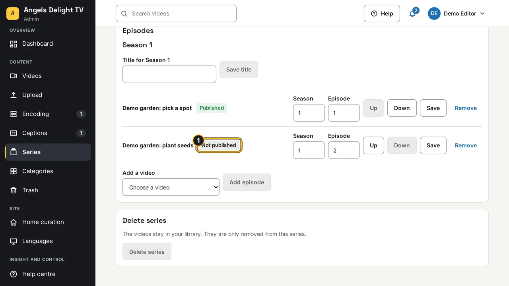

## What you will do
Find out why a lesson, episode or chapter does not show on the viewer page for a [series](glossary:series), and fix it. You end with every lesson published and in order.

## Before you start
You need the Editor role or above. The words **Lessons** and **Parts** depend on the names chosen for this series. They can be Season and Episode, Book and Chapter, Part and Lesson or Module and Lesson. The steps are the same.

## Steps
<!-- kb:steps T14 -->
1. Choose **Series** in the side menu.
2. Click **Demo series: Small space gardening**.
3. Scroll to **Not published** on one lesson.
   Viewers only see lessons that are published. A lesson that is still a draft is in the list for you, not for them.
   
4. Check the **Published** switch for the whole series.
<!-- /kb:steps -->

## What you should see
Each lesson in the list says **Published**, the series switch is on, and the numbers have no yellow **Check the numbers** box. The viewer page then lists every lesson in order.

## If something goes wrong
- **A lesson says Not published.** Open its video and publish it. A draft lesson stays hidden from viewers. [A video will not publish](help:T02)
- **The Published switch for the series is off.** Switch it on. A series that is a draft hides all its lessons.
- **Check the numbers shows.** Two lessons share a number, or a number is missing. Change the number in the lesson row and click **Save**.
