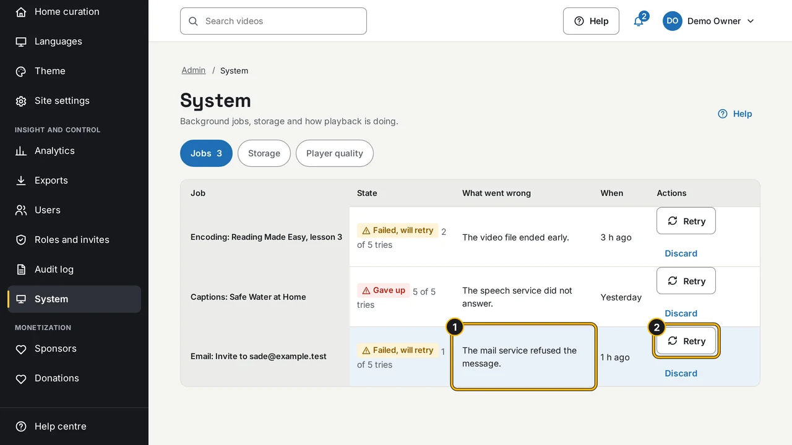

## What you will do
Find out why an email did not arrive, such as an invite. You end with the failed email tried again, or with the reason to tell ARKDEV.

## Before you start
You need the Super admin role. Ask the person to look in their spam folder first and to check the address you typed. Emails are sent by a [job](glossary:job) in the background, and a failed job shows on **System**.

## Steps
<!-- kb:steps T15 -->
1. Choose **System** in the side menu.
2. Check the **Jobs** tab.
3. Scroll to **Email** in the jobs table.
   
4. Check the **What went wrong** text for that email.
   The mail service refused the message is the usual sign that the email service is not set up or its key has stopped working. Tell ARKDEV.
5. Click **Retry Email for Invite to sade@example.test**.
<!-- /kb:steps -->

## What you should see
A message says **Job queued again**, and the row leaves the list when the email is sent. If the email service is working, the person gets the email within a few minutes.

> [!NOTE]
> The **System** screen shows failed jobs, storage and how playback is doing. It does not show a list of every email sent, and it has no setting for the email service. That is set up by ARKDEV.

## If something goes wrong
- **The row says Gave up.** The job tried all its times and stopped. Click **Retry** once. If it fails again, the email service needs ARKDEV.
- **There is no Email row.** Invite and sign in emails go out at once, so they never get a row. If an invite said it was saved but the email could not be sent, click **Resend invite** under **Pending invites** on **Roles and invites**. Otherwise the email may not have been sent at all. Check the address on **Roles and invites**, then ask the person to check spam.
- **Retry works and the email still does not come.** The email may be in spam, or the sending address is blocked. Ask ARKDEV to check the sender settings.
