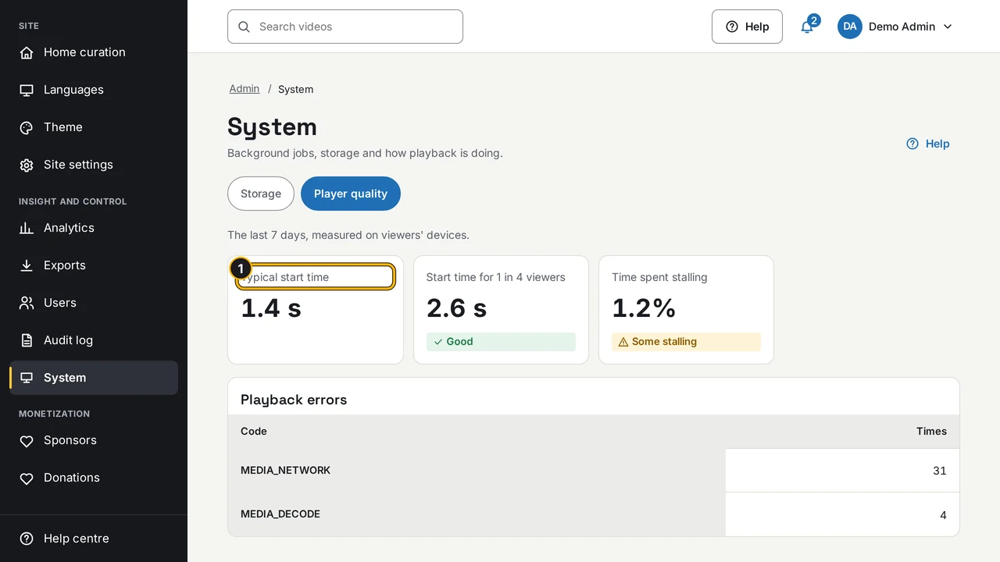

## What you will do
Check how videos are really playing on viewers' devices. You end knowing if the problem is slow starts, stalling or errors, and what to do next.

## Before you start
You need the Admin role or above. Ask a viewer which video, which device and what time. Slow starts on a weak phone connection are common and are not a fault of the site.

## Steps
<!-- kb:steps T16 -->
1. Choose **System** in the side menu.
2. Open the **Player quality** tab.
   
3. Check the **Typical start time** figure.
   This is how long viewers wait before a video starts. It is measured on their own devices over the last 7 days.
4. Check the **Time spent stalling** figure.
   Stalling means the video stops to load. A high figure points to a weak connection or a busy delivery network.
5. Check the **Playback errors** table.
<!-- /kb:steps -->

## What you should see
Start time and stalling each show a short verdict, and **Playback errors** lists the error codes and how often each happened in the last 7 days.

> [!NOTE]
> The figures come from viewers' own devices, so they cover real use. A new site may show **No data yet** until enough people have watched.

## If something goes wrong
- **Start time is slow for everyone.** Ask the developer to look at the server. Send the figures and the time.
- **Errors are high at the same time every day.** The delivery plan may have run out for the day. [The Cloudflare plan limit sign](help:T17)
- **Only one viewer has trouble.** Ask them to try another browser or network, then ask for the reference code. [Ask the developer](help:T11)
