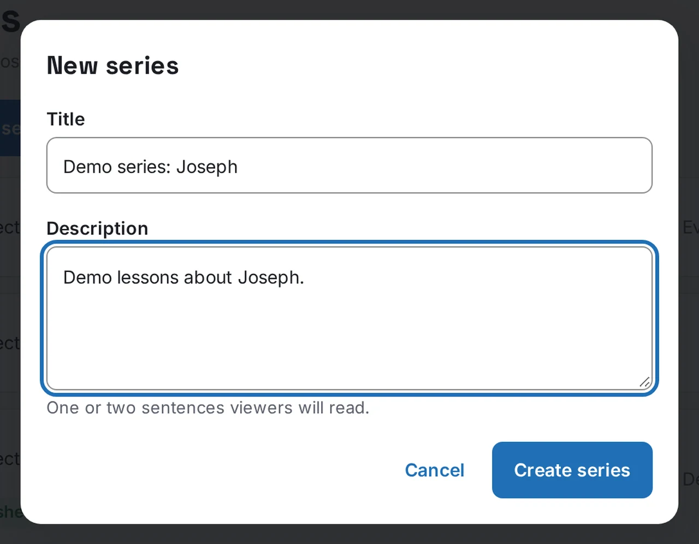
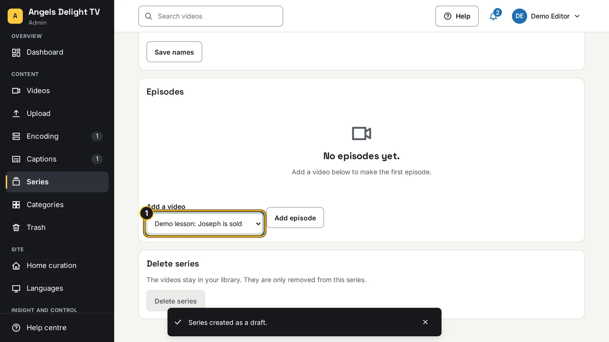

## What you will do
Create a [series](glossary:series) and put its first video in it. You end with a draft series, for example a Joseph series, holding one lesson.

## Before you start
You need the Editor role or above. Upload and prepare your videos first: Add the title, description and categories. Read [Plan a series](help:W20) to decide your groups.

A new series uses the words chosen for the whole site, which are Season and Episode until an Admin changes them. See [Choose the series names for your whole site](help:W21).

## Steps
<!-- kb:steps W01 -->
1. Choose **Series** in the side menu.
2. Click **New series**.
3. Type "Demo series: Joseph" in the **Title** box.
4. Type "Demo lessons about Joseph." in the **Description** box.
   
5. Click **Create series**.
6. Click **Demo series: Joseph** in the list.
7. Select **Demo lesson: Joseph is sold** from the **Add a video** list.
   
8. Click **Add Episode** to put it in the series.
<!-- /kb:steps -->

## What you should see
A message says **Episode added.** The video now shows under its group with a number. The series stays a draft until you publish it, so viewers cannot see it yet.

> [!TIP]
> To add many videos in one go, use [Add many videos to a series](help:W23).

## If something goes wrong
- **The Create series button does nothing.** The title may be empty. Type a title and try again.
- **The video is not in the Add a video list.** Only videos that are not in a series are listed. [Remove a series without losing videos](help:W28)
