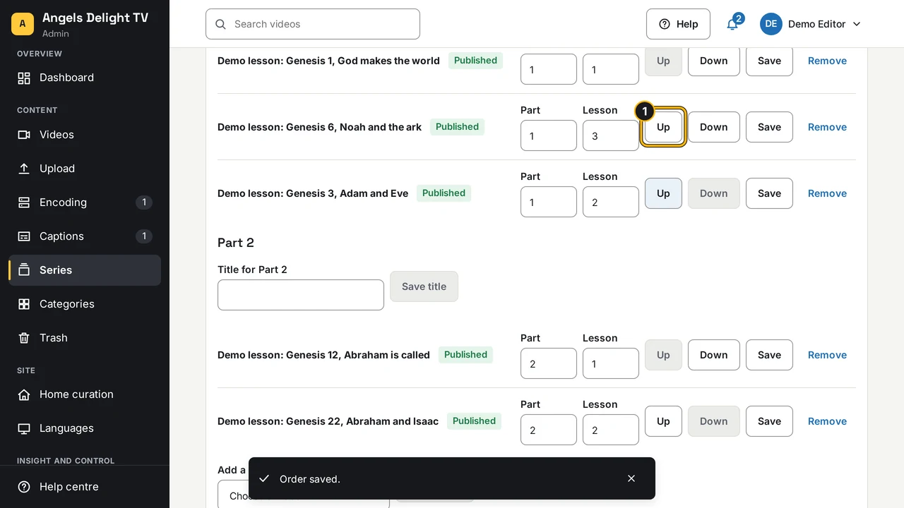

## What you will do
Change the order of lessons inside one group. You end with the lessons in the order viewers should watch them.

## Before you start
You need the Editor role or above. Open a series that already has lessons: [Create a series and add episodes](help:W01).

The screen has **Up** and **Down** buttons, not drag and drop. Each button names its lesson, such as **Move Demo lesson: Genesis 6, Noah and the ark up**. A lesson at the top has no Up, and the last has no Down.

## Steps
<!-- kb:steps W02 -->
1. Choose **Series** in the side menu.
2. Click **Demo series: Genesis** in the list.
3. Click **Move Demo lesson: Genesis 6, Noah and the ark up**.
   
4. Click **Move Demo lesson: Genesis 6, Noah and the ark down**.
<!-- /kb:steps -->

## What you should see
A message says **Order saved.** The lessons swap numbers, so the lesson you moved up now has the smaller number.

> [!NOTE]
> To move a lesson to another group, see [Move a lesson to another group and rename groups](help:W24).

## If something goes wrong
- **Up or Down is grey.** The lesson is already first or last in its group.
- **The numbers look wrong afterwards.** The series may have a gap or a repeat. [Fix gaps and duplicate numbers](help:W25) Still stuck? [What to send ARKDEV](help:T11)
