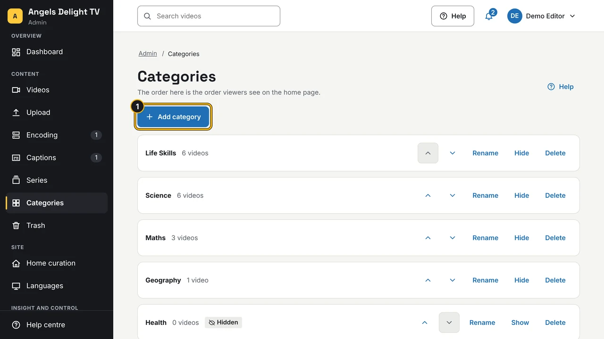
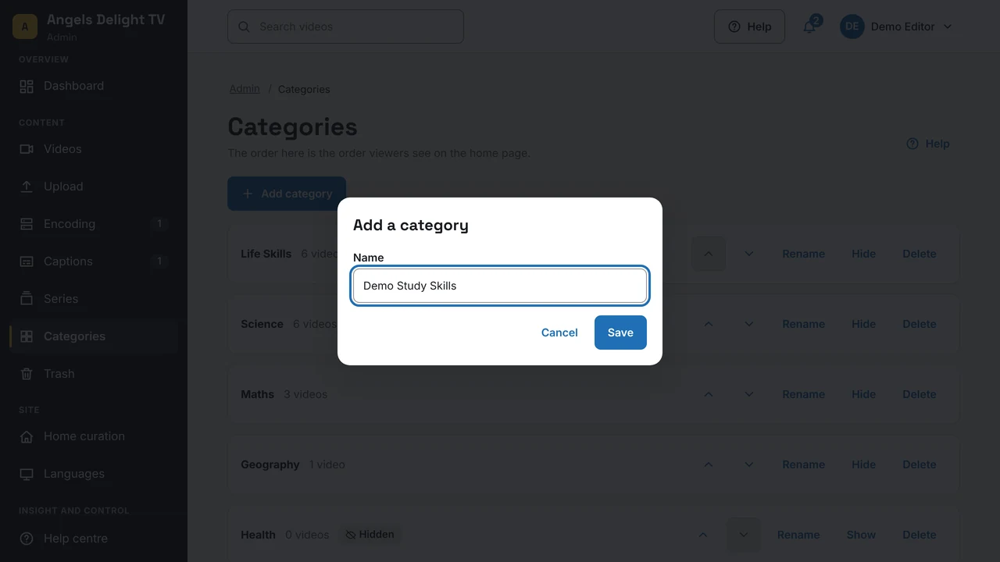
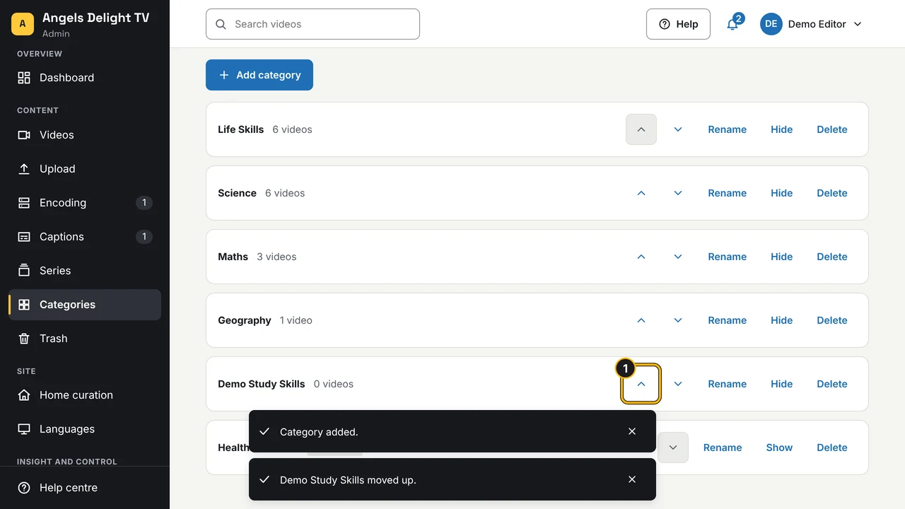
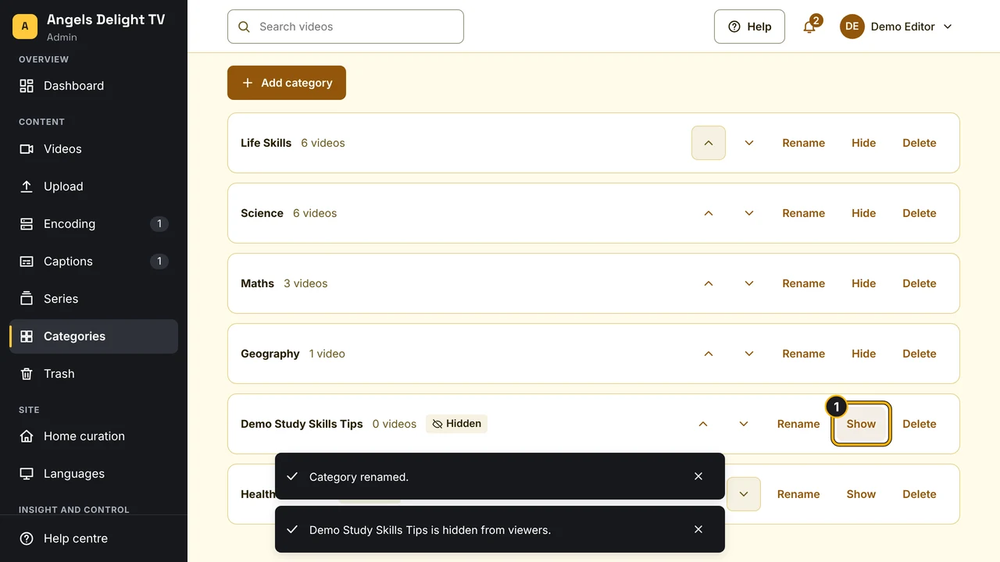

## What you will do
Keep your [categories](glossary:category) tidy. You end with a new category added, in the right place, with a name you like.

## Before you start
Editors, Admins and Super admins can manage categories. The order on this page is the order viewers see on the home page, so decide where each one belongs.

## Steps
<!-- kb:steps W03 -->
1. Choose **Categories** in the side menu.
   The order here is the order viewers see on the home page.
   
2. Click **Add category**.
3. Type "Demo Study Skills" in the **Name** box.
   Use up to 40 characters. Short names fit best on a phone.
   
4. Click **Save**.
   The new category goes to the end of the list.
5. Click **Move Demo Study Skills up**.
   Each click moves it one place. Use Move down to go the other way.
   
6. Click **Rename Demo Study Skills**.
7. Type " Tips" in the **Name** box.
   The old name is already in the box, so your words are added to the end.
8. Click **Save**.
9. Click **Hide Demo Study Skills Tips**.
   A hidden category stays here with a Hidden badge, but viewers no longer see it.
   
10. Click **Delete Demo Study Skills Tips**.
   A category that still holds videos cannot be deleted. Hide it instead.
11. Click **Delete category**.
   This cannot be undone.
<!-- /kb:steps -->

## What you should see
The category list with your changes. A hidden category shows a **Hidden** badge. A short message at the bottom of the screen confirms each change, for example "Category added."

> [!TIP]
> Hide a category when you are not ready to show it, or when you want to keep it for later. Hiding does not delete anything, and you can choose **Show** at any time.

> [!CAREFUL]
> Delete cannot be undone. A category that still holds videos cannot be deleted, and the box tells you how many videos use it. Hide it, or move its videos first.

## If something goes wrong
- **The buttons are greyed out.** Your role cannot manage categories, or a change is still saving. Wait a moment, then try again.
- **The box says the name is not allowed.** Names must not be empty or repeat another category. Choose a different name.
- **The delete box says videos still use it.** Open each video and change its category, or choose **Hide** instead.
