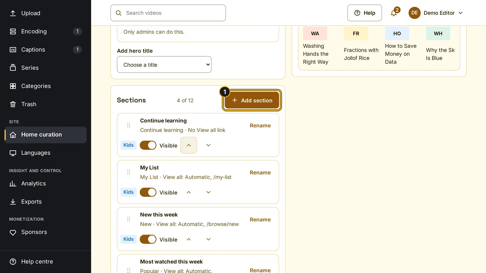

## What you will do
Add a section, hide another and publish the new Home page. You end with Home showing the rows you chose.

## Before you start
You need to be an Editor or above. Read [Find your way around](help:S04) if you have not yet. Sections on screen are called rows on the viewer site.

## Steps
<!-- kb:steps W04 -->
1. Click **Home curation** in the side menu.
2. Check the **Sections** list.
   Each section is one row on the viewer Home page, in the order viewers see them.
   
3. Click **Add section**.
4. Check the **What kind of section?** list and pick one.
   Kinds include New, Popular, Trending now, Top 10, Most liked, Category, Series and a Manual list you fill by hand. Trending, Top 10 and Most liked stay hidden until enough viewers have watched.
   
5. Click **Add section** to confirm.
6. Check the **View all link** choices.
   Automatic opens the matching list page. Custom link uses a path or an https link. None hides the link.
   
7. Untick **Show My List**.
   A hidden section stays in the list but viewers do not see it. Kids profiles have their own switch in the section editor.
8. Click **Mobile** in the live preview.
9. Click **Save draft**.
10. Click **Publish changes**.
   Viewers see the new order within a minute. Use Restore previous to undo the last publish.
<!-- /kb:steps -->

## What you should see
The message **Home page published.** appears and the bar at the top says **Published and up to date**. The **Live preview** shows the rows in the order viewers see them.

> [!TIP]
> Section kinds: **New** (newest videos), **Popular** (most watched), **Trending now**, **Top 10**, **Most liked**, **Category**, **Series** and **Manual list**. Trending now, Top 10 and Most liked stay hidden from viewers until enough people have watched.

> [!NOTE]
> To change the order, drag the handle beside a section, or click **Move up** and **Move down**. In the section editor you can rename a section, set **Minimum titles to show**, choose **Fall back to newest**, and turn on **Show on Kids profiles**. **Restore launch defaults** puts back the first layout. **Restore previous** undoes the last publish.

## If something goes wrong
- **Publish changes is greyed out.** There is nothing new to publish, or a yellow message names a problem to fix first. Read the message above the lists.
- **A section does not show for viewers.** It may be hidden, or it has fewer titles than its minimum. Check the **Show** switch and **Minimum titles to show**.
- **I cannot add another section.** Home holds at most 12 sections. Hide or remove one first.
