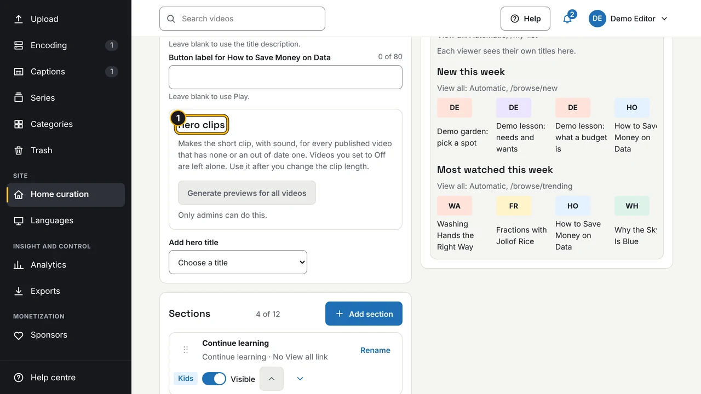

## What you will do
Choose the titles shown in the big [hero](glossary:hero) banner at the top of Home, and write a short headline for each.

## Before you start
Editors, Admins and Super admins can do this. Pick videos that are published and have a good [poster](glossary:poster). Read [Arrange the Home rows](help:W04) first.

## Steps
<!-- kb:steps W05 -->
1. Choose **Home curation** in the side menu.
2. Scroll to **Hero titles**.
   The hero is the big banner at the top of Home.
   
3. Type " today" in the **Headline for How to Save Money on Data** box.
   Keep it short. Viewers read it in a second.
4. Scroll to **Hero clips**.
   A hero clip is a short silent preview. Choose Automatic, Pick a segment or Off on the video screen.
   
5. Click **Save draft**.
<!-- /kb:steps -->

## What you should see
Your new headline in the hero area, and the live preview on the right showing the banner. Click **Publish changes** when you are happy.

> [!NOTE]
> Each hero title has a **Headline**, a **Description** and a **Button label**. Use **Add hero title** to add another title. Use **Move up** and **Remove** to change the order or take one off. The number of hero titles is limited, so remove one before adding another if the list is full.

> [!NOTE]
> A [preview clip](glossary:preview-clip) is a short silent clip that plays behind the banner. On each video you choose **Automatic**, **Pick a segment** or **Off**. **Generate previews for all videos** makes clips for every video that has none.

## If something goes wrong
- **The banner does not change for viewers.** You saved a draft but did not publish. Click **Publish changes**.
- **A video is skipped.** It is not published yet, so the banner skips it. Publish the video first.
