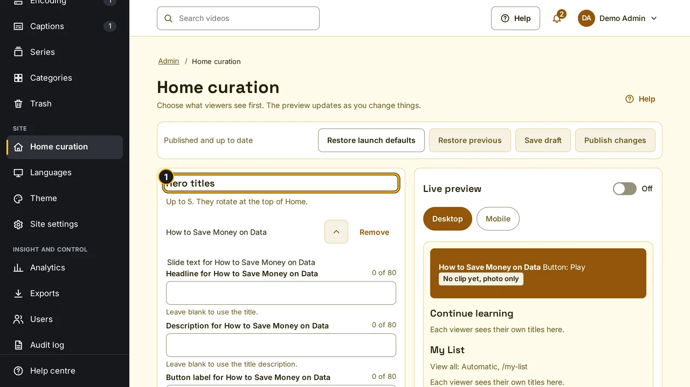
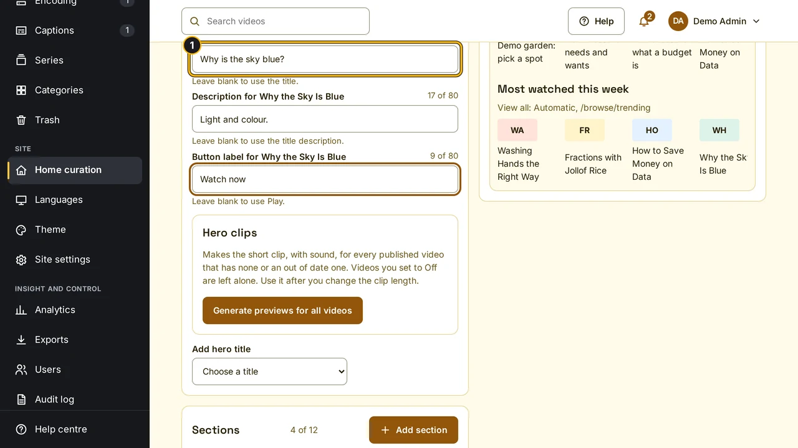
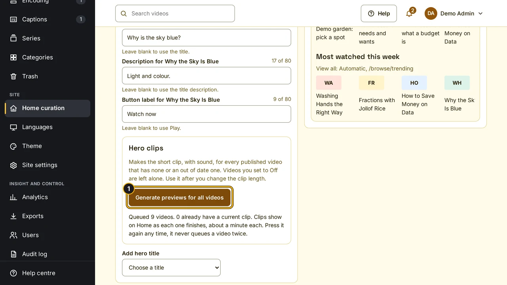

## What you will do
Choose a hero title, write its slide text and queue preview clips. You end with the hero published.

## Before you start
You need to be an Admin to make previews. An Editor can do the other steps. The video must be published to show in the hero. Read [Arrange the Home rows](help:W04) first.

## Steps
<!-- kb:steps W05 -->
1. Click **Home curation** in the side menu.
2. Check the **Hero titles** card.
   The hero is the big banner at the top of Home. You can choose up to 5 titles. With none chosen, Home shows your 5 newest.
   
3. Select **Why the Sky Is Blue** from the **Add hero title** list.
4. Type "Why is the sky blue?" in the **Headline for Why the Sky Is Blue** box.
   Leave the headline blank to use the video title.
5. Type "Light and colour." in **Description for Why the Sky Is Blue**.
6. Type "Watch now" in the **Button label for Why the Sky Is Blue** box.
   Leave the button label blank to use Play.
   
7. Click **Generate previews for all videos**.
   This makes the short silent clip for every published video that has none. Only Admins can do this. Clips appear as each one finishes, about a minute each.
   
8. Click **Save draft**.
9. Click **Publish changes**.
<!-- /kb:steps -->

## What you should see
The message **Home page published.** appears. The hero list shows your title, and the **Live preview** shows the headline and button you wrote. Clips appear on Home as each one finishes, about a minute each.

> [!NOTE]
> The timing and sound of the hero are site wide settings in [Home and Discovery settings](help:C05): **Seconds per hero slide**, **Slide waits for its clip**, **Sound button on hero clips**, **Seconds per hero clip** and **Hero loops before it stops**. Clips always start muted. A video can also have its own preview clip set to Automatic, a start point or Off on its own preview screen.

## If something goes wrong
- **The title says Not published, skipped.** The video is not published, so the hero skips it. Publish the video first.
- **Generate previews for all videos is greyed out.** Your role is Editor. Ask an Admin to press it.
- **No clip shows yet.** Clips take about a minute each, and viewers with Data saver on or a slow connection see a photo instead. Still stuck? [What to send ARKDEV](help:T11)
