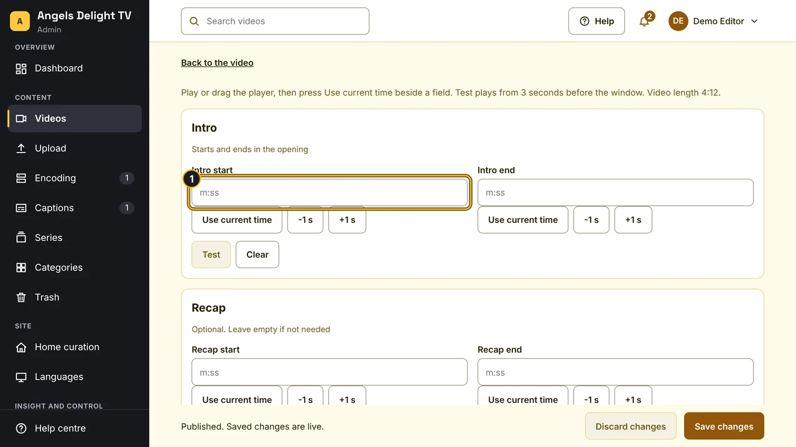
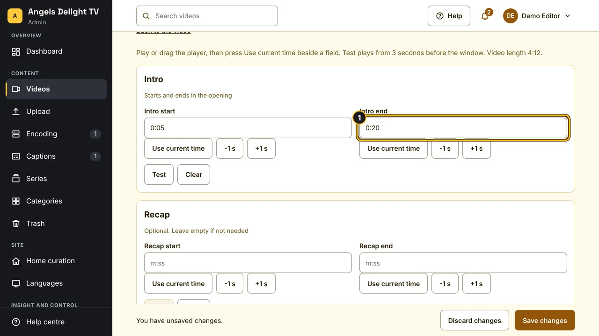
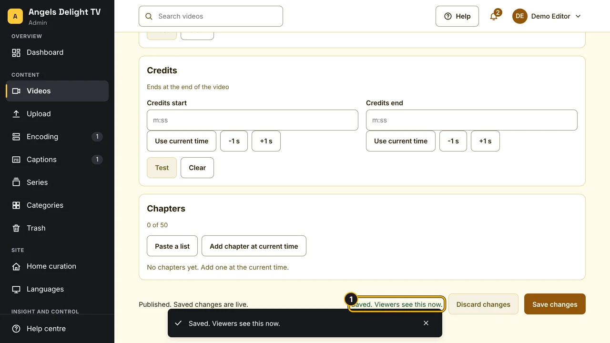

## What you will do
Tell the player where the intro starts and ends, so viewers get a **Skip intro** button. You can do the same for a recap and for the credits.

## Before you start
Editors, Admins and Super admins can do this. You need a video that has finished [encoding](glossary:encoding). Know roughly when the intro starts and ends, in minutes and seconds.

## Steps
<!-- kb:steps W06 -->
1. Choose **Videos** in the side menu.
2. Click **How to Save Money on Data**.
3. Click **Set up skip and chapters**.
   
4. Type "0:05" in the **Intro start** box.
   Use minutes and seconds, like 0:05. You can also play the video and click Use current time.
5. Type "0:20" in the **Intro end** box.
   Viewers get a Skip intro button between these two times.
   
6. Click **Save changes**.
   Viewers see the change straight away.
   
<!-- /kb:steps -->

## What you should see
The message "Saved. Viewers see this now." appears. The **Intro start** and **Intro end** boxes keep your times.

> [!NOTE]
> Other parts of this page work the same way. **Recap** and **Credits** each have a start and an end. For chapters, play the video to the right point, then click **Add chapter at current time** and type a name. **Paste a list** adds many chapters at once, one on each line, like "0:00 Welcome".

> [!TIP]
> Play the video in the preview on this page. Click **Use current time for Intro start** at the right moment, so you do not have to guess. Then click **Test intro** to check the jump.

> [!NOTE]
> In the practice site used for these pictures, the video preview cannot play, so the page shows "Connection lost". On your real site the preview plays.

## If something goes wrong
- **A time is refused.** Type it as minutes and seconds, like 0:05, or as 1:30.
- **The end is before the start.** The box shows a message. Change one of the times so the end comes later.
- **Saving did not work.** The page says "Could not save. Check your connection and try again." Check your connection, then click **Save changes**.
