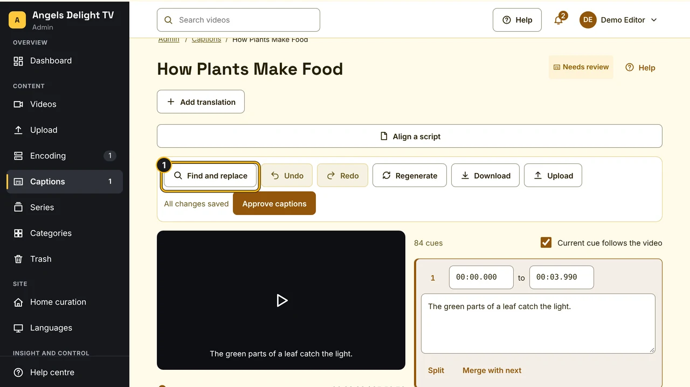
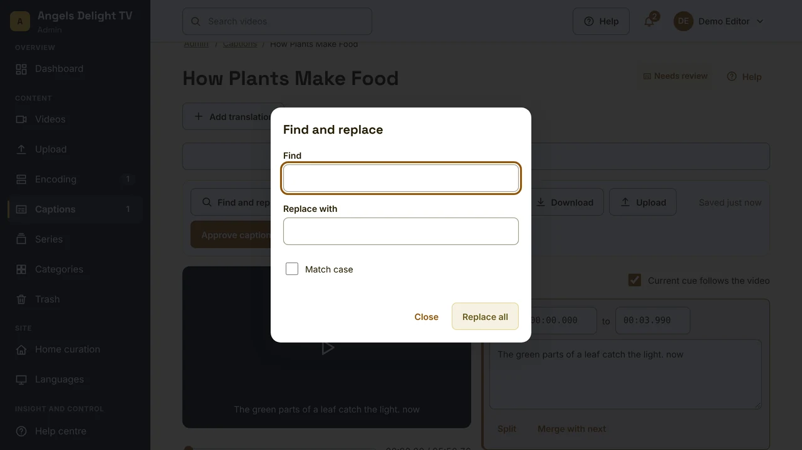

## What you will do
Open the caption screen of a video and fix the words. You end with a corrected cue, and you know how to undo it and how to change a word everywhere.

## Before you start
Editors, Admins and Super admins can edit [captions](glossary:caption). Read [Review and approve captions](help:D07) first. Have the video open in your head: you fix what the speaker says, not what you wish they said.

## Steps
<!-- kb:steps W07 -->
1. Click **Review captions**.
   It is in Needs attention on the Dashboard. You can also open Captions in the side menu.
   
2. Type " now" in the **Words in cue 1** box.
   Your change is saved by itself. Fix wrong words, names and numbers.
3. Click **Undo**.
   Undo and Redo step back and forward through your changes.
4. Click **Redo**.
5. Click **Find and replace**.
   Use it when one word is wrong in many cues, such as a name.
   
6. Click **Close**.
<!-- /kb:steps -->

## What you should see
Each [cue](glossary:cue) is one block of words with a start and an end time. Your change shows in the cue and is saved by itself.

> [!NOTE]
> Other tools on this screen. **Split** breaks one cue in two at the cursor. **Merge with next** joins two cues. **Regenerate** makes the captions again from the speech and replaces your edits. **Download** saves a caption file and **Upload** replaces the cues with a file you made. **Approve captions** or the green **Approved** badge shows whether viewers can see them.

> [!CAREFUL]
> **Regenerate** replaces every cue, including your edits. Use it only when the captions are very wrong. You can use **Undo** right after.

> [!TIP]
> Change a time only when the words appear too early or too late. Changing times can put the words out of step with the speech.

## If something goes wrong
- **The video preview does not play.** The page says the preview could not start. Timing still works, so you can keep editing the words.
- **A cue is flagged Check this cue.** It is too long or too fast to read. Split it, or shorten the words.
- **Your edit did not save.** Check your connection. The page tries again by itself and says when it has saved. Still stuck? [What to send ARKDEV](help:T11)
