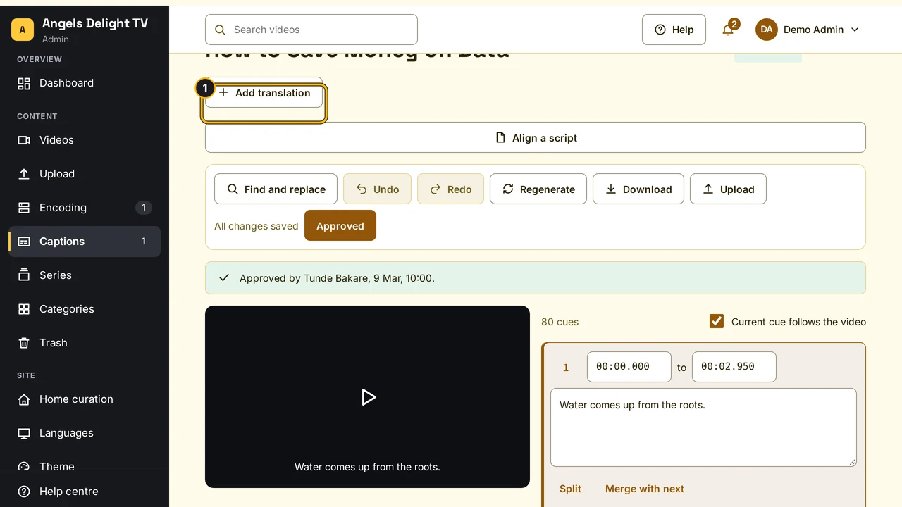
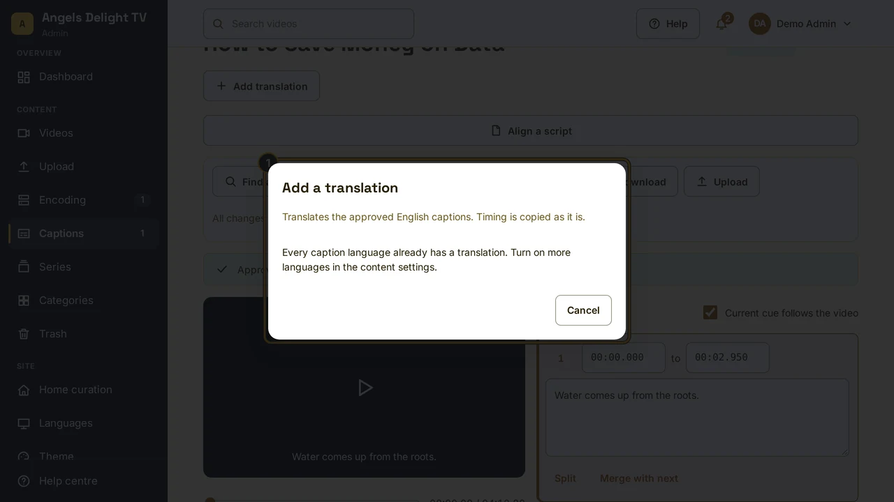

## What you will do
Open the Add translation box on a video with approved captions. You end knowing how a new caption language is started, reviewed and published.

## Before you start
You need approved captions in the video's spoken language, see [Review and approve captions](help:D07). The language must be turned on for captions, and the translation engine must be connected. Both are set by your developer. This demo cannot show the full procedure.

> [!NOTE]
> In the demo only English is turned on and no translation engine is connected, so the video and the steps below stop at the Add a translation box. The rest is described under What you should see.

## Steps
<!-- kb:steps W08 -->
1. Click **Captions** in the side menu.
2. Click **How to Save Money on Data**.
   
3. Check the **Add translation** button.
   Only Admins and Editors with approved captions can start a translation. The video needs approved captions in its spoken language first.
4. Click **Add translation**.
5. Check the **Add a translation** box.
   On your site it lists each caption language that is turned on and has no translation yet. Choose one, then Start translation.
   
6. Click **Cancel**.
   In this demo only English is turned on and no translation engine is connected, so the box ends here.
<!-- /kb:steps -->

## What you should see
In the demo, the **Add a translation** box says every caption language already has a translation, and there is nothing to start. On a site with languages turned on the full flow is: choose a language, click **Start translation**, wait for the draft, then read it side by side with the original and fix wrong lines. Click **Approve** when it reads right. Then an Admin turns on the switch **Show captions to viewers** for that language. Viewers then find the language in the player's caption menu.

> [!CAREFUL]
> A translation is a draft until a person reads it. Never publish a language you have not checked. A machine can get names and place names wrong.

## If something goes wrong
- **The box says translation is not set up on this server.** Ask your developer to turn it on.
- **There is no language to choose.** Every language that is turned on already has a translation. Ask your developer to turn on another caption language.
- **The publish switch is greyed out.** The translation is not approved yet, or your role is Editor. Approve it, or ask an Admin. [Turn captions on or off for one video](help:W09)
