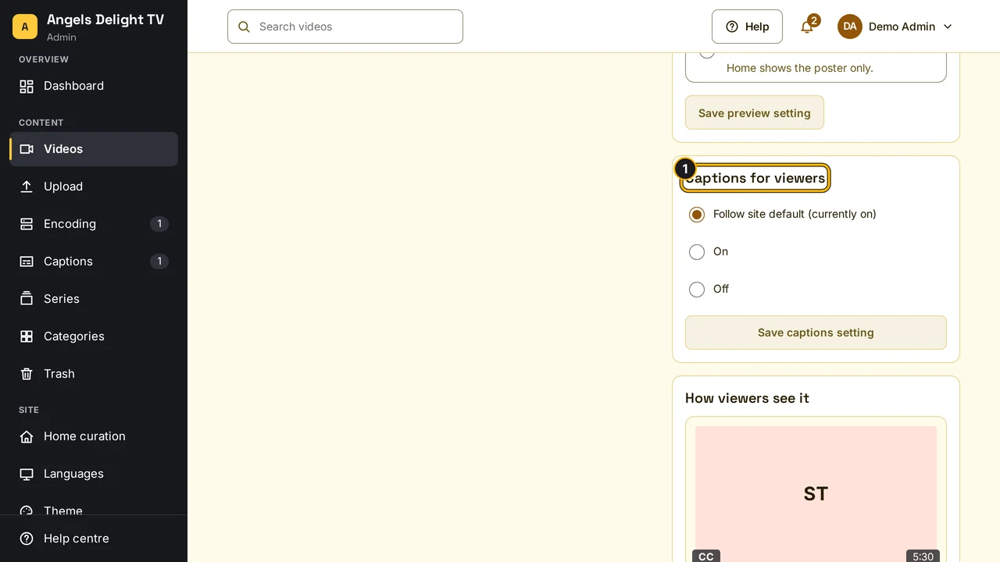
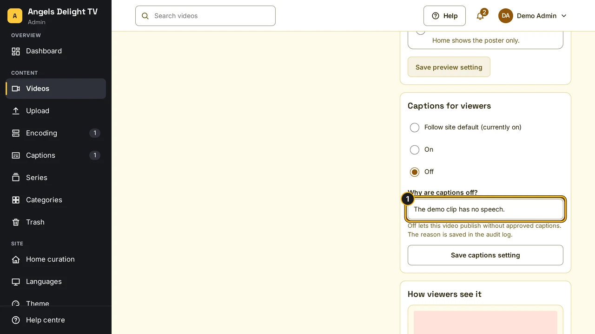

## What you will do
Switch the captions of one video off and give a reason. You end with the choice saved and recorded in the audit log.

## Before you start
You need to be an Admin or a Super admin. Editors can see the card but not change it. Read [Review and approve captions](help:D07) if you have not yet.

## Steps
<!-- kb:steps W09 -->
1. Click **Videos** in the side menu.
2. Click **Staying Safe Online** to open the video.
3. Scroll to **Captions for viewers**.
   
4. Click **Off**.
   The choices are On, Off and Follow site default. Follow site default uses the switch in Features and limits. Off hides the CC button for this video. Viewers who saved a caption choice keep it for other videos.
5. Type "The demo clip has no speech." in the **Why are captions off?** box.
   The reason is saved in the audit log.
   
6. Click **Save captions setting**.
<!-- /kb:steps -->

## What you should see
The message **Captions setting saved.** appears. With **Off**, the CC button is hidden on that video. Viewers who saved a caption choice keep it for other videos.

> [!NOTE]
> **Follow site default** uses the site wide setting **Captions are available to viewers by default** in Features and limits. **On** shows the CC button for this video even if the site default is off. **Off** also lets the video publish without approved captions, so the reason is kept in the audit log.

## If something goes wrong
- **The choices are greyed out.** Your role is Editor. Only an Admin can change this.
- **Save captions setting is greyed out.** You chose **Off** but have not typed a reason. Type one.
- **Captions are on but viewers see none.** The captions may not be approved yet. Approve them first. [Review and approve captions](help:D07) Still stuck? [What to send ARKDEV](help:T11)
