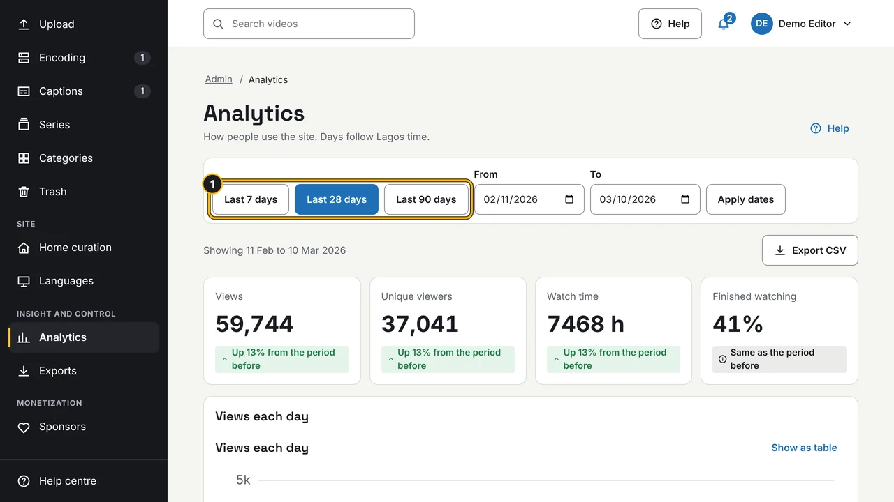
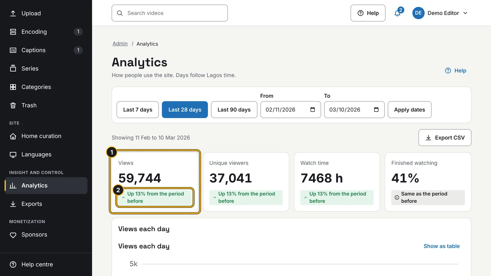
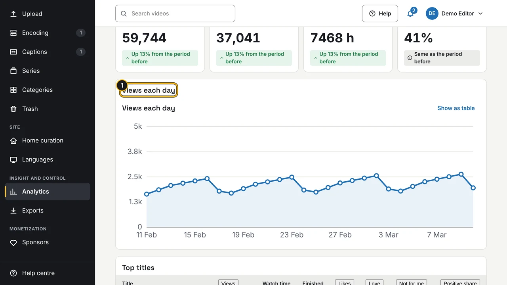
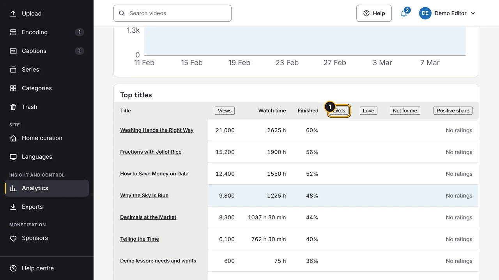
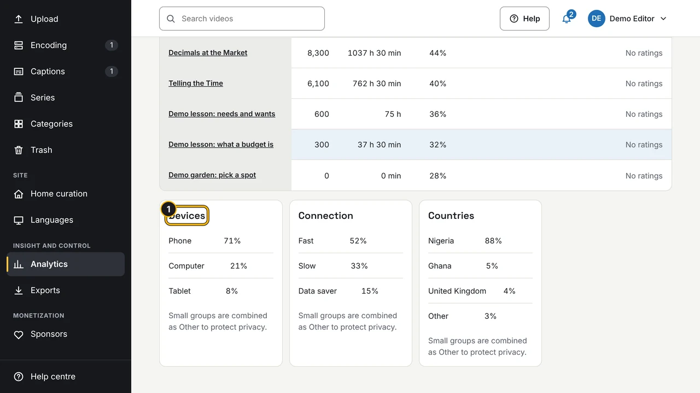

## What you will do
Open [Analytics](glossary:analytics) and read the numbers once a week. You end knowing what each tile means, which titles viewers like most, and who is watching.

## Before you start
Editors, Admins and Super admins can open this page. You do not need to change anything, so you cannot break anything here. Days follow Lagos time.

## Steps
<!-- kb:steps W10 -->
1. Choose **Analytics** in the side menu.
   Editors, Admins and Super admins can open this page.
   
2. Click **Last 28 days**.
   Days follow Lagos time. Use the **From** and **To** boxes with **Apply dates** for your own dates.
3. Check that the **Views** tile shows a number.
   Views counts each time someone starts a video.
   
4. Check that the **Finished watching** tile shows a percent.
   It is the share of views that reached the end of a video.
5. Scroll to **Views each day**.
   The line shows the busiest and quietest days.
   
6. Scroll to **Top titles**.
   The most watched videos in this range, with their ratings.
   
7. Click **Sort by Likes**.
   Click it again to turn the order round. A title with no ratings goes last, and one with fewer than 10 ratings shows Under 10 ratings instead of a share.
8. Scroll to **Devices**.
   Devices, Connection and Countries show where viewers come from. Small groups are combined as Other.
   
<!-- /kb:steps -->

## What you should see
Four tiles, a line of **Views each day**, the **Top titles** table and three cards that split viewers by device, connection and country. Each tile also says how it compares with the period before. For example, "Up 12% from the period before".

> [!NOTE]
> What each tile means. **Views** counts each time someone starts a video. **Unique viewers** counts each person once, however often they watch. **Watch time** adds up all the time people spent watching. **Finished watching** is the share of views that reached the end.

> [!NOTE]
> What the ratings columns mean. **Likes**, **Love** and **Not for me** count the ratings viewers gave. **Positive share** is the percent of ratings that were Likes or Love. It shows **Under 10 ratings** until a title has at least 10 ratings, because a small number is not a fair picture.

> [!TIP]
> Compare the same range each week. A rise in **Views** with a fall in **Finished watching** can mean new people are finding you but leaving early. Open the title to find out where. [See how one video is doing](help:W11)

## If something goes wrong
- **The page says "No views in this period."** Choose **Last 90 days**. If it is still empty, no one has watched yet, or the dates are before your first video.
- **A tile says "No data for the period before".** The range you picked starts before there is data. Pick a shorter range or wait a few weeks.
- **The page says "We could not load analytics."** Nothing was changed. Wait a minute and try again. If it keeps failing, send the reference code on the screen to the developer.
